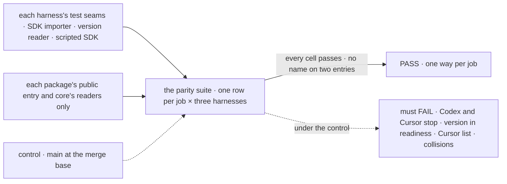

# FIX-2458 · Neutral harness contract: shared failure kinds, model-list type and env base; one naming scheme per harness

**Spec** · [Decisions](DECISIONS.md)

## Six people, before and after

| Someone who… | Today | After |
|---|---|---|
| **stops a Codex or Cursor run, and checks core's `isAbortLike`** | Reads a failure. Codex's and Cursor's stop errors are not abort-like; Claude Code's is | A stop reads as a stop in all three |
| **has a Claude Agent SDK the package never ran against** | It runs anyway (the peer range is `*`). A changed wire shows up as malformed items. No harness's readiness check looks at the version | The readiness check and the block name the installed and the tested versions and refuse, in all three |
| **builds a model picker for Cursor** | Keeps the list by hand, as Kitchen Sink does (11 entries), and Codex's README says Codex can't list models beside `listCodexModels` | `listCursorModels` returns the account's models in the same shape as Codex's and Claude Code's |
| **installs two harness packages in one app** | 8 names (`createEmitState`, `TESTED_SDK_VERSION`, …) come from two or three packages with different declarations | No name is on two harness entries. A shared shape is imported once, from `core/harness` |
| **autocompletes `@flow-state-dev/claude-code`** | 88 names on two entries, in five spellings (`Claude`, `ClaudeAgent`, `ClaudeCode`, `Sdk`, none), the translate and emit internals, and a `./cli` nothing imports | One entry. Every harness name says `ClaudeCode`, as Codex's say `Codex`. No internals |
| **builds the environment for a harness of their own** | Copies the 13 names all three lists share | `[...HARNESS_BASE_PASS, "MY_KEY"]` |

An app that offers more than one coding agent writes its error handling, its model picker and
its setup check once per vendor today. The three packages do the same jobs in different words.

## The goal, and how we'll know it's met

**An app author who drives any of the three coding harnesses tells a stop, a machine that
can't run it, a refused conversation, the model list and the run's environment apart the same
way for all three, and each harness package exports one consistently named surface.**

| Is it the right goal? | |
|---|---|
| **The real need** | The epic's *one path*: "three harnesses with their own error types" is one of the duplicates [D1 of the epic](../../epics/FIX-2447/DECISIONS.md#d1) names, and its *Surface* row for claude-code |
| **Smaller, and rejected** | "`HarnessFailureKind` has more members." Met while a stop still reads differently per harness and Kitchen Sink still hand-checks two SDKs. Also rejected: the runtime parity alone, with claude-code's surface left as it is |
| **Bigger, and not this issue's** | One shared emitter and one set of error classes for all three: [LAB-156](https://linear.app/fixpoint-labs/issue/LAB-156) |
| **Not done if** | A harness's stop fails `isAbortLike`, or another failure passes it · a harness's readiness check passes an SDK outside its tested range, or a peer range is unbounded (`*`) · a harness has no model-list function, or Cursor's models come from a hand list · a name is exported by two harness packages · claude-code exports `./cli`, a translate or emit internal, or a name in a second spelling · a harness README or docs page contradicts its exports · the parity block passes only because it imports a harness's internals |



The check reads what a host would read: core's readers over each package's public entry. Under
today's code it must fail on the cells named.

| How we verify | |
|---|---|
| **Goal check** | A contract block in Kitchen Sink's existing `test/harness-parity.test.ts`, the one suite that already holds the three harnesses to one table: `pnpm --filter @flow-state-dev/kitchen-sink test harness-parity`. No model, no vendor process. Run by the implementer at completion; verdict in the implementation PR. In the epic's closure manifest it flips the *Surface* assertions that name `claude-code`, `codex` and `cursor` (the export check's entries, and leg b's installed-name collisions) to `expect: pass` |
| **Signal** | Every cell passes, per harness: a stop is `isAbortLike`, and a refused resume, an absent SDK and a run error are not; an absent SDK gives readiness `ready: false` with a remedy; an SDK one step below and one step above the tested range each give readiness `ready: false` naming both versions, and building the block throws; a refused resume reads `"unknown-conversation"`; the model list equals what the scripted SDK returned, as a `HarnessModelList`; the pass list holds every `HARNESS_BASE_PASS` name, and the base holds the 13 names the three lists share today. Across harnesses: no runtime name is on two entries; claude-code's entry exports no translate or emit name, no `./cli`, and no name outside `ClaudeCode`/`claudeCode`/`CLAUDE_CODE_` and core's shared names; Kitchen Sink has no hand list of Cursor models |
| **Input** | Each harness's own seams. A different valid input: a version one step outside the range on either side, a list with no default |
| **Anti-game** | Import each harness only from its public entry, as a namespace resolved at run time, so a missing name fails its own cell and not the file. Drive it only through each package's public seams (its SDK importer and version reader options). Classify only through core's readers: `instanceof CodexAgentAbortedError` passes today, so the block never names an error class |
| **Control that must fail** | `main` at the merge base: the Codex and Cursor stop cells, every readiness version cell, Claude Code's build-gate cells, the Cursor list cell, the base-list cell, the collision row and the claude-code surface row fail by name, while the refused-resume and absent-SDK readiness cells pass, which shows the block reaches the code. The PR shows it before the PASS |

## What changes


Read across a row: today each cell is a vendor's own answer, and after it is one answer.

**What an app author types:**

```diff
- import { claudeCodeAgent, listClaudeModels, type ClaudeModelList } from "@flow-state-dev/claude-code/sdk";
+ import { claudeCodeAgent, listClaudeCodeModels } from "@flow-state-dev/claude-code";
+ import { HARNESS_BASE_PASS, type HarnessModelList } from "@flow-state-dev/core/harness";

- } catch (err) { if (err instanceof CodexAgentAbortedError) showStopped(); }
+ } catch (err) { if (isAbortLike(err)) showStopped(); }   // the same for all three

- const CURSOR_MODELS = [{ id: "composer-2.5", label: "Composer 2.5" }, …];
+ const list: HarnessModelList = await listCursorModels({ env });

- env: harnessEnv({ pass: ["PATH", "HOME", "USER", "SHELL", "TMPDIR", "HTTPS_PROXY", …, "MY_KEY"] }),
+ env: harnessEnv({ pass: [...HARNESS_BASE_PASS, "MY_KEY"] }),
```

How old names reach adopters is per ER-3 and Q1's answer: every rename and removal above.

**Docs:** update `apps/docs/docs/tools/coding-agents.md` (telling a stop, a refusal and an
unusable SDK apart; the model list; the shared environment), `claude-code-sdk.md` (the entry and
names), `codex.md` (drop "can't list its models"), `cursor.md` (`listCursorModels`, the version
in readiness), and the core, claude-code, codex and cursor READMEs. No new page: the harness-line
guide the issue asks for is already *Steering a running turn* in `coding-agents.md`.

## What stays as it is

- `HarnessFailureKind` keeps its one member ([D1](DECISIONS.md#d1)). `harnessFailureKind`, the
  run handle and the readiness type are unchanged.
- Each package's error classes stay exported as vendor detail; documentation branches on core's
  readers. Each `emit.ts` stays its own copy (LAB-156).
- Harness lines and `useHarnessLines`; its name is FIX-2557's, outside the set.
- Where these names live in core: FIX-2448 moves them to `core/harness`. This adds beside them.

## What's already here, and the debt

| Already here | What this does with it |
|---|---|
| Who already tells a stop apart: `isAbortLike` (core root), read by the generator and discovery tools; harness-manager reads `ctx.signal.aborted` | **Builds on.** Every harness's stop error passes it ([D1](DECISIONS.md#d1)). This would be the second way if a kind were added; searched `abort`, `stopped`, `cancel` across `packages/` |
| `harness-readiness` (core's `HarnessReadinessCheck`, one check per harness, harness-manager's rows) | **Extends.** Each check reports an absent SDK and one outside the tested range. Kitchen Sink's hand checks for Codex and Cursor go |
| `coding-harness`: `HarnessFailureKind` (`unknown-conversation`), `harnessEnv` | **Leaves alone** the kind; **builds on** `harnessEnv` with a base list |
| `listCodexModels`, `listClaudeModels` and their four field-identical types | **Replaced** by one shared type; the functions keep a harness name ([D3](DECISIONS.md#d3)) |
| Codex's and Cursor's exact pin and build-time gate; claude-code's `*` | **Generalised** into one policy ([D2](DECISIONS.md#d2)) |
| claude-code's `./cli`: 7 names, no consumer but its own test | **Removes**, per Q1 |
| [FIX-1174](../FIX-1174/SPEC.md)'s `<package>/<door>` entries | **Superseded in part**: with `./cli` gone claude-code has one door, which becomes its root, as Codex's and Cursor's are |

| Adds | Existing piece considered | Why it doesn't fit / how composed |
|---|---|---|
| `HarnessModelInfo`, `HarnessModelList` on `core/harness` | `coding-harness` · `CodexModelInfo`, `ClaudeModelInfo` | The two are field-identical; one moves to core, both go |
| `HARNESS_BASE_PASS` | `coding-harness` · `harnessEnv`, the three `*_PASS` lists | A value for `harnessEnv`'s `pass`, not a second builder |
| `listCursorModels` | `listCodexModels`; the Cursor SDK's `Cursor.models.list()` | The third copy of one function, on the shared type |
| A version gate in claude-code | `harness-readiness`; Codex's `assertTestedSdkVersion` | The same gate, in the readiness check and at build |

| The debt | |
|---|---|
| **Removes** | Kitchen Sink's hand list of Cursor models and its own model type · its hand SDK checks for Codex and Cursor · four per-harness model types · three copies of 13 environment names · 8 names on two or three entries · claude-code's `./cli`, its translate and emit names, and its second spellings |
| **Adds** | Three names on `core/harness`, one function in cursor, one gate and one error class in claude-code. With Q1's alias option, deprecated aliases until the removal minor |
| **Leaves** | Three near-copied `emit.ts` and `errors.ts` (LAB-156) · usage's two shapes (FIX-2330) · `useHarnessLines`'s name (FIX-2557) |

**Net: down.** Three copies become one per job; about 35 public names leave the entries for 5 added.

## Sign off

**[The goal](#the-goal-and-how-well-know-its-met), at that size:** one reader per job across
three harnesses, and one name scheme. If wrong: a parity epic that leaves adopters writing a
branch per vendor.

**[The debt](#whats-already-here-and-the-debt), net down:** about 35 names and three hand
copies go, five names come. If wrong: a breaking minor for three harness packages that buys
adopters little.

1. **[D1](DECISIONS.md#d1) · A stop, an unusable SDK and a bad config use the readers core
   already has; `HarnessFailureKind` stays one kind.** If wrong: a host that only has the
   thrown error can't tell an unusable SDK from a crash.
2. **[D2](DECISIONS.md#d2) · One SDK policy: the peer range is the tested range, and outside it
   the harness refuses.** If wrong: claude-code adopters wait on our release for each SDK bump.
3. **[D3](DECISIONS.md#d3) · Every harness name carries its package's name; shared shapes live
   once in core.** If wrong: one more rename round for claude-code.

**Open: none.** D1 is the one to weigh: it narrows what the issue proposed.

Improvement · `core`, `claude-code`, `codex`, `cursor`, Kitchen Sink · medium (4 packages; about
35 public names removed and 30 renamed; 2 hand copies removed) · epic [FIX-2447](../../epics/FIX-2447/SPEC.md)
