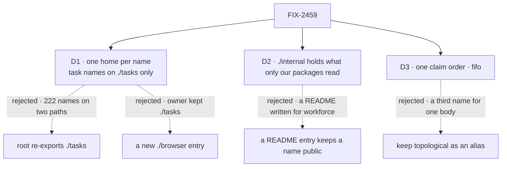

# FIX-2459 · Decisions

[Spec](SPEC.md) · **Decisions**

What was chosen, what lost, and what each choice locks in. D1 to D3 are the sign-off. The
epic's D1 (which folds FIX-2462's method table in here), D2 (two kinds of hidden surface), D3 (a
loud refusal for a retired value) and ER-1 to ER-9, with ER-1 as amended at set review, bind this
spec; none is reopened here.

## The tree

Solid edges are what you're signing. Dashed edges lost, and the label says why.

## D1 · Each name has one home: task names on `./tasks` only, the root for skills and Node-only seams

| | |
|---|---|
| **Instead of** | Keeping `export * from "./tasks"`, so a Node app imports everything from the root. And the issue's `./browser` entry, which the owner declined: `./tasks` stays the one browser-safe entry (epic ER-6) |
| **Because** | The root is Node-only (it reaches `node:fs` through skills and `node:async_hooks` through the lease-renewal scope). With every task name on both paths, the docs mix them, and a root import copied into a UI component breaks that app's bundle in their build, not ours |
| **Locks in** | The root's job is skills, the frontmatter helpers, `resolveCatalogTools`, the task-turn test, the lease-renewal scope and the filer's settled entry. Every task-substrate name is reached through `./tasks`. Removing 222 names from the root is a breaking move for anyone on 0.5.0, delivered per ER-3 / Q1's answer |

It comes down to a copied import: from the root it breaks a browser bundle, silently until build.

## D2 · `./internal` holds what only our own packages read, even where the README documents it

| | |
|---|---|
| **Instead of** | A README entry keeping a name public, ER-1's reading before set review. `payBoardDebts` and `settlePassWake` are documented "for a flow that runs its own pass", and the filing asserts are named in the README |
| **Because** | The only flow that runs its own pass or files through those asserts is workforce's conversation board. A README entry written for our own package is not an adopter consumer, and keeping it public puts every workforce refactor under orchestration's semver. ER-1 now reads the same way for every package, so this is ER-1's letter applied here |
| **Locks in** | The rule for each root, `./tasks` and `./task-board` name: a reader in adopter code (apps, examples, labs) or a docs-site page keeps it public; readers only in `@flow-state-dev/*` source or `goals/` (ours, and free to import `/internal`) move it to `./internal`, and its README passage moves to `docs/architecture/`; no reader and no doc unexports it. FIX-2448's one census module applies the rule, not a hand list. Orchestration can change moved names between minors, and workforce moves with it under exact pins |

It comes down to the reader: only workforce runs its own pass, so the README entry served nobody else.

Applied to the entry names: `taskToolActions` has docs-site and goal readers, so it stays public
with one home, `./task-board`, and its root copy goes. `TASK_SETTLED_ENTRY` and `taskToolReads`
are read only by workforce, so they go to `./internal`. `taskSettledEntry` (docs, Kitchen Sink)
stays on the root.

## D3 · One claim order, `fifo`; `"topological"` refuses and names it

| | |
|---|---|
| **Instead of** | The issue's other option: keep `topologicalClaimOrder` as an alias, named `defaultClaimOrder`. Or keep `topological` and retire `fifo` |
| **Because** | The two have one body, `collection.claim(workerId)`. The substrate's admission rule already gates on deps (since FIX-1005), so `topological` orders by nothing it doesn't share with `fifo`. An alias keeps the docs line "behave identically" forever, and `default` names a scenario, not what varies. `fifo` says what varies: the order is creation time |
| **Locks in** | The board's default becomes `"fifo"`; callers that pass nothing see no change. `claimOrder: "topological"` fails through FIX-2454's `refuseRetired` on `@flow-state-dev/contracts/internal`, from a `"topological"` row in orchestration's retired table, naming `"fifo"` and a removal version (epic D3). That PR is blocked by FIX-2454; without the table row, FIX-2454's retired-name check flags the string. The `topologicalClaimOrder` export goes per ER-3 / Q1's answer |

It comes down to two names for one body: the alias keeps "behave identically" in the docs forever.

## Decided, not asked

- **No `./browser`.** The owner's answer to the epic: ER-6 keeps `./tasks` as orchestration's one
  browser-safe entry. `./inbox` stays a feature entry the same guard covers.
- **`./internal` follows the epic's D2 exactly:** in both `exports` and `publishConfig.exports`,
  undocumented except one README line saying it is not for apps. One per package. The PR that
  creates it ships the import-completions fix if one exists; if none does, the epic D2 closure
  spot-check stands as a recorded finding.
- **A type in a public signature stays public with it** (`DefinedTaskCollection` with
  `defineTaskCollection`), whatever the census says about the type alone.
- **The two backing constructors go behind `./internal`.** Only a harness-manager test reads
  them. `defineTaskCollection` declares, `getOrCreateTaskCollection` opens: two jobs, both public.
- **Orchestration's entry names are this issue's,** under D2's rule (above): `TASK_SETTLED_ENTRY`,
  `taskToolActions`, `taskToolReads`. Core's `WAIT_DEADLINE_ENTRY` is FIX-2448's; workforce's
  entry names are FIX-2463's.
- **Patterns:** subpaths become kebab-case (`./routed-specialists`, `./event-actors`); the README
  links to the task-board docs instead of copying them. No subpath is added for `parallelTasks`.
  The benchmark adapters and both benchmark entries are FIX-2460's (its D2), not this issue's.
- **Surface cells:** orchestration's and patterns' are this issue's. FIX-2460 contributes to
  patterns, and the last of the two to land flips it, naming both.
- **The method table is FIX-2462's design, as this issue's last PR.** The storage interface, one
  decline form (`decide` returns a decline reason as a value), the table's `patch` and
  `transition` as the one convergence point every row write passes through, and the `findBy` seam
  are as [FIX-2462's Decided](../FIX-2462/DECISIONS.md#decided-not-asked) sets them. Workforce
  keeps its wrapped board ([FIX-2462 D2](../FIX-2462/DECISIONS.md#d2)).
- **PR order.** The surface moves and the constructor placement first, since the manifest cells
  wait on them; the claim-order refusal when FIX-2454 lands; the method table last, editing files
  at their final paths. A surface review never reads through the rewrite.
- **`delivery.passEntry` stays a typed option on `defineTaskCollection`, documented with the pass
  pair in `docs/architecture/`.** Only workforce sets it, but taking it off the public type needs a
  second declaration path for one caller. It is a field, not an entry name, so no root carries it.
- **Changesets:** one each for orchestration and patterns, naming each moved name's new home
  (ER-7). Workforce and harness-manager change imports only. The method table needs none
  (BP-022): no published name, option or behaviour changes.

## Considered and dropped

| Option | Why it lost |
|---|---|
| An unpublished `./internal` (the issue's ask), or `stripInternal` | Epic D2: workforce's tarball would fail on first install; siblings compile against the published `.d.ts` |
| Keeping the pass pair public because `delivery.passEntry` is public | The option only names an entry; running a pass needs the pair, and only workforce runs one. FIX-2462 D2 keeps workforce's board a wrapper, so no adopter path needs the pair |
| FIX-2462 as a standalone issue outside the epic (the set review's alternative) | The epic's D1, as signed, folds a child with no export win into this one. The PR order keeps the surface PRs from waiting on the rewrite |
| Unify the decline form only | Clears today's visible drift and leaves 38 bodies to drift on the next feature |

## Settled

**No POC.** The one premise that could fail, a published `./internal` missing from a tarball,
is what the packed-install leg b checks, if FIX-2564 takes the assertion. Whether a published
`./internal` can be hidden from import completions is the epic's open POC, not this spec's. The
method table's counts (38 shared methods, 8 returned declines, 13 thrown) are FIX-2462's, read
on `main` at `d6a38c09`. The export census and its numbers (346 root
names, 222 shared with `./tasks`, about 60 read only by our packages) were run on `origin/main`
with `scripts/mechanism-exports.mjs`'s `packageExports` and an import scan.

## Analysis

Not run at member time: `epic-agent` runs `analysis` and `reuse-review` over the whole spec set.

## How it got here

- **Drafted (Nov 5)** as a spec-set member of FIX-2447. The owner's answer on ER-6 removed the
  issue's `./browser`. The issue's import-graph test already existed, so it became a Builds on row.
- **Set review (Nov 5):** FIX-2462's method table folded in as the last PR (epic D1), with
  `delivery.passEntry` decided here; `patterns/benchmark` dropped to FIX-2460; the `"topological"`
  refusal goes through `refuseRetired` and waits on FIX-2454; D2 became ER-1's letter, read by
  FIX-2448's census, with `goals/` counted as ours; orchestration's entry names placed under D2;
  the Surface cells and the leg b assertion named.

**Open: none.** Q1 is the epic's.
