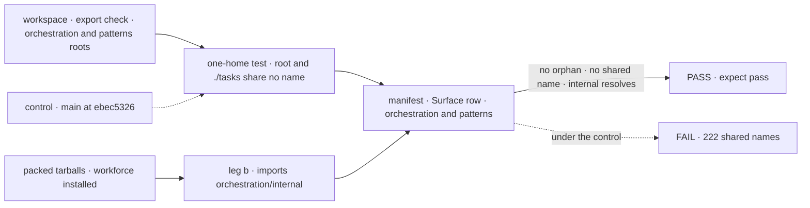

# FIX-2459 · Orchestration and patterns surface: one home per name, an internal subpath, one claim order

**Spec** · [Decisions](DECISIONS.md)

## Six people, before and after

| Someone who… | Today | After |
|---|---|---|
| **autocompletes `@flow-state-dev/orchestration`** | 346 names: 222 also on `./tasks`, about 60 read only by our own packages (`filerResolver`, `payBoardDebts`) | Skills and Node-only seams. Task names on `./tasks` only; our plumbing behind `./internal` |
| **copies a docs import into a browser component** | A root import works in Node and can break their bundle: the root reaches `node:fs` | The name is only on `./tasks`, guarded browser-safe |
| **picks a claim order** | Three to choose from. The docs say two of them "behave identically" | Two that differ: `fifo`, the default, and `priority`. `"topological"` fails loudly and names `fifo` |
| **makes a task collection** | Four constructors, option rules varying by path | `defineTaskCollection` declares, `getOrCreateTaskCollection` opens; the backings are internal |
| **reads the orchestration or patterns README** | "Depends only on core" (client too). Patterns copies the `taskBoard` docs and mixes `./round-robin` with `./eventActors` | True dependencies; a link to the task-board docs; kebab-case subpaths |
| **adds a rule to how a task write behaves** | Writes it twice, once per backing, kept in step by hand; a refused write is a returned decline in one and a thrown `WriteDeclined` in the other | Writes it once, in one method table over both backings; one decline form |

## The goal, and how we'll know it's met

**An app author who imports orchestration or patterns finds each name at one path, sees nothing
only our own packages use, and chooses between claim orders that actually differ.** Underneath,
a change to how a task write behaves is made once and holds on both backings.

| Is it the right goal? | |
|---|---|
| **The real need** | The epic's *Surface* and *One path* rows, for the two packages a Layer-2 adopter meets first ([FIX-2447](../../epics/FIX-2447/SPEC.md#the-goal-and-how-well-know-its-met)). And the epic's Removes line, "a second copy of 38 collection methods", folded in from [FIX-2462](../FIX-2462/SPEC.md) under the epic's D1 |
| **Smaller, and rejected** | "Workforce's helpers move to `./internal`." Leaves 222 names on two paths and the copied root import that breaks a browser bundle |
| **Bigger, and not this issue's** | Every other published root (memory, tools, workforce beyond its entry names): held by ER-1's ratchet, for follow-up issues. Merging the two backings into one constructor that takes a storage |
| **Not done if** | A name is exported from both the root and `./tasks` · a public export's only outside reader is another `@flow-state-dev/*` package · `fifoClaimOrder` and `topologicalClaimOrder` are both exported · workforce's installed tarball can't import `orchestration/internal` · an app or example imports an `/internal` path · a README states a dependency the `package.json` contradicts · a backing file still defines a `TaskCollectionRef` method itself · the parity tests pass on one backing only |



The check reads the exports maps and the installed tarball, not the READMEs.

| How we verify | |
|---|---|
| **Goal check** | This issue owns the closure manifest's *Surface* cells for orchestration and patterns (FIX-2564 names the ids). Patterns has a second contributor, FIX-2460's benchmark entries, so whichever of the two lands last flips it to `expect: pass`. The implementer runs `run.mjs --goal` on the PR head; the closure FIX-2562 reruns it on `main` |
| **Signal** | FIX-2448's export check passes for both packages with no allow-list entry; its census finds no app or example importing `/internal`. A one-home test beside `tasks-subpath-browser-safe.spec.ts` reads that census's per-entry index and finds zero names on both root and `./tasks`, and the guard still passes. Leg b, if FIX-2564 takes the assertion: workforce's installed tarball imports `orchestration/internal`. For the method table: a source test finds no table method defined in either backing file, and the 26 `describe.each(BACKINGS)` parity files pass unchanged |
| **Input** | Today's packages. A new export added to `./tasks` and re-exported from the root must turn the one-home test red; a method added to one backing file must turn the source test red |
| **Anti-game** | The census reads importers, never a list the diff writes; hiding a name an app imports fails it. The parity tests' assertions don't change in the method-table PR, and a method kept in a backing under a renamed local still counts |
| **Control that must fail** | `main` at `ebec5326`: the one-home test fails on 222 shared names, the export check fails on the first-party-only names on the root, and the source test finds the 38 methods in each backing |

## What changes


Each name sits in one box. Below the fence (the epic's D2) is ours, published but outside semver.

**What an app author types:**

```diff
- import { defineTaskCollection, createSkillsLibrary } from "@flow-state-dev/orchestration";
+ import { defineTaskCollection } from "@flow-state-dev/orchestration/tasks";
+ import { createSkillsLibrary } from "@flow-state-dev/orchestration";

- taskBoard({ collection, claimOrder: "topological" })
+ taskBoard({ collection })                      // fifo is the default; "topological" refuses, naming "fifo"

- import { eventActors } from "@flow-state-dev/patterns/eventActors";
+ import { eventActors } from "@flow-state-dev/patterns/event-actors";
```

How each moved name reaches an adopter is ER-3, per Q1's answer; this spec doesn't pick it.

**Underneath, in its own PR after the moves:** the 38 collection methods are written once, in one
method table over a storage interface each backing supplies (read a row, read it committed, list,
a compare-and-set write, an after-commit hook). Every write goes through the table's `patch` and
`transition`, with one decline form. No name, option or behaviour changes. The design is
[FIX-2462's](../FIX-2462/SPEC.md), retained there.

**Docs:** update both READMEs (dependencies, imports, claim orders; patterns links to the
task-board docs), `orchestration/task-substrate.md`, `task-board.md`, and the pages and guides
importing task names from the root. README passages for names that move to `./internal` (the
filer pass, the filing asserts, `taskToolReads`) move to `docs/architecture/` (ER-1). Add both rows
to FIX-2448's *what each package root is for* page. `mechanisms.yaml` drops `topological`. No new
page. The method table has no docs impact.

## What stays as it is

- `./task-board`, `./inbox` (a feature entry, not a second browser barrel) and `./inbox/check`.
- `priorityClaimOrder`, the `ClaimOrder` interface, and what a claim does.
- `TaskCollectionRef`, every write rule (caps, leases, holds, filing, notices), and the parity tests.
- Workforce's conversation board: a wrapped `taskBoard({ mode: "delegation" })`, not a second board.
- Patterns' behaviour and its other subpaths. Its benchmark adapters and their entry are
  FIX-2460's (its D2).

## What's already here, and the debt

| Already here | What this does with it |
|---|---|
| Root `export * from "./tasks"` | **Removes.** Each task name keeps its `./tasks` home |
| `tasks-subpath-browser-safe.spec.ts`, guarding `./tasks` and `./inbox` | **Builds on.** The issue's import-graph test already exists; the one-home test sits beside it |
| `client/./internal`, published and read by our packages | **Reused** as `orchestration/internal`'s shape (epic [D2](../../epics/FIX-2447/DECISIONS.md#d2)) |
| `./inbox/check`, hidden by `publishConfig` | **Left alone.** D2's second kind |
| FIX-2448's export check and import census | **Builds on.** It decides each name's home; no second walker |
| Choosing which ready task to claim: the `task` mechanism's three claim orders | **Replaces** `topological`, which has `fifo`'s body. Searched `claimOrder`, `ClaimOrder`, `claim(` across `packages/`: no fourth way |
| Making a task collection: `defineTaskCollection`, `getOrCreateTaskCollection` and two backing constructors | **Narrows to two public.** Declaring and opening are different jobs; the backings (one harness-manager test reads them) go behind `./internal` |
| FIX-443 §4 (Linear): claim orders as named primitives | **Amended.** `topological` added nothing the substrate's admission rule (FIX-1005) didn't already do |
| FIX-909 (Linear): patterns imports task names from `./tasks` | **Kept**, and now the only way |
| Orchestration's entry names: `TASK_SETTLED_ENTRY` on `./tasks`, `taskToolActions` on the root and `./task-board`, `taskToolReads` on the root | **Takes D2's rule**, like every other name. `taskToolActions` (docs, goals) keeps one home, `./task-board`; `TASK_SETTLED_ENTRY` and `taskToolReads` (workforce only) go to `./internal` |
| Writing a task row: two backings, each with its own 38 methods over its own `casWrite`, `patchOne`/`patchRef`, `transitionTo`/`transitionRef` | **Replaces** the two copies with one table over those locals, named once |
| `describe.each(BACKINGS)` across 26 collection test files | **Builds on** as the parity suite. No new suite |
| FIX-2532's `findBy`, which changes the resource backing's add path | **Seam.** Its index write moves into the resource storage's compare-and-set write; whichever lands second rebases |

| Adds | Existing piece considered | Why it doesn't fit / how composed |
|---|---|---|
| `@flow-state-dev/orchestration/internal` | `client/./internal`; `./inbox/check` | Same kind as the client's. `./inbox/check`'s kind would drop it from workforce's tarball |
| A one-home test | The browser-safe guard; FIX-2448's export check and its census's per-entry index | Beside the guard, reading the census's index; no second walker. The export check finds orphans, not one name on two entries |
| An internal storage-adapter interface | Each backing's own read, CAS write and list locals | Composed from them: what those locals already do, named once. Not exported |
| A source test that no backing defines a table method | The parity tests | They hold behaviour, not where it is written; the drift this fixes passed them |

| The debt | |
|---|---|
| **Removes** | 222 duplicate paths; about 60 first-party-only names from public view; unread, undocumented exports; `topologicalClaimOrder`; two public collection constructors; patterns' copy of the `taskBoard` docs; two false dependency claims; the second copy of 38 method bodies and one of two decline forms |
| **Adds** | One `./internal` entry to keep. An internal storage interface and a source test. A `"topological"` row in orchestration's retired table until its removal version (epic D3). With Q1's alias option, deprecated aliases for a minor |
| **Leaves** | `delivery.passEntry`, a typed option only workforce sets ([Decided](DECISIONS.md#decided-not-asked)). Workforce's wrapper re-runs filing checks before it reserves chain room, so seven filing names stay behind `./internal` |

**Net: down.** Two packages' roots shrink to what an app author uses, one duplicate mechanism
goes, and 38 duplicated method bodies give way to one internal interface.

## Sign off

**[The goal](#the-goal-and-how-well-know-its-met), at that size:** one path per name, no
first-party plumbing in view, claim orders that differ. If wrong: autocomplete still shows our
process, or we hold this for FIX-2462's rewrite.

**[The debt](#whats-already-here-and-the-debt), net down:** two entries added, 222 duplicate
paths and a duplicate claim order removed. If wrong: adopters pay a breaking move for names they
never used.

1. **[D1](DECISIONS.md#d1) · Each name has one home: task names on `./tasks` only, the root for
   skills and Node-only seams.** If wrong: Node apps write two import lines for nothing.
2. **[D2](DECISIONS.md#d2) · `./internal` holds what only our packages read, README entry or
   not.** If wrong: an adopter's own delegating board loses a semver-covered path.
3. **[D3](DECISIONS.md#d3) · One claim order, `fifo`; `"topological"` refuses.** If wrong: 15
   repo sites and some adopters change a string for no behaviour change.

**Folded in, under the epic's D1 as signed:** FIX-2462's method table, as this issue's last PR,
after the surface moves and constructor placement, so the PRs the manifest cells wait on aren't
held by it. If wrong: this issue carries an internal rewrite it didn't need.

**Open: none.** D2 is the one to weigh. Q1 (the epic's) decides how moved names reach adopters.

Improvement · `orchestration` + `patterns`, imports in `workforce` and `harness-manager`, plus the collection rewrite · large · epic FIX-2447
