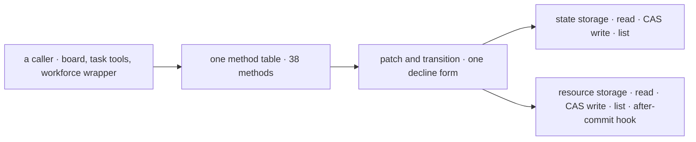
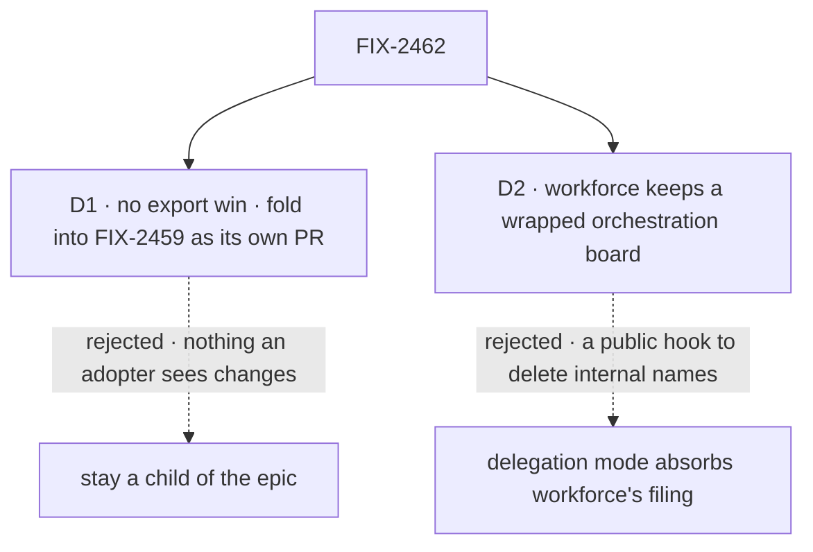

# FIX-2459 · Appendix · The method table (FIX-2462's retained design)

[Spec](SPEC.md) · [Decisions](DECISIONS.md) · **Appendix: the method table**

FIX-2462 folded into FIX-2459 under [epic D1](../../epics/FIX-2447/DECISIONS.md#d1): it has no
export win, so it is not a child of its own. This appendix is its reviewed design, kept whole.
FIX-2459 builds it as its last, follow-on PR, after the surface moves, and FIX-2462 closes as folded
when the spec-set PR merges. Linear:
[FIX-2462](https://linear.app/fixpoint-labs/issue/FIX-2462).

## Design

### Four people, before and after

| Someone who… | Today | After |
|---|---|---|
| **adds a rule to how a task write behaves** (a new guard, a new hold, a new field) | Writes it twice, once in each backing, and keeps the two in step by hand. 20 of the 38 shared methods were added in one two-week window, in both files | Writes it once, in the one method table. Both backings get it |
| **reads why a write was refused** | Finds two forms: the state backing returns a decline from a callback (8 sites), the resource backing throws `WriteDeclined` (13 sites) | Finds one form |
| **runs a flow on either backing** | Gets the same behaviour, held there by the shared tests | Gets the same behaviour, held there by one table and the same tests |
| **imports from orchestration's package roots** | Sees the names they see today | Sees the same names. This issue changes no export |

The issue's second half asked whether workforce runs a parallel board. It no longer does: its
conversation board is `taskBoard({ mode: "delegation" })`, wrapped to add delegates, chain limits
and steps. That wrapper, not a second board, is why orchestration exports filing helpers
([D2](#mt-d2)).

### The goal, and how we'll know it's met

**A change to how a task write behaves is made in one place, and both backings behave the same
under it.**

| Is it the right goal? | |
|---|---|
| **The real need** | "Have each backing supply only read, compare-and-set write and list. Write the method table once." ([FIX-2462](https://linear.app/fixpoint-labs/issue/FIX-2462), Proposed change). The epic counts "a second copy of 38 collection methods" in its Removes ([epic SPEC](../../epics/FIX-2447/SPEC.md#whats-already-here-and-the-debt)) |
| **Smaller, and rejected** | "Unify the decline form." Clears the one visible drift and leaves 38 bodies to drift again on the next feature |
| **Bigger, and not this issue's** | Fewer collection constructors on the public surface, and orchestration's `./internal`: both FIX-2459's |
| **Not done if** | A backing file still defines a `TaskCollectionRef` method itself · the shared tests pass on one backing only · a backing-only write path (refresh, lapse notes, the owed-at-stop send) skips the table's guards |

This is a refactor with no adopter-visible change, so it carries no `goals/` check and owns no row
in the epic's closure manifest. What proves the goal instead:

| How we verify | |
|---|---|
| **Signal** | A source test in orchestration: neither backing file defines any of the 38 method names; the table defines each once. The existing parity tests (`describe.each(BACKINGS)`, 26 files) pass on both backings, unchanged |
| **Anti-game** | The parity tests' assertions don't change in the same PR. A method kept in a backing under a renamed local still counts |
| **Control that must fail** | `main` at `d6a38c09`: the source test finds 38 method definitions in each backing |

### What changes

The table moves; the storage under it and everything above it stays where it is.

Each backing keeps what is truly its own, the state slot or the shared store with its re-read of a
decline and its after-commit delivery, as hooks the table calls.

**Docs:** no documentation impact. No public name, option or behaviour changes, and the package
README doesn't describe the backings' internals.

### What stays as it is

- `TaskCollectionRef`, `defineTaskCollection`, `getOrCreateTaskCollection` and both backing
  constructors, by name and signature. Where the constructors live is FIX-2459's call.
- Workforce's conversation board and its wrapper. It keeps importing the filing helpers, from
  wherever FIX-2459 puts them ([D2](#mt-d2)).
- Every write rule: caps, leases, holds, filing rules, notices. They move with the table and keep
  their single convergence points.

### What's already here, and the debt

| Already here | What this does with it |
|---|---|
| Mechanism `task` (`defineTaskCollection`) and `task-board` (`taskBoard`): one row of work, and the drain over it. This would be the first way to *write* a row shared by both backings; today there are two | **Replaces** the two copies with one |
| The `apply*` and `*Write` helpers in `collection/internal.ts` (`applyTransition`, `applyClaimToTask`, `settingsWrite` and others), from the one-task-primitive epic | **Builds on.** The table calls them as both backings do today |
| `filing.ts`, `holds.ts`, `task-caps.ts`: the convergence points for filing rules, holds and caps | **Leaves alone.** The table calls each once instead of twice |
| `describe.each(BACKINGS)` across 26 collection test files | **Builds on** as the parity suite. No new suite |
| Workforce's `conversation-board/board.ts`: `taskBoard({ mode: "delegation" })` plus a ref wrapper | **Leaves alone** ([D2](#mt-d2)) |
| [FIX-2532](../FIX-2532/SPEC.md)'s `findBy`. Partly merged: the store's index verbs (`set` with `{ indexEntries }`) are on `main` at `45c158b4`; the add path that writes them is still to land | **Seam.** `findBy`'s index write moves into the resource storage's compare-and-set write. Whichever lands second rebases its add onto the other's |

| Adds | Existing piece considered | Why it doesn't fit / how composed |
|---|---|---|
| A storage-adapter interface, internal to orchestration: read one row, read committed, list, compare-and-set write, after-commit hook | `task` · each backing's own local `casWrite`, `patchOne`/`patchRef`, `transitionTo`/`transitionRef` | Composed from them: the interface is what those locals already do, named once |
| A source test that no backing defines a table method | The parity tests | They hold behaviour, not where it is written; the drift this fixes passed them |

| The debt | |
|---|---|
| **Removes** | The second copy of 38 method bodies; one of the two decline forms |
| **Adds** | One internal interface and one source test. Neither is exported |
| **Leaves** | Workforce's wrapper re-runs filing checks before it reserves chain room ([D2](#mt-d2)). Orchestration exports names only workforce reads; FIX-2459 moves them |

**Net: down.** One copy of 38 methods goes for an internal interface; no export changes either way.

### Sign off

**[The goal](#the-goal-and-how-well-know-its-met):** a task-write change is made once and holds on
both backings. If wrong: the backings drift again on the next feature.

**[The debt](#whats-already-here-and-the-debt):** net down, 38 duplicated bodies for one internal
interface. If wrong: we pay a large refactor for no adopter-visible change.

1. [D1](#mt-d1) · **Decided at the epic: folded.** No export win, so the epic's trigger
   fires. This issue closes as folded when the spec-set PR merges; FIX-2459 implements it as its
   own PR. If wrong: FIX-2459 grows by an internal refactor it didn't need.
2. [D2](#mt-d2) · Workforce's board stays a wrapped orchestration board; its filing helpers
   stay. If wrong: orchestration keeps workforce-only names behind `./internal`.

**Open:** none.

Improvement · orchestration · 38 methods, two files, one internal interface · epic FIX-2447, folds into FIX-2459

## Decisions

Two calls are the sign-off: the epic's exit trigger
([epic D1](../../epics/FIX-2447/DECISIONS.md#d1)) read against the evidence, and the issue's
question about workforce.

### The tree

Solid edges are what you sign. Dashed edges lost, and the label says why.

### D1 · No distinct export win: the method table folds into FIX-2459, as its own PR

| | |
|---|---|
| **Instead of** | FIX-2462 staying a child of the epic, with its own PR and its own place in the closure |
| **Because** | The epic keeps this child only for a distinct export win. There is none. The 38 methods sit behind `TaskCollectionRef`, which doesn't change. Neither backing constructor changes, and where they live is FIX-2459's call. The table deletes none of the 65 names orchestration exports that only workforce reads (counted outside orchestration and tests): filing checks, notice helpers and board repairs, none a duplicated method |
| **Locks in** | FIX-2459 implements the method table as its own follow-on PR after its surface moves, so a surface review never reads through it, with this spec as the retained design. FIX-2462 closes as folded when the epic's spec-set PR merges. The rewrite owns no closure-manifest row |

It comes down to the export count: zero, so the epic's own trigger fires.

**What would change my mind:** FIX-2459 deciding to merge the two backing constructors into one
that takes a storage. That export change needs this table first, and the two would then belong in
one issue the other way round.

### D2 · Workforce keeps a wrapped orchestration board; its filing helpers stay

| | |
|---|---|
| **Instead of** | Delegation mode absorbing what workforce needs, through a hook on `createTask` that runs workforce's chain reservation inside orchestration's checked add, so the filing helpers can go |
| **Because** | There is no parallel board left to absorb. Workforce's board is `taskBoard({ mode: "delegation" })`; what it adds is a ref wrapper (`board.ts`) for delegates, chain depth and breadth, and steps on a plan ledger. It runs the filing checks first so a refused filing reserves no chain room. Taking that into orchestration puts workforce's vocabulary under the layer it builds on (tenet 2), and adds a public hook to delete names that, behind `./internal`, adopters no longer see ([epic D2](../../epics/FIX-2447/DECISIONS.md#d2)) |
| **Locks in** | Orchestration's `./internal` keeps the seven filing names workforce reads (`assertFilingCallerContext`, `assertFilingSettings`, `assertFollowUpHasRun`, `assertIdsFree`, `assertUniqueIds`, `assertDepsFileable`, `filerResolver`) for as long as workforce reserves before it adds |

It comes down to the hook: deleting hidden names would add a public option.

**What would change my mind:** a second package wrapping a board to reserve before it files. Two
callers would make the reservation a real orchestration job.

### Decided, not asked

- **The storage interface.** Each backing supplies: read a row, read it committed, list, a
  compare-and-set write of a batch, and an after-commit hook. The table owns `patch(id, event,
  decide)` and `transition(...)`, and every method is written over those two. Names are the
  implementer's.
- **One decline form: `decide` returns a decline reason as a value.** The state backing's form.
  A backing may still throw internally to unwind its own write, but no table method throws one.
- **Convergence point (tenet 5).** The table's `patch` and `transition` are the one place a row
  write takes its guards. Every writer passes through them: the 38 methods, and any of the
  resource backing's own paths that writes a row (`cancelIfDepEnded` does; `refresh`,
  `noteLapsed`, `sendOwedAtStop` and `confirmedDecline` read, notify or re-read, and become
  storage hooks). `cascade.ts` writes through the `CascadeWrites` each backing hands it today;
  the table supplies that once, over `transition`. A path that writes a row around it fails the
  goal's *not done if*.
- **Order inside FIX-2459.** After its `./internal` move and constructor placement, so this PR
  edits the files at their final paths.
- **The FIX-2532 seam** (#4757; the epic's seam row names this PR). `findBy`'s index write moves into the resource storage's
  compare-and-set write, so a row and its index entries still commit together. FIX-2532 is
  partly merged: the store's index verbs are on `main` at `45c158b4`, the add path that writes
  them is not yet. Whichever lands second rebases.
- **`delivery.passEntry` is not this spec's.** The method table doesn't touch it; FIX-2459
  decides it.
- **No changeset** (BP-022): no published name, option or behaviour changes.

### Considered and dropped

| Option | Why it lost |
|---|---|
| Unify the decline form only | The smaller goal. Clears today's visible drift and leaves 38 bodies to drift on the next feature |
| One backing, the state slot read through a resource | Removes a backing, which is a public constructor and FIX-2459's surface, and changes per-request durability |
| Leave the epic, as a standalone orchestration issue | The rewrite owns no manifest row, but the epic's debt line counts it and the owner confirmed it in the set. The epic decided under its D1: folded into FIX-2459, not moved out |

### Open / settled

No POC. The premises are counts read off `main` at `d6a38c09`: 38 shared method names in both
backing files (`emit` aside); 8 `decline:` callbacks in the state backing and 13 `WriteDeclined`
throws in the resource backing; `taskBoard({ mode: "delegation" })` at `board.ts:1035`; 65 names
only workforce reads.

### How it got here

- **Draft** — the method table is written once over each backing's read, compare-and-set write
  and list, on the one-task-primitive helpers; the workforce half found no parallel board, only a
  wrapper; no export changes, so the epic's trigger fires and the table folds into FIX-2459.
- **Set review (Nov 5)** — the epic confirmed D1 (folded, not moved out): FIX-2459 implements the
  table as its own follow-on PR and this issue closes as folded at spec-set merge;
  `delivery.passEntry` named FIX-2459's; the FIX-2532 seam stands, now partly merged.
- **Spec-set review round 1 (Nov 5)** — the two files became this one appendix under FIX-2459
  (the coordinator's call on Cursor's de-dup); FIX-2462 has no spec directory of its own.

**Open:** none.
