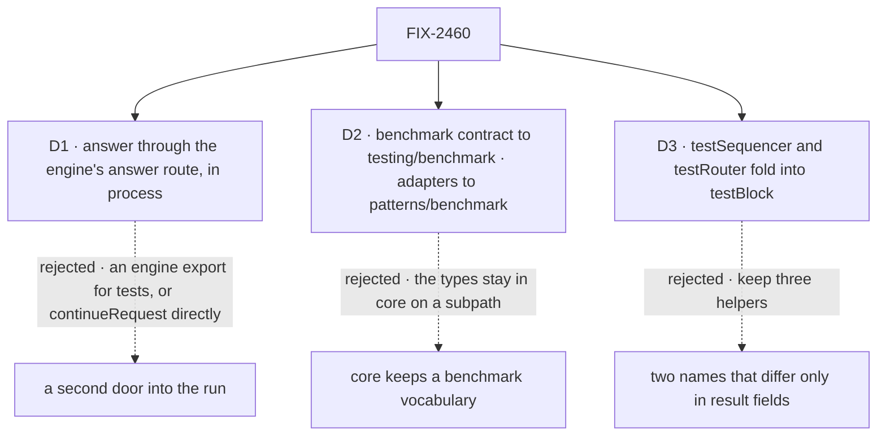

# FIX-2460 · Decisions

[Spec](SPEC.md) · **Decisions**

What was considered, what was chosen, and what each choice locks in. D1 to D3 are the sign-off;
everything else is context for them.

## The tree

Solid edges are what you're signing. Dashed edges lost, and the label says why.

## D1 · A test answers a stop through the engine's answer route, in process

| | |
|---|---|
| **Instead of** | Extracting the route's logic into an engine function the testing package calls, or resuming the run with `continueRequest` directly |
| **Because** | The route is where the checks live: who may answer, which actions the stop allows, the answer's schema, its deadline, *already resolved*, and the request's lease. Epic ER-6 sends the helper through the engine's answer path, and the in-process route is that path with no engine change. The POC ran it on entries the engine already exports ([Settled](#settled)) |
| **Locks in** | A test's answer meets every refusal a screen's does, and a change to the route reaches tests with no testing release. The test goes through the HTTP layer, so a flow with its own `authentication.resolvePrincipal` needs the test to pass what that resolver reads. `run.answer` and `run.resume` take `headers` for that |

**What would change my mind:** the route's timers or its 202-then-continue shape making tests
flaky in a way the helper can't wait out. Then an engine function the route also calls, which
FIX-2449's split would have to host.

It comes down to the refusals: a direct resume passes a second answer a screen gets refused.

## D2 · The benchmark contract moves to `testing/benchmark`, and patterns' adapters go to `patterns/benchmark`

| | |
|---|---|
| **Instead of** | Keeping the six `Benchmark*` types in core, on a `core/benchmark` subpath, with patterns' eight adapters on its root |
| **Because** | The epic's seam gives the types to this issue for `testing/benchmark`. They have two kinds of consumer, both benchmark code: the engine in testing and the adapters in patterns. Patterns imports them from core only because testing is its dev dependency, so the types can move only if the adapters move to a subpath that may reference testing |
| **Locks in** | Core's and patterns' roots carry no benchmark names, and benchmarking is reached only through two subpaths. Patterns lists `@flow-state-dev/testing` as an optional peer dependency, read by `patterns/benchmark`'s types alone; an adopter who never imports that subpath installs nothing new. Changes FIX-2459's patterns root ([Decided](#decided-not-asked)) |

**What would change my mind:** the packed-install check showing that `patterns/benchmark`'s
types fail to resolve for an adopter without testing installed in a way an optional peer can't
fix. Then the types stay in core, on `core/benchmark`.

It comes down to vocabulary: on a core subpath, the framework's base package still names benchmarking.

## D3 · `testSequencer` and `testRouter` fold into `testBlock`

| | |
|---|---|
| **Instead of** | Three block helpers, two of them `testBlock` plus extra result fields |
| **Because** | `testSequencer` is `testBlock` plus step traces and side-chain results read from the items; `testRouter` is `testBlock` plus the route a hook saw. They differ only in what the caller gets back, which `issue-spec` question 7 says is a parameter on the closest entry, not a second helper |
| **Locks in** | One helper per unit an adopter tests: `testBlock` for a block, `testFlow` for an action. `testBlock`'s result type depends on the block's kind. The two names go with no alias (ER-3; Q1 answered break); four test files, four docs pages and four repo guides (`AGENTS.md`, two skills, `development-setup.md`) change |

**What would change my mind:** `testBlock` unable to type `steps` and `selectedRoute` by the
block's kind without a cast in the adopter's test. Then keep the two as typed wrappers.

It comes down to the pick: three names for one job is the choice the epic exists to remove.

## Decided, not asked

- **From the epic, cited, not restated:** [ER-1](../../epics/FIX-2447/DECISIONS.md#who-owns-what), [ER-3](../../epics/FIX-2447/DECISIONS.md#who-owns-what), [ER-6](../../epics/FIX-2447/DECISIONS.md#who-owns-what), [ER-7](../../epics/FIX-2447/DECISIONS.md#who-owns-what) · **cells owned** in [FIX-2564's grid](../FIX-2564/SPEC.md#what-changes): `surface.root.testing`; contributes to `surface.root.core` and `surface.root.patterns`.
- **Durable by default, in memory.** `testFlow` passes `durable: true` unless the test says
  `durable: false`: FIX-2063 D2's name and its test case. A flow that failed on
  `suspendForUser` now parks, which is the point.
- **One runtime config** carries the mocks, settings and durability into both the first run
  and every continuation, so a generator after an answer uses the test's mocks.
- **The verb and its arguments are FIX-2450's.** `run.answer({ action, data? })` mirrors the
  client's `answer`; `suspensionId` defaults to the run's one pending stop and is required when
  there are several. `run.resume` mirrors the client's `resume`, for a developer's own
  `ctx.suspend`. This issue is blocked by FIX-2450 for the name, and by FIX-2455 for the status read below.
- **What `answer` returns** is the same `TestFlowResult` shape, for the same request: status,
  output and the items emitted after the stop (the first result already holds the ones before
  it). It reads them as a client does, in process: the request's stream route for the items,
  closing when the run settles, then one status-route read by request id with
  `include_result_output` (FIX-2455's) for status and output. No wait loop or store read of
  its own, so a third way to wait for a request is not added. A refusal throws an error
  carrying the route's status and message. With no pending stop on this request (a task-board
  stop sits on the worker's request), `answer` throws saying so, before any route call.
- **A flow's own sign-in.** The route checks the principal's user and org against the request,
  so the README names the case: the headers must make the flow's resolver return the test's
  user and the org `testFlow` ran in, or the answer is told the stop doesn't exist.
- **Convergence point:** every answer or resume in a test goes through its engine route. The
  only writers are `run.answer` and `run.resume`; neither calls `continueRequest`.
- **No timer outlives `testFlow`.** The router is built for an answer and disposed after the
  status read that follows the stream's close.
- **The scanners** (`findImportsFromEntry`, `findNodeBuiltinsFromEntry`) move to a `./bundle`
  entry hidden by `publishConfig`, epic D2's second kind. All four importers are repo tests.
- **The moves that go with no alias here** (Q1, answered break): the benchmark names, the core
  types, the patterns adapters, the scanners and the two folded helpers.
- **The goal check is this issue's own, not a manifest cell.** No *Not done if* in the epic's
  *One path* row names `testFlow`, so the manifest carries no stop-answer cell. The leg c
  assertion and the subpath-presence check run under `run.mjs --goal`, with
  `--control=adopter-goal` as the control; the closure re-runs them.
  **Amended (Nov 10):** both run as `run.mjs` packed-install checks (`test-a-stop`,
  `benchmark-subpaths`), not `--goal` cells, so the manifest gains no cell outside its rows
  ([ER-9](../../epics/FIX-2447/DECISIONS.md#who-owns-what)). The goal was touched once, after FIX-2448 merged:
  `goal-core-dts.mjs` stopped skipping its benchmark row ([#4885](https://github.com/fixpoint-labs/flow-state-dev/pull/4885)).
- **Seams** are [the epic's](../../epics/FIX-2447/DECISIONS.md#coordination-seams). One it doesn't list: the router, in-process fetch,
  dispose and durability entries this uses may move to `engine/host` under FIX-2449; testing
  imports them from wherever that split puts them, and counts as their outside consumer.
- **Changesets:** testing, core and patterns.

## Notes for the implementer

From validation, below the bar: the route's busy-wait and the stream's close stall
under `vi.useFakeTimers()`, so the README says so; about 130 `testFlow` call sites, `evalFlow`
included, now write checkpoints, so run the full suite before and after; the POC passed flat
router options and had no generator after the answer, so "one runtime config" is the
implementer's first test (the router also stamps `requestHost`); the optional peer publishes as
an exact pin under `workspace:*`; the goal check's legs and control are FIX-2564's to build.

## Considered and dropped

| Option | Why it lost |
|---|---|
| Build `testFlow` on `createFlowState` | Its stores option is profile-based and can't take the test's registry, so a shared `stores` across runs breaks |
| An `answerSuspension()` engine export | The same checks as the route, plus a new engine export on FIX-2449's root, for no gain the POC didn't already show |
| The scanners in a private workspace package | A new package for two functions, when epic D2's hidden entry already exists |
| Durability opt-in (`durable: true` to turn it on) | A test would run a different engine from production's default, and an adopter would need to know durability exists to test an approval |

## Open / settled

**Settled · CONFIRMED · [answer-in-process](poc/answer-in-process/README.md).** On `main` at
`d6a38c09`, using only engine root exports: an action that calls `suspendForUser` parks over
in-memory stores; the answer route, through `createInProcessFetch`, resumes it to `completed`
with the step's output; a second answer is refused *already resolved*; a developer's
`ctx.suspend` resumes through the resume route. Controls: today's `testFlow` fails the same flow,
and a router without durability refuses the answer.

**Settled · [surface-census](poc/surface-census/README.md).** Every count in the spec, from
source, with a totality assertion over the testing root that failed on a real omission first and
fails on a planted name.

**Open: none.**

## Analysis

Run by the epic-agent over the whole spec set, with `reuse-review` on *Builds on / Adds*.

## How it got here

- **Owner amendment (Nov 6)** — [epic Q1 answered, break](../../epics/FIX-2447/DECISIONS.md#q1), and [epic D4, no
  backward-compat code](../../epics/FIX-2447/DECISIONS.md#d4) ([owner's comment](https://github.com/fixpoint-labs/flow-state-dev/pull/4836#issuecomment-6689198303)). The moved benchmark, scanner and helper names go with no alias; the
  *Not done if* row's alias window is removed. Direction unchanged.
- **Draft** — framed as the epic's fourth team: a step that waits for a person can't be tested,
  and the testing root mixes benchmark and repo tooling into adopter helpers. The answer goes
  through the engine's own route in process, built on checkpoint durability; benchmark and
  scanner names leave three roots for subpaths; two block helpers fold into one.
- **Validation** — the goal check now proves the route by a screen's answer first, covers the
  patterns root and the subpaths' presence, and checks `resume` and timers; the docs line gained
  two pages and the repo guides; D3's count corrected.
- **Set review (Nov 5)** — `run.answer` learns the outcome from the request's stream and
  FIX-2455's by-id status read, not a wait of its own; both benchmark entries and patterns'
  optional peer are this issue's, with the FIX-2459 and FIX-2455 seams named; the stop-answer
  check is this issue's own goal check, re-run by the closure, beside the Surface cells it owns
  or contributes to; testing's row on the package-roots page.
