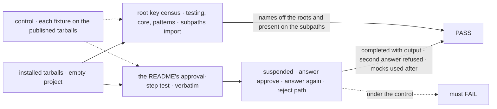
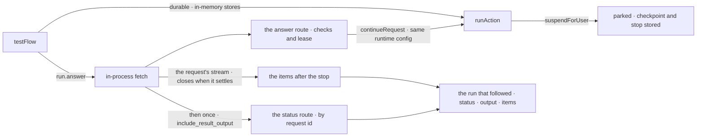

# FIX-2460 · Testing package: support suspensions and durability, and split benchmark and bundle tooling into subpaths

**Spec** · [Decisions](DECISIONS.md)

## Seven people, before and after

| Someone who… | Today | After |
|---|---|---|
| **unit-tests a step that waits for a person** | `testFlow` returns `failed`: *"stopping for a person needs durable execution"*. Nothing in the package can park the stop | The run comes back `suspended` with the stop on it. `run.answer({ action: "approve" })` returns the run that followed, with its status, output and items |
| **answers it wrong in a test** (an action the stop doesn't allow, a second answer, data that fails the schema) | n/a | Gets the same refusal a screen gets, thrown with the route's message |
| **has a generator after the approval** | n/a | The rest of the run uses the test's mocks. An unmocked generator follows the test's unmocked policy |
| **tests their own `ctx.suspend`** | Fails the same way | `run.resume(...)` continues it, through the route the client's `resume` uses |
| **autocompletes `@flow-state-dev/testing`** | 90 names: test helpers beside a benchmark suite (21 names), two import-graph scanners and a package marker. Six of the benchmark types are on core's root too | The helpers for testing an app and evals. Benchmarking is at `testing/benchmark`; the scanners are off the published surface |
| **writes a benchmark or runs `fsdev benchmark`** | Imports from the roots of testing, patterns and core | Imports from `testing/benchmark` and `patterns/benchmark`. The run is the same |
| **tests a sequencer or a router** | Picks between `testBlock`, `testSequencer` and `testRouter` | `testBlock`. Its result carries the steps and side chains for a sequencer and the chosen route for a router |

Durable-by-default and `ctx.suspendForUser` shipped in the same window, and the testing package
can't exercise either. The first row is the epic's
[fourth team](../../epics/FIX-2447/SPEC.md#five-teams-before-and-after).

## The goal, and how we'll know it's met

**An adopter tests a step that waits for a person with the published testing package alone:
runs it, sees it stop, answers it as a screen would, and sees what happened next. The package
root offers only what testing an app needs.**

| Is it the right goal? | |
|---|---|
| **The real need** | *"An adopter cannot unit-test a `ctx.suspendForUser` approval step, even though durable-by-default and suspendForUser shipped this window"* (the issue), and the epic's *Surface* row for every published root |
| **Smaller, and rejected** | "`testFlow` accepts a durability provider" (the issue's *runtimeConfig passthrough*). Leaves the answer to the adopter, who would wire a router, a registry and a provider by hand: the 40 lines our own engine test needs. `testFlow` builds that config itself instead; no general passthrough is added |
| **Bigger, and not this issue's** | A test helper that spawns or messages other sessions (FIX-1293). The Inbox's answer path for a task-board run, which FIX-2450 owns |
| **Not done if** | The answer or `resume` reaches the run by some route other than the engine's answer or resume route · `run.answer` learns the outcome from a wait loop or a store read of its own, not the engine's request stream and by-id status read · a generator after the answer reaches a real model · the README example passes only in the workspace, not from the installed tarball · a benchmark, scanner or folded-helper name is still on the testing, core or patterns root, an alias included · the benchmark names were deleted rather than moved, or `fsdev benchmark` stops running · a timer outlives `testFlow` and holds the test process open |



The check reads what an adopter's project sees after `npm install`. Under the control, the
README test fails at the first `expect` and the census finds `runBenchmark`.

| How we verify | |
|---|---|
| **Goal check** | This issue's own: two packed-install checks in `scripts/packed-install/run.mjs`, the stop answered (`test-a-stop`) and the subpath census (`benchmark-subpaths`), not `--goal` cells ([amended Nov 10](DECISIONS.md#decided-not-asked)). The closure re-runs it. Separately, the manifest's *Surface* cells: this issue owns testing's and contributes to core's and patterns' ([DECISIONS → Decided](DECISIONS.md#decided-not-asked)). Run by the implementer at completion; verdict in the implementation PR |
| **Signal** | The README test (the code block under its *Testing a step that waits for a person* heading) passes: `suspended`, then `completed` with the step's output; a `reject` reaches the block as a no; a generator after the answer returns its mock; a `ctx.suspend` resumed with `run.resume` completes. The process exits in under 10 s with no force-exit flag. Census: `Object.keys` of the testing, core and patterns roots holds none of the moved or folded names (the list is the census on `ebec5326`, written into the goal check), and `testing/benchmark` and `patterns/benchmark` import from the tarball and export every one of them |
| **Input** | The README's refund-approval example. A different stop kind (`input`, with a schema) must pass too |
| **Anti-game** | Assert on the installed tarball, never workspace `src`. Prove the route, not the message: the stop is first answered through the engine's own answer route on the same stores, as a screen would, and only then does `run.answer` have to refuse it. A helper that keeps its own record of answered stops, or validates with its own schema check, can't see that answer |
| **Control that must fail** | Each fixture run against the published tarballs, not `--control=adopter-goal`, which runs only `--goal` cells ([amended Nov 10](DECISIONS.md#decided-not-asked); #4885 records the census's): fails on *suspended* (today `failed`) and on the census (`runBenchmark` on the root, no `testing/benchmark`). In the implementation PR, a variant with `run.answer` swapped for a direct `continueRequest` must fail the refusal-after-screen-answer assertion |

## What changes


Left is today, right is after. The top band is the run a test sees; the bottom band is where
each name lives, with the fence marking what adopters never see.

**An approval step, as a test writes it:**

```diff
  const run = await testFlow({ flow: refunds, action: "refund", input: { amount: 5 }, userId: "u1" });
- expect(run.status).toBe("failed"); // "stopping for a person needs durable execution"
+ expect(run.status).toBe("suspended");
+ expect(run.suspension).toMatchObject({ kind: "approval", prompt: "Refund 5?" });
+ const after = await run.answer({ action: "approve" });
+ expect(after.output).toEqual({ refunded: 5 });
```

```diff
- import { comparePatterns, defineBenchmark } from "@flow-state-dev/testing";
- import type { BenchmarkTask } from "@flow-state-dev/core";
- import { defaultBenchmarkRegistry } from "@flow-state-dev/patterns";
+ import { comparePatterns, defineBenchmark, type BenchmarkTask } from "@flow-state-dev/testing/benchmark";
+ import { defaultBenchmarkRegistry } from "@flow-state-dev/patterns/benchmark";
```

A moved name reaches an adopter on 0.4.0 or testing 0.3.x as a compile error, with no alias,
and the changeset names its new home (ER-3; Q1 answered break;
[DECISIONS → Decided](DECISIONS.md#decided-not-asked)).

**Docs:** update the testing README (an approval-step example, `answer` and `resume`, the
`durable` option, the subpaths) and the patterns README's benchmark section; update
`testing/testing-flows` with a *Testing a step that waits for a person* section,
`testing/benchmarks`, `api/benchmarks` and the *choosing patterns with benchmarks* guide for
the new imports, `api/testing`, `testing/overview` and `testing/flow-integration-tests` for the
result's methods and the folded helpers, and one line in the human-in-the-loop guide pointing
to the test section. The repo's own teaching of the folded helpers moves with them (BP-034):
`AGENTS.md`, the `write-block-tests` and `tdd` skills, `development-setup.md`. On *What each package root is for* (`apps/docs/docs/api/package-roots.md`, FIX-2448's page), add
testing's row: the root is for testing an app and evals, its public subpaths are `testing/benchmark`
and `testing/conformance`; and add `patterns/benchmark` to the subpaths in patterns' row. No new page.

## How an answer reaches the run



The test enters the engine at the same door as a screen, and learns the outcome the way a
client does: the request's stream carries the items after the stop and closes when the run
settles, then one by-id read of the status route with `include_result_output` (FIX-2455's flag)
returns its status and output. No wait loop of the helper's own. Everything after the fetch is
engine code; the POC ran the answer and resume half ([Settled](DECISIONS.md#settled)).

## What stays as it is

- The engine. No new export, no route change from this issue: the answer, resume, stream and
  status routes and their checks are used as they are (the status route's
  `include_result_output` is FIX-2455's).
- `testBlock` for every other block kind, `evalBlock` and `evalFlow`, the mocks,
  `createTestContext`, `./conformance`.
- `fsdev benchmark`'s behaviour and its scorecard. Only its imports move.
- What a test passes in `stores` to share state across runs.

## What's already here, and the debt

| Already here | What this does with it |
|---|---|
| `suspension` · `suspendForUserOn`; the answer route (`engine/src/routes/answer-routes.ts`) | **Builds on.** A test answers through it, in process |
| The resume route (`resume-routes.ts`) | **Builds on**, for a developer's own `ctx.suspend` |
| `durability` · `resolveDurabilityProvider({ durable: true })`, the checkpoint provider | **Builds on.** `testFlow`'s default, as for any host |
| `createInProcessFetch`, `createFlowApiRouter` | **Builds on.** The in-process door the client's `fetcher` already uses |
| The request's stream route (`stream-routes.ts`), which closes on the request's terminal event; the status route's by-id read with `include_result_output` ([FIX-2455](../FIX-2455/SPEC.md), `request-status-routes.ts`) | **Builds on.** How `run.answer` and `run.resume` learn the outcome: the items from the stream, then status and output from one status read. FIX-2455 adds the flag the client's `result()` reads; this is its second in-process reader, so this part lands after FIX-2455 |
| Other ways to answer a stop: the answer route, the resume route, the Inbox's answer call (orchestration), the engine's own suspend test harness (`engine/test/suspend-for-user.test.ts`). Searched `answer`, `resume`, `continueRequest`, `parkOnWait` across `packages/` | **None added.** The helper is a client of the first two. This would be the third *caller* of the answer route, after the client and the Inbox, not a third way |
| `testBlock`; `testSequencer`, `testRouter` | **Extends** `testBlock`; **removes** the two ([D3](DECISIONS.md#d3)) |
| Core's `Benchmark*` types (`core/src/benchmark/types.ts`); patterns' benchmark adapters | **Moved** to `testing/benchmark` and `patterns/benchmark` ([D2](DECISIONS.md#d2)) |
| [FIX-2063 D2](../FIX-2063/DECISIONS.md#d2): durable by default wherever stores persist, `durable: true` for tests | **Kept.** `testFlow` makes the test choice for the adopter |
| [FIX-2129 D2](../FIX-2129/DECISIONS.md#d2): an answer route beside resume | **Kept.** A test uses both as a screen does |

| Adds | Existing piece considered | Why it doesn't fit / how composed |
|---|---|---|
| `answer` and `resume` on `testFlow`'s result (each taking `headers` for a flow's own sign-in), and `suspension` | `suspension` · the answer and resume routes; the client's `answer` (FIX-2450) | Composed: each is one in-process call to its route. The testing package doesn't depend on the client, so it calls the route the client calls |
| A `durable` option on `testFlow` | `resolveDurabilityProvider`'s `durable` | The same name and meaning, passed through |
| `testing/benchmark`, `patterns/benchmark` (this issue owns both) | Each package's `exports` map; core's `./benchmark/types.ts` | Extends the maps. No new package |
| `@flow-state-dev/testing` as an optional peer of patterns | Testing as patterns' dev dependency, today | Read only by `patterns/benchmark`'s types ([D2](DECISIONS.md#d2)) |
| A repo-only `./bundle` entry on testing | Orchestration's `./inbox/check`, hidden by `publishConfig` | Epic D2's second kind, reused |

| The debt | |
|---|---|
| **Removes** | 21 benchmark and 3 scanner names from the testing root, 6 `Benchmark*` types from core's root, 8 benchmark names from patterns' root, `testSequencer` and `testRouter` and their result types |
| **Adds** | Two public subpaths to keep. Patterns' new optional peer dependency on testing, for `patterns/benchmark`'s types. No deprecated aliases (Q1 answered break) |
| **Leaves** | A test helper with no request host for spawning or messaging (FIX-1293). The testing package marker, which the epic gives FIX-2449 with the other three. **Amended (Nov 10):** a known overlap, `runForTest` on testing's root beside `testBlock`, two ways to run one block; follow-up: fold or remove. `createReplayingRef` stays, as the replay-safety double |

**Net: down.** The testing root loses 28 of its 90 names, two other roots lose their benchmark names,
two helpers fold into one, and no answer path or wait is added. Patterns gains one optional peer.

## Sign off

**[The goal](#the-goal-and-how-well-know-its-met):** a step that waits for a person, tested
from the installed tarball, answered through the engine's route, and a root with only test
helpers. If wrong: adopters still can't test the feature the window shipped.

**[The debt](#whats-already-here-and-the-debt), net down:** 38 root names move off three roots and two helpers fold;
two public subpaths and one optional peer are added. If wrong: benchmark users pay a move for nothing.

1. [D1](DECISIONS.md#d1) · **A test answers through the engine's answer route, in process.**
   If wrong: a test passes a stop a screen would have refused.
2. [D2](DECISIONS.md#d2) · **The benchmark contract moves to `testing/benchmark`, and patterns'
   adapters go to `patterns/benchmark` with it.** If wrong: patterns' types reach for a package
   its adopters didn't install.
3. [D3](DECISIONS.md#d3) · **`testSequencer` and `testRouter` fold into `testBlock`.** If
   wrong: four test files and two docs pages change for a naming preference.

**Open: none.** D1 is the one to weigh.

Improvement · `testing` + `core` + `patterns` (+ `cli`, `pattern-benchmark` imports) · medium:
three published packages, two subpaths, 38 names moved, two helpers folded, no engine change · after FIX-2450 (the verb) and
FIX-2455 (the status read) · epic [FIX-2447](../../epics/FIX-2447/SPEC.md)
