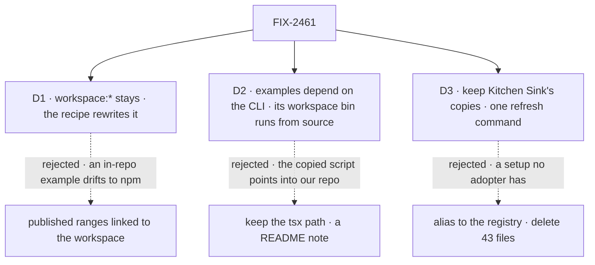

# FIX-2461 · Decisions

[Spec](SPEC.md) · **Decisions**

Three decisions are the sign-off. D3 departed from a line in the epic; the epic-agent decided it
at set review on this card's recommendation and amended the epic to match.

## The tree

Solid edges are what you're signing.

## D1 · Examples keep `workspace:*`; one copy-out recipe rewrites it to the published versions

| | |
|---|---|
| **Instead of** | Published ranges (`^0.4.0`) that pnpm links to the workspace while they match |
| **Because** | In the repo an example must run on today's source, which is what CI tests. A range stops matching after a release, and pnpm then installs from npm without a word. Packages version apart (core 0.4.0, orchestration 0.5.0), so every release would bump every example |
| **Locks in** | One recipe in `examples/README.md` is the only supported way out; each example README links it. The goal check runs it verbatim, so editing the recipe edits the check's input. A reader who skips the step gets npm's error naming `workspace:` |

It comes down to the in-repo run: a range drifts to npm after a release, silently.

**What would change my mind:** the examples moving to their own repository. Then published
ranges are the only shape, and the recipe goes.

## D2 · Every example depends on `@flow-state-dev/fsdev` and calls `fsdev`; the CLI's workspace bin runs from source

| | |
|---|---|
| **Instead of** | Keeping `tsx ../../packages/cli/bin/fsdev.ts` and adding a README note for outside the repo |
| **Because** | The copied `package.json` is what a reader runs, and a note beside a broken script contradicts it. In the workspace the CLI's `bin` is `dist/bin.js`: it needs a build, then imports workspace packages whose `exports` are `.ts` source plain Node can't load. So the bin changes: `bin/fsdev.ts` (already a `tsx` script) in the workspace, `dist/bin.js` in `publishConfig` |
| **Locks in** | The CLI's manifest carries two bins; the tarball must keep `dist/bin.js`, which packed-install already exercises. Each example keeps `tsx` as a dev dependency for the workspace bin |

It comes down to the copied `package.json`: the `tsx` path fails outside the repo.

**What would change my mind:** `pnpm pack` ignoring `publishConfig.bin`. Two claims are unverified
here (no install in this session): that `dist/bin.js` fails in the workspace, and that pnpm 10
applies `publishConfig.bin`. Both are the implementer's first checks.

## D3 · Kitchen Sink keeps its 43 registry copies; one refresh command replaces the hand sync

Decided by the epic-agent at set review, on this recommendation. The epic's *Removes* row now
reads "the hand sync of Kitchen Sink's registry copies". The reasoning, as it was put:

**In plain terms.** Kitchen Sink keeps 43 copies of registry components, byte-identical and checked
by a drift test in CI (the issue counted 37 and no check). What remains is the double edit. The
epic lists the copies under *Removes*.

**The trade-off.** An alias from `@/components/flow-state` to the registry source means one edit
per change. But Kitchen Sink would show a setup no adopter can have: their components are copies
an install leaves in their app. Bare imports would resolve from `packages/ui`, which doesn't
declare `ai`, and Turbopack resolving `@/` across that boundary is unproven. Keeping them costs
one command after an edit; the drift test fails if it's forgotten.

**The call: keep the copies, add one refresh command** over the drift test's own options, so the
two can't disagree. The epic's *Removes* row names the hand sync, not the files.

**What would change my mind.** Kitchen Sink no longer being the reference for how an app uses the
registry. Then the alias wins, and the copies go.

**What being wrong costs.** Keeping wrongly: 43 files and a refresh step. Deleting wrongly: a
Kitchen Sink that builds only in this repo, after a resolution fix.

It comes down to what Kitchen Sink teaches: only kept copies match an adopter's app.

## Decided, not asked

- **From the epic, cited, not restated:** [ER-5](../../epics/FIX-2447/DECISIONS.md#who-owns-what), [ER-8](../../epics/FIX-2447/DECISIONS.md#who-owns-what) · **cells owned** in [FIX-2564's grid](../FIX-2564/SPEC.md#what-changes): `first-hour.example.<name>.<step>`.
- **One recipe, in `examples/README.md`.** Copy the folder, rewrite `workspace:*` to `latest`,
  `npm install`. It links the quick start for a project that starts empty.
- **`tsconfig.json` is self-contained** in each example, as `hello-chat`'s already is.
- **`hello-chat`'s `next.config.mjs` reads nothing outside its folder.** The workspace-only
  settings, `transpilePackages` and the tracing root, apply only when it sits in the repo.
- **A test that compares an example to an `apps/docs` page runs only in the repo**, detected by
  the workspace root, and fails loudly there if the page is missing. Outside, the page doesn't
  exist and there is nothing to compare.
- **The refresh is a copy beside `compareRegistryCopies`**, not `fsdev ui add`, which runs
  `npx shadcn@latest` over the network and stops at overwrite prompts.
- **Kitchen Sink goes last** after FIX-2554, FIX-2458, FIX-2456, FIX-2452 (the `scheduler` line
  in `fsdev.config.ts`) and FIX-2450 (two `resumeSuspension` call sites), editing only its
  `fsdev` script, the Codex comments, `.gitignore`, `CLAUDE.md` and the refresh script.
- **Kitchen Sink's tracker ids stay.** It is unpublished, so its 145 sites sit outside the
  Leakage rule; named in the spec's *Leaves*.
- **CI's `pnpm --filter @flow-state-dev/kitchen-sink run fsdev gen --check`** must still pass
  through the new script.
- **No changeset.** The CLI's published manifest doesn't change (BP-022).

## Considered and dropped

| Option | Why it lost |
|---|---|
| A check that every API a README names is in the example's code | README prose isn't structured; review catches it at this size |
| An `fsdev` command that copies an example out | A new feature for a one-line rewrite |
| Kitchen Sink copied out, in the goal | It is a reference to read, built on harness sign-ins and 24 workspace packages |

## Analysis

Not run on this spec alone: the epic-agent runs `analysis` and `reuse-review` over the whole
spec set.

## Notes from review

Spec-set review round 1 (Nov 5), recorded, not folded.

- **Cursor, one visualization** ([review](https://github.com/fixpoint-labs/flow-state-dev/pull/4772#pullrequestreview-5778749039)): "One visualization per 'what changes' where mermaid and diff blocks say the same thing (e.g. FIX-2461)." For the implementer when the spec is next amended.

## How it got here

- **Drafted (Nov 5)** as a spec-set member of FIX-2447. Necessity check: *build as scoped*, with
  two of the issue's items already true on `main` (Kitchen Sink's Codex README, a drift test).
  The copy-out gaps grew past the CLI path to `workspace:*`, `tsconfig` extends, a repo import in
  `next.config.mjs`, and tests that read docs pages.
- **Set review (Nov 5):** the open fork on Kitchen Sink's registry copies became D3, decided on
  its recommendation; *Leaves* now credits Shift Manager's drift test and names only the labs'
  copies as untested; the goal cells are admitted under *First hour* and shared with FIX-2562's
  j1, with `--control=adopter-goal` as the control; Kitchen Sink's tracker ids are left; the
  Kitchen Sink seam adds FIX-2452 and FIX-2450 ahead of this issue.
