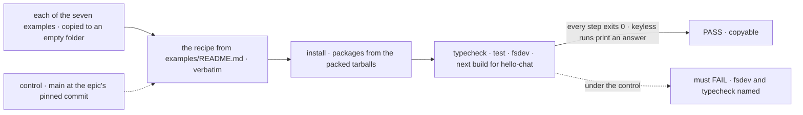
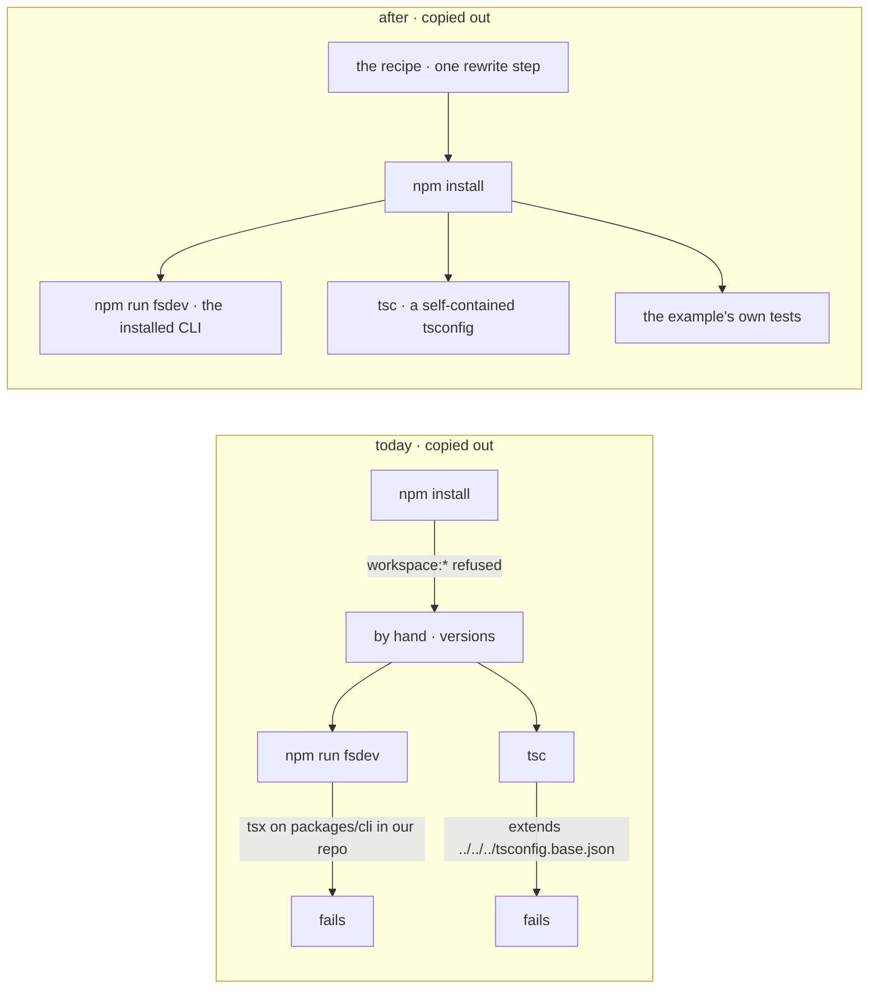

# FIX-2461 · Make the examples and Kitchen Sink copyable and honest

**Spec** · [Decisions](DECISIONS.md)

## Six people, before and after

| Someone who… | Today | After |
|---|---|---|
| **copies `hello-chat` out of the repo to start an app** | `npm install` refuses `workspace:*`. Past that, `npm run fsdev` runs `tsx` on a path into our repo, and `next.config.mjs` imports a repo script | One recipe in `examples/README.md`: copy, one rewrite step, `npm install`. Then `npm run dev` and `npm run fsdev` work |
| **copies a guide's example out after reading its docs page** | `tsc` can't find `../../../tsconfig.base.json`. Two guides' tests read `apps/docs` pages and fail | The same recipe. `typecheck` and `test` pass; a docs-page comparison runs in the repo only |
| **reads `hello-chat`'s README to learn the framework** | It promises `ctx.emit.message()` and `useClientData`; neither is in the code. No run steps | It names what the code does, and how to run it |
| **opens `examples/` to find a starting point** | The table lists two examples. The five `guides/` examples aren't there | All seven, each with its docs page linked |
| **edits a registry component** | Edits it twice; 15 of the last 18 commits to Kitchen Sink's copies edited the registry too. A drift test catches a miss | Edits the registry, runs one command. The drift test stays the gate ([D3](DECISIONS.md#d3)) |
| **reads Kitchen Sink's Codex mode, or clones the repo** | Comments describe a sandbox narrowed to the run's directory; the code turns it off. A Playwright run dirties a tracked `test-results/.last-run.json` | The comments say what runs. `test-results/` is ignored |

The quick start (FIX-2451's) gets an adopter to a first answer; the examples are where they go next.

## The goal, and how we'll know it's met

**Someone who copies any example out of the repo into an empty folder installs, typechecks,
tests and runs it by following its README, and every feature the README names is in its code.**

| Is it the right goal? | |
|---|---|
| **The real need** | "An example copied out of the repo still runs" ([the epic](../../epics/FIX-2447/SPEC.md#five-teams-before-and-after)) |
| **Smaller, and rejected** | "The examples depend on the CLI." A copy still fails on `workspace:*`, `tsconfig` extends and docs-reading tests |
| **Bigger, and not this issue's** | Kitchen Sink copied out: it needs harness sign-ins, Postgres and 24 workspace packages, and is a reference to read. The quick start is FIX-2451's |
| **Not done if** | The check runs inside the repo, where parent `node_modules` hide every gap · it covers only the keyless examples · a README names an API its example doesn't call |



The check reads what an empty folder does with the example, never the repo's view of it.

| How we verify | |
|---|---|
| **Goal check** | Cells `first-hour.example.<name>.<step>`, admitted under the manifest's *First hour* row in FIX-2564's `scripts/packed-install/run.mjs` (`run.mjs --goal`) at `expect: fail`. This issue flips them to `expect: pass`; FIX-2562's j1 reuses the same cells rather than adding its own. Model `n/a` |
| **Signal** | Each example's *install*, *typecheck*, *test* and *fsdev* (`npm run fsdev -- --help`) exit 0. The keyless `board-lifecycle`, `custom-pattern` and `research-team` run their README's `fsdev run` lines to an answer; `hello-chat` passes `next build` |
| **Input** | The seven folders under `examples/`. An eighth example added later is picked up by the folder walk, not a list |
| **Anti-game** | A temporary folder outside the repo, no parent `node_modules`, tarballs under the resolution guard. Never assert on `package.json` text |
| **Control that must fail** | `run.mjs --control=adopter-goal` over `main` at the epic's pinned commit: `first-hour.example.board-lifecycle.fsdev` fails on the `tsx` path, and `.typecheck` on the missing `tsconfig.base.json` |

## What changes



Same folder, copied out twice. Every failure on the left is a path that reaches back into our repo.

An example's `package.json`, as it ships in the repo and as a reader copies it:

```diff
   "scripts": {
-    "fsdev": "tsx ../../../packages/cli/bin/fsdev.ts"
+    "fsdev": "fsdev"
   },
   "devDependencies": {
+    "@flow-state-dev/fsdev": "workspace:*",
```

The CLI's workspace `bin` runs from source; the tarball keeps `dist/bin.js` ([D2](DECISIONS.md#d2)).
Kitchen Sink's `fsdev` script takes the same change. The recipe rewrites `workspace:*` on the way
out ([D1](DECISIONS.md#d1)).

**Docs:** update `examples/README.md` (seven examples, the recipe), every example README's run
section, `hello-chat`'s README, and Kitchen Sink's `CLAUDE.md` upstream-first section; one line
pointing at the recipe in the five `apps/docs` pages that link `examples/guides/`.

## What stays as it is

- `workspace:*` in the repo; the drift test and its 43-file scope.
- The CLI's published `bin`, `fsdev ui add`, the registry's contents.
- Labs and Shift Manager, with the same `tsx` path and their own copies.

## What's already here, and the debt

| Already here | What this does with it |
|---|---|
| `compareRegistryCopies` and Kitchen Sink's drift test: both directions, 43 files, in CI | **Builds on.** The refresh takes the same scope |
| `fsdev ui add`, the adopter's install path | **Leaves alone** ([why](DECISIONS.md#decided-not-asked)) |
| `scripts/packed-install/run.mjs`, and FIX-2564's legs and manifest | **Extends**, through FIX-2564's assertions |
| The CLI's `publishConfig` swap of `main`/`exports` to `dist` | **Extends** to `bin` |
| `hello-chat`'s self-contained `tsconfig.json` | **Builds on.** The other six match it |
| Kitchen Sink's README on Codex mode | **Leaves alone.** Already true |

*Keep an app's registry copies equal to the registry* has a checker and no writer; this adds the writer beside it.

| Adds | Existing piece considered | Why it doesn't fit, or how this is composed |
|---|---|---|
| A refresh for an app's registry copies | `compareRegistryCopies`; `fsdev ui add` | Composed: one options object, so what is copied is what is checked |
| The copy-out recipe | FIX-2451's quick start | The quick start starts empty; the recipe starts from an example. It links the quick start |

| The debt | |
|---|---|
| **Removes** | Eight `tsx` scripts into `packages/cli`; six repo-relative `tsconfig` extends; `hello-chat`'s repo import and two false README claims; stale Codex sandbox comments; a tracked `test-results` file; the hand sync of Kitchen Sink's registry copies |
| **Adds** | A second `bin` in the CLI's manifest; a recipe to keep true, which the goal check runs; a refresh script |
| **Leaves** | Shift Manager's 31 registry copies, drift-tested by its own `test/static.test.ts`. The labs' 9 + 9 (`teammates`, `claude-code-style`), with no drift test. The labs' `tsx` scripts. Kitchen Sink's 145 tracker-id sites: it is unpublished and outside the Leakage rule. Unfiled; raised with the epic |

**Net: down.** Every path from an example into the repo goes, for one manifest field and a recipe.

## Sign off

**[The goal](#the-goal-and-how-well-know-its-met):** all seven examples run copied out. If wrong:
examples pass in CI and fail on the first copy.

**[The debt](#whats-already-here-and-the-debt):** net down. If wrong: a recipe that drifts from
the folders it describes.

1. [D2](DECISIONS.md#d2) · Examples depend on the CLI, and its workspace bin runs from source.
   If wrong: the tarball's bin changes. **The one to weigh.**
2. [D1](DECISIONS.md#d1) · `workspace:*` stays; the recipe rewrites it. If wrong: one step a
   reader skips.
3. [D3](DECISIONS.md#d3) · Kitchen Sink keeps its 43 registry copies; one refresh command
   replaces the hand sync. Decided at set review on this recommendation; the epic's *Removes*
   row now names the hand sync. If wrong: 43 files and a refresh step.

Improvement · examples, Kitchen Sink, `packages/cli` manifest, `packages/ui` script · S · epic [FIX-2447](../../epics/FIX-2447/SPEC.md)
