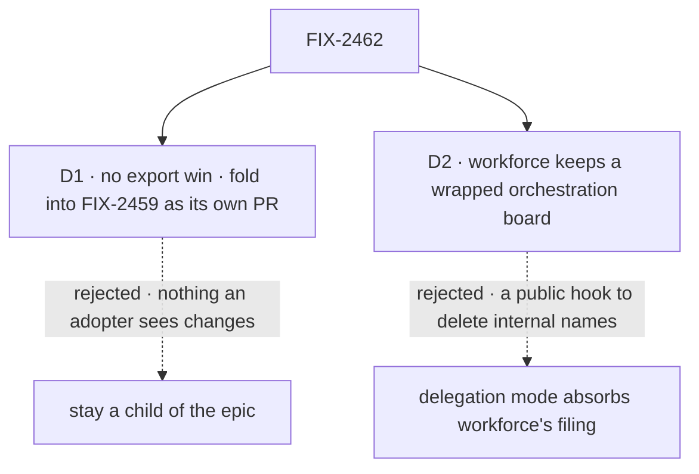

# FIX-2462 · Decisions

[Spec](SPEC.md) · **Decisions**

Two calls are the sign-off: the epic's exit trigger
([epic D1](../../epics/FIX-2447/DECISIONS.md#d1)) read against the evidence, and the issue's
question about workforce.

## The tree

Solid edges are what you sign. Dashed edges lost, and the label says why.

## D1 · No distinct export win: the method table folds into FIX-2459, as its own PR

| | |
|---|---|
| **Instead of** | FIX-2462 staying a child of the epic, with its own PR and its own place in the closure |
| **Because** | The epic keeps this child only for a distinct export win. There is none. The 38 methods sit behind `TaskCollectionRef`, which doesn't change. Neither backing constructor changes, and where they live is FIX-2459's call. The table deletes none of the 65 names orchestration exports that only workforce reads (counted outside orchestration and tests): filing checks, notice helpers and board repairs, none a duplicated method |
| **Locks in** | FIX-2459 implements the method table as its own follow-on PR after its surface moves, so a surface review never reads through it, with this spec as the retained design. FIX-2462 closes as folded when the epic's spec-set PR merges. The rewrite owns no closure-manifest row |

It comes down to the export count: zero, so the epic's own trigger fires.

**What would change my mind:** FIX-2459 deciding to merge the two backing constructors into one
that takes a storage. That export change needs this table first, and the two would then belong in
one issue the other way round.

## D2 · Workforce keeps a wrapped orchestration board; its filing helpers stay

| | |
|---|---|
| **Instead of** | Delegation mode absorbing what workforce needs, through a hook on `createTask` that runs workforce's chain reservation inside orchestration's checked add, so the filing helpers can go |
| **Because** | There is no parallel board left to absorb. Workforce's board is `taskBoard({ mode: "delegation" })`; what it adds is a ref wrapper (`board.ts`) for delegates, chain depth and breadth, and steps on a plan ledger. It runs the filing checks first so a refused filing reserves no chain room. Taking that into orchestration puts workforce's vocabulary under the layer it builds on (tenet 2), and adds a public hook to delete names that, behind `./internal`, adopters no longer see ([epic D2](../../epics/FIX-2447/DECISIONS.md#d2)) |
| **Locks in** | Orchestration's `./internal` keeps the seven filing names workforce reads (`assertFilingCallerContext`, `assertFilingSettings`, `assertFollowUpHasRun`, `assertIdsFree`, `assertUniqueIds`, `assertDepsFileable`, `filerResolver`) for as long as workforce reserves before it adds |

It comes down to the hook: deleting hidden names would add a public option.

**What would change my mind:** a second package wrapping a board to reserve before it files. Two
callers would make the reservation a real orchestration job.

## Decided, not asked

- **The storage interface.** Each backing supplies: read a row, read it committed, list, a
  compare-and-set write of a batch, and an after-commit hook. The table owns `patch(id, event,
  decide)` and `transition(...)`, and every method is written over those two. Names are the
  implementer's.
- **One decline form: `decide` returns a decline reason as a value.** The state backing's form.
  A backing may still throw internally to unwind its own write, but no table method throws one.
- **Convergence point (tenet 5).** The table's `patch` and `transition` are the one place a row
  write takes its guards. Every writer passes through them: the 38 methods, and any of the
  resource backing's own paths that writes a row (`cancelIfDepEnded` does; `refresh`,
  `noteLapsed`, `sendOwedAtStop` and `confirmedDecline` read, notify or re-read, and become
  storage hooks). `cascade.ts` writes through the `CascadeWrites` each backing hands it today;
  the table supplies that once, over `transition`. A path that writes a row around it fails the
  goal's *not done if*.
- **Order inside FIX-2459.** After its `./internal` move and constructor placement, so this PR
  edits the files at their final paths.
- **The FIX-2532 seam.** `findBy`'s index write moves into the resource storage's
  compare-and-set write, so a row and its index entries still commit together. FIX-2532 is
  partly merged: the store's index verbs are on `main` at `45c158b4`, the add path that writes
  them is not yet. Whichever lands second rebases.
- **`delivery.passEntry` is not this spec's.** The method table doesn't touch it; FIX-2459
  decides it.
- **No changeset** (BP-022): no published name, option or behaviour changes.

## Considered and dropped

| Option | Why it lost |
|---|---|
| Unify the decline form only | The smaller goal. Clears today's visible drift and leaves 38 bodies to drift on the next feature |
| One backing, the state slot read through a resource | Removes a backing, which is a public constructor and FIX-2459's surface, and changes per-request durability |
| Leave the epic, as a standalone orchestration issue | The rewrite owns no manifest row, but the epic's debt line counts it and the owner confirmed it in the set. The epic decided under its D1: folded into FIX-2459, not moved out |

## Open / settled

No POC. The premises are counts read off `main` at `d6a38c09`: 38 shared method names in both
backing files (`emit` aside); 8 `decline:` callbacks in the state backing and 13 `WriteDeclined`
throws in the resource backing; `taskBoard({ mode: "delegation" })` at `board.ts:1035`; 65 names
only workforce reads.

## How it got here

- **Draft** — the method table is written once over each backing's read, compare-and-set write
  and list, on the one-task-primitive helpers; the workforce half found no parallel board, only a
  wrapper; no export changes, so the epic's trigger fires and the table folds into FIX-2459.
- **Set review (Nov 5)** — the epic confirmed D1 (folded, not moved out): FIX-2459 implements the
  table as its own follow-on PR and this issue closes as folded at spec-set merge;
  `delivery.passEntry` named FIX-2459's; the FIX-2532 seam stands, now partly merged.

**Open:** none.
