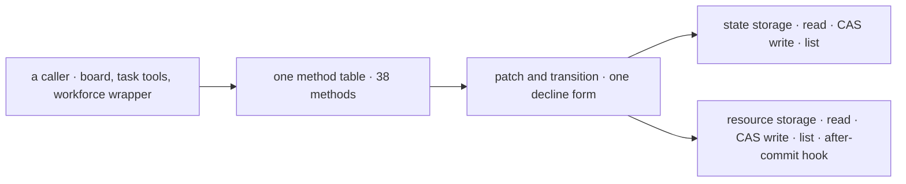

# FIX-2462 · Write task-collection methods once over storage primitives; question workforce's parallel board

**Spec** · [Decisions](DECISIONS.md)

## Four people, before and after

| Someone who… | Today | After |
|---|---|---|
| **adds a rule to how a task write behaves** (a new guard, a new hold, a new field) | Writes it twice, once in each backing, and keeps the two in step by hand. 20 of the 38 shared methods were added in one two-week window, in both files | Writes it once, in the one method table. Both backings get it |
| **reads why a write was refused** | Finds two forms: the state backing returns a decline from a callback (8 sites), the resource backing throws `WriteDeclined` (13 sites) | Finds one form |
| **runs a flow on either backing** | Gets the same behaviour, held there by the shared tests | Gets the same behaviour, held there by one table and the same tests |
| **imports from orchestration's package roots** | Sees the names they see today | Sees the same names. This issue changes no export |

The issue's second half asked whether workforce runs a parallel board. It no longer does: its
conversation board is `taskBoard({ mode: "delegation" })`, wrapped to add delegates, chain limits
and steps. That wrapper, not a second board, is why orchestration exports filing helpers
([D2](DECISIONS.md#d2)).

## The goal, and how we'll know it's met

**A change to how a task write behaves is made in one place, and both backings behave the same
under it.**

| Is it the right goal? | |
|---|---|
| **The real need** | "Have each backing supply only read, compare-and-set write and list. Write the method table once." ([FIX-2462](https://linear.app/fixpoint-labs/issue/FIX-2462), Proposed change). The epic counts "a second copy of 38 collection methods" in its Removes ([epic SPEC](../../epics/FIX-2447/SPEC.md#whats-already-here-and-the-debt)) |
| **Smaller, and rejected** | "Unify the decline form." Clears the one visible drift and leaves 38 bodies to drift again on the next feature |
| **Bigger, and not this issue's** | Fewer collection constructors on the public surface, and orchestration's `./internal`: both FIX-2459's |
| **Not done if** | A backing file still defines a `TaskCollectionRef` method itself · the shared tests pass on one backing only · a backing-only write path (refresh, lapse notes, the owed-at-stop send) skips the table's guards |

This is a refactor with no adopter-visible change, so it carries no `goals/` check and owns no row
in the epic's closure manifest. What proves the goal instead:

| How we verify | |
|---|---|
| **Signal** | A source test in orchestration: neither backing file defines any of the 38 method names; the table defines each once. The existing parity tests (`describe.each(BACKINGS)`, 26 files) pass on both backings, unchanged |
| **Anti-game** | The parity tests' assertions don't change in the same PR. A method kept in a backing under a renamed local still counts |
| **Control that must fail** | `main` at `d6a38c09`: the source test finds 38 method definitions in each backing |

## What changes

The table moves; the storage under it and everything above it stays where it is.

Each backing keeps what is truly its own, the state slot or the shared store with its re-read of a
decline and its after-commit delivery, as hooks the table calls.

**Docs:** no documentation impact. No public name, option or behaviour changes, and the package
README doesn't describe the backings' internals.

## What stays as it is

- `TaskCollectionRef`, `defineTaskCollection`, `getOrCreateTaskCollection` and both backing
  constructors, by name and signature. Where the constructors live is FIX-2459's call.
- Workforce's conversation board and its wrapper. It keeps importing the filing helpers, from
  wherever FIX-2459 puts them ([D2](DECISIONS.md#d2)).
- Every write rule: caps, leases, holds, filing rules, notices. They move with the table and keep
  their single convergence points.

## What's already here, and the debt

| Already here | What this does with it |
|---|---|
| Mechanism `task` (`defineTaskCollection`) and `task-board` (`taskBoard`): one row of work, and the drain over it. This would be the first way to *write* a row shared by both backings; today there are two | **Replaces** the two copies with one |
| The `apply*` and `*Write` helpers in `collection/internal.ts` (`applyTransition`, `applyClaimToTask`, `settingsWrite` and others), from the one-task-primitive epic | **Builds on.** The table calls them as both backings do today |
| `filing.ts`, `holds.ts`, `task-caps.ts`: the convergence points for filing rules, holds and caps | **Leaves alone.** The table calls each once instead of twice |
| `describe.each(BACKINGS)` across 26 collection test files | **Builds on** as the parity suite. No new suite |
| Workforce's `conversation-board/board.ts`: `taskBoard({ mode: "delegation" })` plus a ref wrapper | **Leaves alone** ([D2](DECISIONS.md#d2)) |
| [FIX-2532](../FIX-2532/SPEC.md)'s `findBy`, in review, which changes the resource backing's add path | **Seam.** Whichever lands second rebases its add onto the other's |

| Adds | Existing piece considered | Why it doesn't fit / how composed |
|---|---|---|
| A storage-adapter interface, internal to orchestration: read one row, read committed, list, compare-and-set write, after-commit hook | `task` · each backing's own local `casWrite`, `patchOne`/`patchRef`, `transitionTo`/`transitionRef` | Composed from them: the interface is what those locals already do, named once |
| A source test that no backing defines a table method | The parity tests | They hold behaviour, not where it is written; the drift this fixes passed them |

| The debt | |
|---|---|
| **Removes** | The second copy of 38 method bodies; one of the two decline forms |
| **Adds** | One internal interface and one source test. Neither is exported |
| **Leaves** | Workforce's wrapper re-runs filing checks before it reserves chain room ([D2](DECISIONS.md#d2)). Orchestration exports names only workforce reads; FIX-2459 moves them |

**Net: down.** One copy of 38 methods goes for an internal interface; no export changes either way.

## Sign off

**[The goal](#the-goal-and-how-well-know-its-met):** a task-write change is made once and holds on
both backings. If wrong: the backings drift again on the next feature.

**[The debt](#whats-already-here-and-the-debt):** net down, 38 duplicated bodies for one internal
interface. If wrong: we pay a large refactor for no adopter-visible change.

1. [D1](DECISIONS.md#d1) · **The one to weigh.** No export win, so this folds into FIX-2459 as its
   own PR. If wrong: FIX-2459 grows by an internal refactor it didn't need.
2. [D2](DECISIONS.md#d2) · Workforce's board stays a wrapped orchestration board; its filing helpers
   stay. If wrong: orchestration keeps workforce-only names behind `./internal`.

**Open:** none.

Improvement · orchestration · 38 methods, two files, one internal interface · epic FIX-2447, folds into FIX-2459
