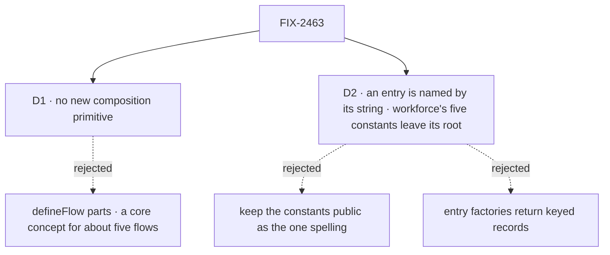

# FIX-2463 · Decisions

[Spec](SPEC.md) · **Decisions**

What was considered, what was chosen, and what each choice locks in. Two decisions are the
sign-off. This issue carried the epic's exit trigger ([epic D1](../../epics/FIX-2447/DECISIONS.md#d1)):
it stays as a new primitive only if the existing pieces can't carry the job. They can, so the
trigger fired. Epic D1 is amended to record that: no new primitive, and this child stays in the
set narrowed to a small removal, pending the owner's sign-off on the spec-set PR.

## The tree

Solid edges are what you're signing. Dashed edges lost, and the label says why.

## D1 · No new flow-composition primitive; the session board's spread stays

| | |
|---|---|
| **Instead of** | `defineFlowPart({ actions, reads, internal, resources, session })`, accepted as `defineFlow({ parts })` with collision refusals, which the issue proposed |
| **Because** | The mistake it guards is already refused. The hire's role table finds a half-spread board (no `dispatch` or `onTaskSettled` built by the board) and names the fix, at hire, not at run time. What a part adds beyond that is shorter code in about five flows that spread a board: the built-in agent, the coordinator, Shift Manager's EM, and two test fixtures. A capability can't carry actions or entries, but nothing here needs one to: `board.entries()` already is the bundle |
| **Locks in** | `defineFlow` gains no `parts` slot. A Layer-2 feature hands back keyed records (`board.entries(turn)`, `board.actions`, `board.reads`) that an app spreads, as today. The next feature that wants a flow part starts from this card |

It comes down to the hire: it already refuses the half-spread board a part would prevent.

**What would change my mind:** a second and third Layer-2 feature each handing an app a bundle
for three or more slots. Then the spread is a pattern, and a part pays for its concept.

## D2 · An entry the framework calls is named by its string, like an action; workforce's five `*_ENTRY` constants leave its root

| | |
|---|---|
| **Instead of** | Keeping the constants public and making the docs use them everywhere. Also considered: each entry factory returns a keyed record, `{ work: … }`, to spread |
| **Because** | An action is a documented string found by name at hire (`respond`, FIX-2084 D2), and so is `onTaskSettled` in Kitchen Sink and in core's own refusal. Four of the five strings an app writes are already refused at hire or definition when missing; one hire rule covers the fifth. Keyed records change five factories' return shapes, which no deprecated alias can carry ([Q1](../../epics/FIX-2447/DECISIONS.md#q1)) |
| **Locks in** | `work`, `onTaskSettled`, `onMessageReceived`, `onTaskSteered` and `onWorkstreamOpened` are documented public names; renaming one is a breaking wire change. A piece an entry factory built, under any other name, is refused at hire. Workforce's five become module-private. Core's `WAIT_DEADLINE_ENTRY` and orchestration's `TASK_SETTLED_ENTRY` are not this decision's: FIX-2448 and FIX-2459 move them with their roots |

It comes down to consistency: every other name a flow declares is a string checked at hire.

**What would change my mind:** an entry whose misplaced piece the hire can't see, because the
flow is never hired or defined with it. Then that entry keeps a constant, on its own subpath.

## Decided, not asked

- **The trigger fired; the issue stays in the set as a removal, narrowed.** Epic D1, as amended,
  records it: no new primitive, and this child stays, pending the owner's sign-off on the
  spec-set PR. What it keeps is workforce's entry-name cell of the epic's *Surface* row: five
  constants made module-private, one hire rule, the documented strings, docs. Core's and
  orchestration's seams are their roots' issues'; `taskToolActions` and `taskToolReads` are
  FIX-2459's, under its D2 rule. Workforce's wider root is held by the epic's ratchet, outside it.
- **The premise was half right.** 14 `*_ENTRY` names are declared in source, but 7 are on a
  published root (census below), five of them workforce's. The other 7 sit inside
  `board.entries()` or nowhere public.
- **Convergence point for the new rule: the hire's worker-flow check** (`workerFlowProblems`
  with `roleProblems`, and the registration's `messageReceivedProblem`), which every hired flow
  passes. The writers are the four workforce root factories and the board's own pieces;
  `steerTurnEntry` takes a mark as the board's pieces do. Orchestration's `onTaskSettled` stays
  `defineFlow`'s, which already refuses its absence.
- **Ordering.** Blocked by FIX-2448 only: the root half of the goal reads its census module,
  and the workforce entry-name cell lives in the closure manifest that census feeds. Nothing
  left here needs FIX-2459, since no remaining piece touches orchestration's root or `/internal`;
  the two may land in either order.
- **App-level copies** (Shift Manager's `coder`, `em` and `host`, Kitchen Sink's landing
  control) switch to the strings in the same change.

## Considered and dropped

| Alternative | Why not |
|---|---|
| `defineFlow({ parts })` | D1 |
| A documented `workforce/worker-flow` subpath holding the constants and their factories | A breaking move for about 20 of 439 names, and the constants would still be a second spelling |
| Fold `sessionStateShape` and `serverOwned` into `installation.session(board)` | Saves one line in five flows. Not this issue's goal; noted for workforce |

## Settled

- **Seven `*_ENTRY` constants are on published roots, not 14** — **CONFIRMED** by
  `poc/entry-census/census.mjs`: core 1, orchestration 1, workforce 5, the same at the issue's
  evidence commit `a19e2824`. Totality: every root constant must be classified, and a planted
  one (`--plant`) fails the run. `--expect-none` reads workforce's root only, fails today on
  five, and is the after state; it prints core's and orchestration's as moved elsewhere.
- **Who reads each** — **CONFIRMED** by the same census. `WAIT_DEADLINE_ENTRY`: engine only.
  Orchestration's `TASK_SETTLED_ENTRY`: workforce only. `FILE_SCHEDULED_TASK_ENTRY`: nobody
  outside workforce. The other four: Shift Manager's team files and Kitchen Sink's landing control.
- **A misspelled `steerTurnEntry` key is hired today** — read, not run: `steerTurnEntry`
  (`conversation-board/steer.ts`) carries no mark, and `roleProblems` checks only marked pieces
  and the role table's names. The goal check's control runs it.

## How it got here

- **Draft** — framed as the epic's one candidate for a new primitive; the census and the hire's
  role table showed the existing pieces carry it, so the direction is a removal of seven root
  constants behind one hire rule, building on `board.entries()`, `markRolePiece` and FIX-2084 D2.
- **Set review (Nov 5)** — narrowed to "entry names are strings, refused at hire": the moves of
  `WAIT_DEADLINE_ENTRY` and orchestration's `TASK_SETTLED_ENTRY` dropped (FIX-2448's and
  FIX-2459's), five constants not seven, the goal's root half moved onto the epic's one census
  and this issue's one *Surface* cell, the blocked-by on FIX-2459 dropped, and the trigger cited
  to epic D1 as amended.
