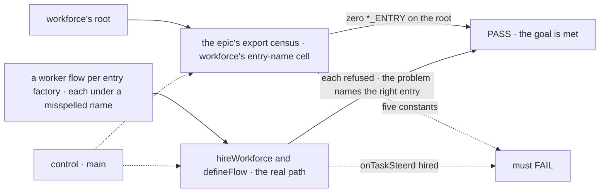
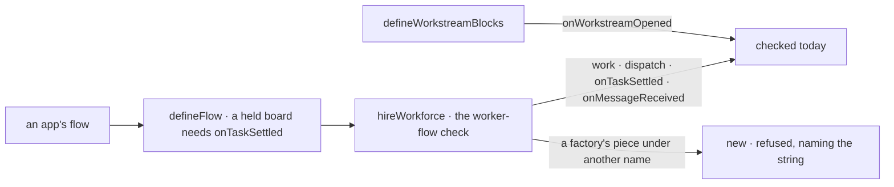

# FIX-2463 · Entry names are strings, refused at hire

**Spec** · [Decisions](DECISIONS.md)

| Someone who… | Today | After |
|---|---|---|
| **autocompletes workforce's root** | Five `*_ENTRY` constants beside the entry factories that use them | None. The names an app declares are documented strings, like action names |
| **writes a worker flow of their own** | The docs name an entry two ways: `work` as a string, `[MESSAGE_RECEIVED_ENTRY]` as an imported constant | One way: `work`, `onMessageReceived`, `onTaskSteered`, the same as `respond` |
| **misspells an entry, `onTaskSteerd: steerTurnEntry(...)`** | Hired without a word; a late steer is owed to an entry that isn't there | Refused at hire, naming `onTaskSteered` |
| **holds a task board in an app flow** | Writes `onTaskSettled`, as Kitchen Sink does; core refuses the flow without it | Unchanged |
| **wires a session board into a worker flow** | Spreads its pieces into five slots; the hire refuses a half-spread board, naming the fix | Unchanged: no new composition primitive |

## The goal, and how we'll know it's met

**An app author who writes a worker flow of their own, or holds a task board, finds no entry-key
constant on workforce's root, names every entry the framework calls by its documented string,
and has a wrong or missing name refused when the flow is defined or hired, naming the entry.**

| Is it the right goal? | |
|---|---|
| **The real need** | The epic's *One path*, and the one *Surface* cell this issue owns: workforce's entry names. A root shows what an app author needs, with one way to do each thing. The issue asks that the `*_ENTRY` keys leave the public barrels and that a mistake not wait for run time |
| **Smaller, and rejected** | "Delete the constants." A string with no refusal behind it trades a compile error for a silent run-time miss, which is worse |
| **Bigger, and not this issue's** | A `defineFlow({ parts })` primitive: considered and rejected ([D1](DECISIONS.md#d1)). Core's `WAIT_DEADLINE_ENTRY` and orchestration's `TASK_SETTLED_ENTRY`, framework seams no app reads: FIX-2448 and FIX-2459 move them with their roots. The rest of workforce's root: held by the epic's ratchet, outside the epic |
| **Not done if** | A `*_ENTRY` is reachable from workforce's root · a docs page or README names an entry through a constant · an entry factory's piece under any other name is hired or defined without a refusal · core gains a flow-composition slot |



The check reads the roots and the hire's verdict, not the source of the factories.

| How we verify | |
|---|---|
| **Goal check** | `goals/entry-names/refused-at-hire/`, no model, run by the implementer at completion, for the hire half. For the root half, the closure manifest's workforce entry-name cell, which this issue flips to `expect: pass`, read through the epic's one census module (FIX-2448's per-entry index of `packageExports`), not a second census. `poc/entry-census/census.mjs --expect-none` is the spec-time stand-in. Verdict on the implementation PR |
| **Signal** | The cell passes: zero `*_ENTRY` on workforce's root, with no `@deprecated` alias ([Q1](../../epics/FIX-2447/DECISIONS.md#q1) answered break). Every misnamed-entry flow is refused, the problem naming the right string |
| **Input** | One flow per entry factory (`workerTaskEntry`, `steerTurnEntry`, `messageReceivedEntry`, `workstreamOpenedEntry`, orchestration's `taskSettledEntry`), each under a one-letter typo. A different typo must fail the same way |
| **Anti-game** | Not the factories' unit tests: they pass while the hire ignores a misplaced piece. The census reads the exports map, not a list the diff writes |
| **Control that must fail** | `main`. The cell fails on five names (the stand-in exits 1 on five); `onTaskSteerd: steerTurnEntry(...)` is hired with no problem |

## What changes


An app writes each of workforce's five as a string, and a misplaced piece is refused at hire.
The two framework seams no app reads move with their own roots, not here.

**A worker flow of your own, as the app writes it:**

```diff
-import { MESSAGE_RECEIVED_ENTRY, messageReceivedEntry, WORKER_TASK_ENTRY, workerTaskEntry } from "@flow-state-dev/workforce";
+import { messageReceivedEntry, workerTaskEntry } from "@flow-state-dev/workforce";
 ...
-  task: { actions: { [WORKER_TASK_ENTRY]: workerTaskEntry({ name: "em-task", turn }) } },
+  task: { actions: { work: workerTaskEntry({ name: "em-task", turn }) } },
   internal: {
     actions: {
       ...board.entries(answer),
-      [MESSAGE_RECEIVED_ENTRY]: messageReceivedEntry({ installation, flowKind: "em" }),
+      onMessageReceived: messageReceivedEntry({ installation, flowKind: "em" }),
```

**Docs:** update `workforce/messaging-workers.md` and `workforce/projects.md` to the strings, and
the workforce README's `MESSAGE_RECEIVED_ENTRY` examples. No new page; the epic's *what each
package root is for* page needs no row from this issue.

## How a wrong name is caught



The refusals already exist for four names. What's new is one rule at the same point: a piece
an entry factory built, found under any other name, is refused.

## What stays as it is

- `defineSessionBoard`, `board.entries()`, the spread into five slots, and `markRolePiece`.
- Every entry factory, on its root. Blocks and resources stay public library API.
- The entry strings themselves: renaming one is a wire change.
- Workforce's app-level flows are owned copies; this changes what they import, not where.

## What's already here, and the debt

| Already here | What this does with it |
|---|---|
| Anything else that names an entry the framework calls | **The action name.** `respond` is a documented string with no constant, found by name at hire (FIX-2084 D2). The closest entry; this makes entries the same. Searched `_ENTRY`, `Entry(`, `entries(` across `packages/` and `apps/` (`poc/entry-census/`) |
| Anything that bundles flow pieces | `flow` (mechanism) and `capability`: a capability attaches to a block and can't carry actions, reads or internal entries. `board.entries()` is the bundle for entries. **Builds on both; adds nothing beside them** |
| The hire's role table, `markRolePiece` (`workforce/src/worker-roles.ts`) | **Extends**: the new refusal is a row there, not a second check |
| `defineFlow`'s refusal of a held board with no `onTaskSettled` | **Kept**; it already names the string |
| [FIX-2084 D2](../FIX-2084/DECISIONS.md#d2): the hire finds every entry by name | **Kept**, and extended to the steer and message entries' placement |
| The epic's one census module and its closure manifest (FIX-2448's census, FIX-2564's manifest) | **Builds on**: the root half of the goal is this issue's cell there, not a second census |
| [FIX-2070](../../epics/FIX-2070/DECISIONS.md#decided-in-review-recorded-so-no-child-reopens-them): derived names `messageReceivedEntry`, `MESSAGE_RECEIVED_ENTRY` | **Amended in part**: the factory name is kept, the constant leaves the root |

| Adds | Existing piece considered | Why it doesn't fit / how composed |
|---|---|---|
| A refusal for an entry factory's piece under another name | `workforce` · `roleProblems` and its role table | Composed: one rule in the same table, read off the factories' existing mark |

| The debt | |
|---|---|
| **Removes** | Five constants on workforce's root; the docs' second spelling of an entry |
| **Adds** | One hire rule. No deprecated aliases for the five ([Q1](../../epics/FIX-2447/DECISIONS.md#q1) answered break) |
| **Leaves** | The board's five-slot spread, which the hire already guards. Workforce's other 434 root names, held by the epic's ratchet and outside the epic. Core's and orchestration's seams, which FIX-2448 and FIX-2459 move |

**Net: down.** Five public names and a second spelling go, for one rule in an existing table.

## Sign off

**[The goal](#the-goal-and-how-well-know-its-met):** no entry constant on workforce's root, one spelling,
every misplaced piece refused at hire. If wrong: we remove a compile check and keep a silent miss.

**[The debt](#whats-already-here-and-the-debt):** net down, five names and a spelling for one
rule. If wrong: apps lose constants they relied on, for about one percent of one root.

1. [D1](DECISIONS.md#d1) · No new flow-composition primitive; the board's spread stays. If wrong:
   every Layer-2 feature keeps handing out bundles, and the next one asks again.
2. [D2](DECISIONS.md#d2) · An entry is named by its string, like an action; workforce's five
   constants leave its root. If wrong: a typo surfaces at hire, not in the editor. **The one to weigh.**

**Open: none.** A removed name goes with no alias: the epic's [Q1](../../epics/FIX-2447/DECISIONS.md#q1) was answered break (ER-3).

Improvement · `workforce`, `shift-manager` · small · epic FIX-2447
