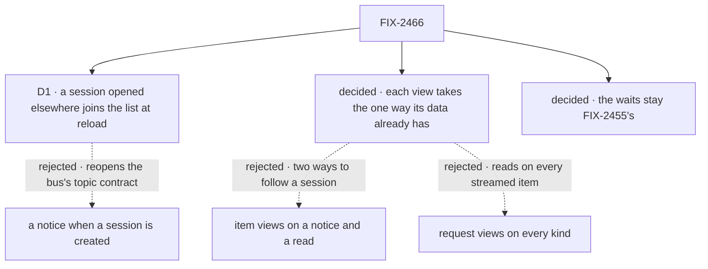

# FIX-2466 · Decisions

[Spec](SPEC.md) · **Decisions**

One call is the owner's. Everything else follows from the epic's rules (ER-2, ER-3, ER-5), the
notices the other children publish, and FIX-2429's precedent, and is recorded so nobody
re-derives it.

## The tree

Solid edges are what you're signing. Dashed edges lost, and the label says why.

## D1 · A session opened in another tab joins the claude-code-style sidebar at its next reload; rows already listed stay live

| | |
|---|---|
| **Instead of** | A new notice when a session is created, on its owner's user topic, so the sidebar hears a session it doesn't list yet |
| **Because** | Topics come only from the session, user and org scopes (ER-2), and no write publishes on a user's topic when one of their sessions is created: the bus publishes the new session's own topic, which nobody watches yet. Adding one is a new kind in FIX-2426's approved contract and a new publisher, for one lab's sidebar. What it would catch is narrow: the sidebar lists only top-level sessions, which only the user opens; a task's or delegate's session is a run, not a row. A session opened in this tab is listed at once, and every listed row (its running turn, its waiting count, its title) reads on its own session's notices |
| **Locks in** | The sidebar is live for the sessions it lists, not for one opened in another tab or on another device. The sidebar keeps no timer, so at closure it counts as no poll |

![D1: does a session opened somewhere else show in the claude-code-style lab's list as it happens? Chosen: it shows at the next reload, while every row already listed updates on its own notices. Instead of: a new notice when a session is created. It comes down to what the choice changes: the chosen one changes only the lab, the other reopens the bus's approved topic contract in two specs. The price is a session opened in another tab that shows only after a reload. Neither keeps a timer. Locks in a list that is live for its rows, not for new ones. Flips if an app lists sessions that other people or processes add](figures/d1-new-sessions.svg)

It comes down to what the choice changes: a session-created notice reopens the bus's approved
contract for one sidebar.

**What would change my mind:** an app with a list of sessions other people or processes add to,
such as a shared inbox of conversations. Then a session-created notice goes in at the epic's
topic seam, and this sidebar uses it too.

## Decided, not asked

- **Each view takes the one way its data already has** (ER-5). A view of a session's items
  follows the session stream, as the Teammates lab's session feed does: Shift Manager's worker
  conversation, and the claude-code-style thread and a task's work. A notice-and-read path for
  items would be a second way to follow a session, which FIX-2428 rules out. Every other view
  calls `client.subscribe` (or `useSubscription` in Shift Manager) on the topic its read covers.
- **What each view hears**, by the read it makes:

  | View | Topic | Acts on |
  |---|---|---|
  | Shift Manager's message log, the Teammates Talk panel | the user's topic | a `resource` notice whose path is in the message log |
  | Shift Manager's project entries | the user's or org's topic, by the project's visibility | a `resource` notice in the projects or workstreams collection |
  | Shift Manager's task view, waiting for its run | the conversation's topic, narrowed to `tasks` | any notice (FIX-2429's board change) |
  | Teammates busy status and activity; the claude-code-style thread's running turn | the session's topic | `request` |
  | Teammates divider | the session's topic | `request`, and a `resource` notice for `historySummary` |
  | claude-code-style sidebar rows | each listed session's topic | `request`, `board` and `resource`, never `items` |
  | claude-code-style pins | the user's topic | `state` |

  Path matching is FIX-1506's (`pathAffectsCollection`), as its panel driver does it. Acting on a
  kind needs `onChange` to carry the notice, which FIX-1506's panel driver already needs; if
  FIX-2428 ships `onChange` without it, the first of FIX-1506 and this issue to build adds it there.
- **Request views never act on `items`.** A streaming reply sends an `items` notice for each
  stored update; a view that read its session's requests on each would read once per chunk. This
  is the `every-kind` control.
- **The task view's run-link wait is this issue's, though it reads a board.** It reads the board
  through the lab reader's `readBoard`, which FIX-2429's checker, matching `listTasks_tasks`, did
  not list. Its notice is FIX-2429's board change, so it ships after FIX-2429. It needs no timer
  where push covers it, so its 30-read give-up and its Retry for a slow link go there; where push
  can miss a change it keeps 2 s, and the give-up stays as the fallback's bound.
- **A view's own read never publishes on a topic it hears.** Pins today are read by running the
  `listPins` action, which writes a request each read. It becomes a flow read (`reads`), so a read
  writes nothing; the subscription is the user's topic, acting on `state`.
- **Each view's fallback pace is today's**: Shift Manager 5 s, its task view 2 s, the Teammates
  lab 1.5 s, the claude-code-style lab 1.5 s, 2 s and 3 s. Today's timers run whenever the view is
  open, so keeping them where push can miss a change (FIX-2428 D3) never reads more than today.
  That includes the SQLite store all three apps run on, whose bus doesn't cross: there each view
  reads on its timer and on each notice. Unlike FIX-2429's Shift Manager board, which polled only
  while a task was open, none of these views needs a gate to stay at today's count.
- **The session-stream views drop their own timers entirely.** The stream's fallback where the
  bus can't cross is its own read about once a second (FIX-2426 D1), a filtered read of what
  changed, in place of a full read of the session every 1.5 to 5 s.
- **The waits stay FIX-2455's.** Shift Manager reads a request's status every 150 ms to 1 s while
  it sends a line, runs an action, interrupts a run or waits on an answered ask, for at most 130 s
  each. Each waits on one request, which is the request's record's job, not a notice's: the epic
  recorded that a request's result is FIX-2043's, read by id, with no topic per request.
  FIX-2455 owns the client call that waits on a request and names the action wait among the
  copies it deletes; the other three (`sendTurn`, `interruptRun`, `settled`) are the same job and
  are handed to it. They are waits, not views, and the closure run counts them as such.
- **Shift Manager gets a changeset** (`patch`: its views update on a change). The labs are
  private and get none (BP-022).

## Considered and dropped

| Alternative | Why not |
|---|---|
| Item views on `client.subscribe`, reading the session on each notice | A second way to follow a session (ER-5), and a full read per notice where the stream sends only what changed |
| Request views on every kind on the session's topic | Reads once per streamed chunk during a reply. The `every-kind` control |
| A narrowed topic per request list | ER-2 narrows only to a resource; a request list is not one |
| Moving the four waits here, onto the request's own stream | FIX-2455 owns the same job for the client and three other copies; doing four sites here forks it |
| Keeping the claude-code-style sidebar's 3 s read for new sessions only | Still a poll at closure, for a case only the user can cause |

## Settled

- **The views are twelve** — **CONFIRMED** by [`poc/app-polls/`](poc/app-polls/): 161 files
  scanned, 36 timer sites under 32 owners, every owner classified: 12 views that move, 4 board
  views (FIX-2429), 4 waits, 10 timers that read nothing, and the labs' 2 helpers. Control
  `FIX2466_CONTROL=plant` exits 1 on an unclassified owner. It found the task view's board wait,
  which FIX-2429's checker missed.
- **No other lab polls.** The knowledge-hub, design-system and fsd-coding-skill labs have no timer
  in their source (searched `setTimeout`, `setInterval`).

## Analysis

2026-11-02 · watermark 2026-11-02 (FIX-2426, FIX-2428, FIX-1506 and FIX-2429 approved; none
built) · **Right approach.** Run by the author in this dispatch, with no fresh sub-agent: this
worker could not dispatch one. The coordinator may run a fresh `analysis` before the gate.

1. **Reuse** — every view composes a path that exists or is specced: the session stream,
   `client.subscribe`, FIX-1506's path matching, FIX-2429's board notice. The one change to a
   flow is the lab's own.
2. **Prior art** — the same split FIX-2429 and FIX-2286 D3 use: the push says when, a read says
   what.
3. **Other shapes** — a notice-and-read for items; a notice for every kind; a session-created
   notice. All dropped above.
4. **New factors** — the task view's board wait, missed by FIX-2429's checker; pins writing a
   request every 3 s. Both folded in.
5. **Necessity** — earns its place: without it, the epic's closure fails on the apps it names.
6. **Ergonomics** — no API change; each view swaps a timer for one call.
7. **Concerns** — on the SQLite store the apps run on, no read is saved, only time to show a
   change. That is the epic's accepted cost (FIX-2428 D3); the reads go on the Postgres bus.

## How it got here

- **Draft** — framed as the rest of the apps' polls after FIX-2429. A checker over every timer in
  the three apps found twelve views, one of them a board wait FIX-2429 missed; each moves to the
  one way its data already has. The waits stay FIX-2455's, and a new session in another tab joins
  the sidebar at reload (D1).

**Open: none.**
