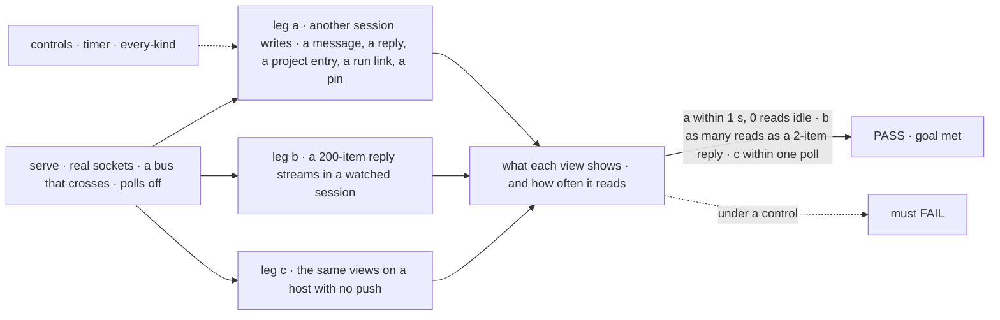
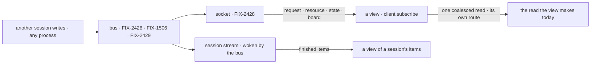

# FIX-2466 · Shift Manager's and the labs' other polls move behind notices

**Spec** · [Decisions](DECISIONS.md)

## Five people, before and after

| Someone who… | Today | After |
|---|---|---|
| **reads the message log or a worker's conversation in Shift Manager** | A message another worker sent shows up to 5 s later; each view reads every 5 s, open message or not | It shows within a second. On the Postgres bus the view reads nothing between changes; on the SQLite store we run it on, it also reads at today's 5 s ([decided](DECISIONS.md#decided-not-asked)) |
| **opens a task in Shift Manager just after it is handed out** | The task's Session tab checks the board every 2 s, up to a minute, then offers Retry | The run shows when the board links it, from any process; no Retry for a slow link |
| **watches a teammate in the Teammates lab** | The busy dot, the Talk panel, the activity line and the divider each read every 1.5 s | Each changes within a second of the change. On the Postgres bus it reads only on a change; on the lab's SQLite store, also at today's 1.5 s |
| **works a session in the claude-code-style lab** | The thread reads every 1.5 s, a task's work every 2 s, the sidebar every 3 s, and pins every 3 s by running an action, so a request is written every 3 s for as long as the tab is open | The thread and a task's work follow the session stream; the sidebar's rows and pins read on a change; reading pins writes nothing. A session you open in another tab joins the sidebar at its next reload ([D1](DECISIONS.md#d1)) |
| **runs the same apps on a host with no push** | Polls | Polls at today's pace, through `client.subscribe`'s one fallback ([epic ER-5](../../epics/FIX-2367/DECISIONS.md#who-owns-what)) |

The epic ([FIX-2367](../../epics/FIX-2367/SPEC.md)) gives this issue the apps' polls that are not
task boards ([FIX-2429 D1](../FIX-2429/DECISIONS.md#d1)). The notices come from the other
children: requests and items from the bus ([FIX-2426](../FIX-2426/SPEC.md)), resources and scope
state from [FIX-1506](../FIX-1506/SPEC.md), board changes from [FIX-2429](../FIX-2429/SPEC.md);
delivery ([FIX-2428](../FIX-2428/SPEC.md)) brings them to the browser.

## The goal, and how we'll know it's met

**On a long-lived host, every view in Shift Manager and the two labs that reads on a timer today
shows a change another session made within a second, and, where push covers it, reads nothing
between changes and no more per reply however long the reply; wherever push can miss a change,
the same views keep today's timer and miss nothing.**

| Is it the right goal? | |
|---|---|
| **The real need** | The issue: *"On a long-lived host, none of these views reads between notices; on a host with no push, each keeps its timer as the fallback."* The epic's closure: *"no lab or Shift Manager view polls with a cross-process bus configured"* ([FIX-2367](../../epics/FIX-2367/SPEC.md#the-goal-and-how-well-know-its-met)) |
| **Smaller, and rejected** | Only the views the issue named. The checker found five more: the claude-code-style lab's four and Shift Manager's task view, which waits on a board link ([checked](DECISIONS.md#settled)). Leaving them keeps a lab polling at closure |
| **Bigger, and not this issue's** | The board views (FIX-2429). Waits on one request the app sent or resumed, which the request's own record answers ([FIX-2455](https://linear.app/fixpoint-labs/issue/FIX-2455), [decided](DECISIONS.md#decided-not-asked)). A notice when a session is created ([D1](DECISIONS.md#d1)) |
| **Not done if** | Any of the twelve views keeps a timer while its socket is up on a bus that crosses · a view of a session's requests reads more during a long reply than a short one · a view follows a session's items by a notice and a read instead of the session stream · a view's own read publishes on a topic it hears · the task view still needs a timer to show its run · a view on a host with no push never reads again |



The check reads what each view shows and counts its reads, not calls to `publish`.

| How we verify | |
|---|---|
| **Goal check** | `goals/realtime/app-views-read-on-notice/` · model `n/a` (handler actions write) · run by the implementer at completion · verdict on the implementation PR. Needs FIX-2426, FIX-2428, FIX-1506 and FIX-2429 merged |
| **Signal** | (a) Each of the twelve views shows the other session's change within 1 s of the write, and makes 0 reads over a 10 s idle window that starts at its first `crosses: true` frame. (b) During a reply of 200 items in a watched session, each view of that session's requests makes the same number of reads as during a reply of 2 items. (c) Within the view's poll interval plus 1 s |
| **Input** | The two lab adapters, driven directly, and Shift Manager's hooks rendered under its real `LabProvider`, against `serve()` on FIX-2426's one test-only crossing double (`goals/lib/crossing-bus.mts`). **PASS legs use a bus that reports crossing; the default in-memory host keeps the timer ([FIX-2428 D3](../FIX-2428/DECISIONS.md#d3)), which leg c covers.** A different valid input: two users; a message or pin of one never makes the other's view read |
| **Anti-game** | Assert on what each view returns and on reads counted at the client, not on `publish` calls or frames sent. Real WebSocket clients on a bound port |
| **Control that must fail** | `GOAL_CONTROL=timer` (each view keeps a fixed timer with the socket up): leg a's 0-reads signal must FAIL. `GOAL_CONTROL=every-kind` (request views read on every notice on their session's topic): leg b must FAIL. Today's `main`: leg a's 1 s signal FAILS for the 5 s views |

## What changes

![What changes. Twelve views in three apps stop reading on a fixed timer. Shift Manager: the message log and a project's entries read on a resource notice, a worker's conversation follows the session stream, and a task's run link arrives as a board notice. Teammates lab: the busy status, activity and the context-window divider read on a request notice, and the Talk panel on a resource notice. Claude-code-style lab: the thread and a task's work follow the session stream, the session rows read on each session's notices, and pins on a user-state notice, through a read that writes nothing. Each keeps today's pace as its fallback where push can miss a change. Left as they are: four waits on one request, owned by FIX-2455; the four board views, FIX-2429's; ten timers that read nothing](figures/what-changes.svg)

Twelve timers become listeners, each on the notice that already names its change.

```diff
 // Shift Manager: the message log (a user-scope collection)
-const timer = setTimeout(() => setReads((n) => n + 1), MESSAGES_POLL_MS);
+useSubscription([topic.user()], readLog, { pollIntervalMs: MESSAGES_POLL_MS }); // reads on a resource notice in the log

 // Shift Manager: a worker's conversation (a session's items)
-readSessionItems(client, sessionId) … setTimeout(reread, MESSAGES_POLL_MS);
+client.sessions.stream(sessionId, { since, onItem }); // the one way to follow a session (ER-5)

 // Teammates: what a conversation is answering (its requests)
-poll(() => client.sessions.requests(sessionId, { limit: 20 }), show);
+client.subscribe([topic.session(sessionId)], { onChange: readRequestsOnRequestKind, pollIntervalMs: 1500 });

 // claude-code-style: pins, now a read that writes nothing
-every(() => pinsDo("listPins", {}), onChange, 3000); // an action: a request row every 3 s
+client.subscribe([topic.user()], { onChange: readPins, pollIntervalMs: 3000 }); // pins as a flow read
```

**Docs:** update Shift Manager's README (*Workstreams*: read when a workstream changes, not every
few seconds; *A task*: the run shows when the board links it, not by checking every 2 seconds),
and the read tables in the Teammates and claude-code-style READMEs. No `apps/docs` change: no
framework API changes, and no published page states these views' timing.



## What stays as it is

- **Every read each view makes.** A notice says when to read; the read says what (epic D2).
- **The four board views** and their publish, FIX-2429's.
- **Shift Manager's snapshot**, read on boot and after the user's own actions. It keeps no timer.
- **Waits on one request** the app sent or resumed: sending a line, an action, an interrupt and
  an answered ask ([decided](DECISIONS.md#decided-not-asked)).
- **The Teammates lab's session feed**, already on the session stream.

## What's already here, and the debt

| Already here | What this does with it |
|---|---|
| **The job, "tell a screen that what it shows changed".** Searched `mechanisms.yaml` (FIX-2426's bus, FIX-2428's `push-delivery`), and `setTimeout`, `setInterval`, `poll(`, `every(`, `sessions.stream`, `subscribe` across the three apps and `packages/`. Found: the session stream, `client.subscribe` with `useSubscription`, and twelve timers ([checker](poc/app-polls/)). Closest: the session stream for items, `client.subscribe` for the rest | **Builds on** both. Nothing new: each view picks the one way its data already has (ER-5) |
| The Teammates lab's `sessionFeeds`, which follows a session on `sessions.stream` | **Builds on.** The same shape for Shift Manager's conversation and the claude-code-style thread and task work |
| FIX-1506's panel driver: subscribe the scope's topic, read on a resource notice whose path is in the collection | **Builds on.** The message log, the Talk panel and a project's entries read the same way |
| FIX-2429's board notice on the filing session's topic, narrowed to the board | **Builds on.** The task view's run link is a board change |
| [FIX-2429 D1](../FIX-2429/DECISIONS.md#d1), the epic's seam "Shift Manager's and the labs' polls", ER-2, ER-3, ER-5 | **Kept.** D1's flip, FIX-1506 merging first, did not fire |
| [FIX-2455](https://linear.app/fixpoint-labs/issue/FIX-2455): one client call that waits on a request and returns its output, deleting the copies of that wait, Shift Manager's action wait among them | **Leaves to it.** The four waits are that job; a comment there names the other three |

| Adds | Existing piece considered | Why it doesn't fit / how composed |
|---|---|---|
| Each view's subscription | `client` · `client.subscribe`; `react` · `useSubscription`; `client` · `sessions.stream` | Composed: each view calls the one its data already has. No helper in a package: the views are in three apps |
| `listPins` as a flow read | The `pins` flow's `listPins` action | Extends the lab's flow: the same handler as a read, so reading writes no request |

| The debt | |
|---|---|
| **Removes** | Twelve timers, the two labs' read-again helpers (`poll`, `every`), `MESSAGES_POLL_MS` and `PROJECT_POLL_MS` as timers (kept as fallback paces), the task view's 30-read give-up and its Retry for a slow link, and a request written every 3 s per open claude-code-style tab |
| **Adds** | Nothing permanent: each view uses a framework path that already exists |
| **Leaves** | The four waits ([FIX-2455](https://linear.app/fixpoint-labs/issue/FIX-2455)). A session opened in another tab joins the claude-code-style sidebar at its next reload ([D1](DECISIONS.md#d1)). On the SQLite store the apps run on, each view still reads at today's pace (FIX-2428 D3) |

**Net: down.** Twelve timers and two helpers go; nothing comes in.

## Sign off

**[The goal](#the-goal-and-how-well-know-its-met):** every timer-driven view in the three apps,
with no read between changes and none per streamed item. If wrong: views that update at once but
still read on a clock.

**[The debt](#whats-already-here-and-the-debt): down**, twelve timers and two helpers out,
nothing in. If wrong: a view that misses a change no notice names.

1. **[D1](DECISIONS.md#d1) · A session opened in another tab joins the claude-code-style
   sidebar at its next reload; rows already listed stay live.** If wrong: someone working in two
   tabs reloads to see a new session.

**Open: none.**

Feature · shift-manager, labs · medium: twelve views, one lab flow read · epic FIX-2367
