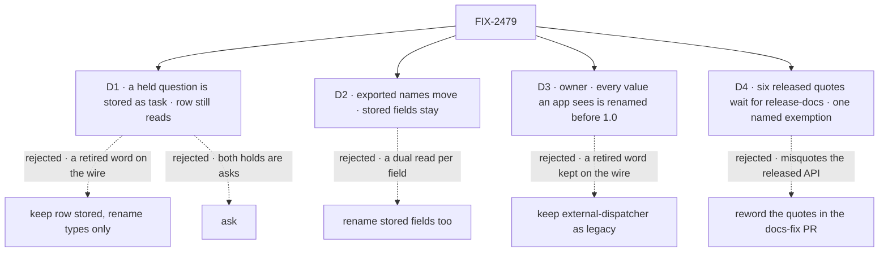

# FIX-2479 · Decisions

[Spec](SPEC.md) · **Decisions**

The owner decided the convention, and on 2026-11-07 the rule for retired words on the wire
(D3); neither is reopened here. Two decisions draw where the rename stops: what a stored hold
says, and whether stored data moves at all. D4 is how published quotes of a renamed message
wait for the release.

## The tree

Solid edges are what you're signing. Dashed edges lost, and the label says why.

## D1 · A question held on a task is stored as `source.kind: "task"`; a stored `"row"` still reads

| | |
|---|---|
| **Instead of** | Keeping `"row"` as the stored value and renaming only the types · `"ask"` · a value for what is parked, such as `"question"` or `"open"` |
| **Because** | Every Inbox client (Shift Manager, the DevTool, an app's own) branches on this value to choose how to answer, so it is a word consumers read, not a storage detail. Both kinds of hold sit on `Task.holds`, so the value can't say where a hold sits. `source` says where it comes from. A suspension hold is a mirror of a run's parked stop, answered by resuming that run. The other is the task's own, with nothing parked, answered by a steer on the task. `"task"` says that, as `"row"` did of the row. `"row"` is the store word the epic retires. `"ask"` fits both: a suspended run's approval is a question to a person too, and FIX-1876's rule keeps *ask* for exactly that. `"question"` collides with `ask.kind`, where a `confirm` sits beside a question, and `"open"` says nothing about the source |
| **Locks in** | `"task"` is a public wire value. `"row"` is accepted on read and never written (BP-030). The dual read is permanent: stored holds don't expire, and only a one-time rewrite of stored holds would let it go, which no issue plans. A client built on `"row"` updates when it upgrades; the changeset says so |

It comes down to what the value says: *ask* fits both holds, *row* names the store, and *task*
says the hold is the task's own rather than a mirror of a parked run.

**What would change my mind:** evidence that no client outside this repository reads the hold
source. Then it is internal, and keeping `"row"` costs nothing. The owner's rule (D3) settled
the other way: retired words on the wire are renamed.

## D2 · Exported names move; stored field names and storage keys stay

| | |
|---|---|
| **Instead of** | Renaming stored fields too: a worktree's and a place's `state` field to `status` |
| **Because** | Each stored field renamed is a dual read on data stores already hold, for a field only its own package's schema parses. Consumers read it through the renamed types. The hold marker in D1 is the exception because every client branches on its value |
| **Locks in** | A stored field name is treated like a storage key. A worktree record keeps a field called `state`, typed `WorktreeStatus`; the glossary's resource entry exempts stored field names |

It comes down to the data already stored: a field rename is a migration, a type rename isn't.

**What would change my mind:** a stored field that reaches a consumer's code the way the hold
marker does. That one moves, with its own dual read.

## D3 · Every retired word an app can see is renamed before 1.0 (owner, 2026-11-07)

**The owner's decision, in session, 2026-11-07, verbatim: "Rename all 4."** Recorded as given.
One rule for a retired word in a value an app reads: rename it before 1.0, in this issue's one
breaking changeset. It replaces the open fork of the first draft, where `"row"` was renamed and
`external-dispatcher` kept.

| Value | New | Why this name (checked against `docs/contributing/glossary.mjs`) |
|---|---|---|
| Hold marker `"row"` | `"task"` | D1. *Row* is retired outside store adapters and UI lists (the Resource entry) |
| Refusal `"external-dispatcher"` | `"external-flow-runner"` | The glossary's *Dispatcher* is the dispatcher block only; what hands a request to another process is the deployment's *flow runner* (`FlowRunner`). Engine already calls the branch `usesExternalRunner`. One word swapped, so the code still reads as the same refusal |
| "A row of an owner-private collection is readable only by the user it belongs to." · "A row of an owner-writes collection is written only by the user it belongs to." | "A resource in an owner-private collection is readable only by the user it belongs to." · "A resource in an owner-writes collection is written only by the user it belongs to." | *Resource*: a resource in a collection is a resource. Only the noun changes, so the sentence says the same thing and still does not say whether the resource exists |
| `Collection pattern "
" can reach the rows of owner-<mode> collection "<Q>".` | `…can reach the resources of owner-<mode> collection "<Q>".` | The same noun. The rest of the message, and the held-flow sentence after it, stay |
| "That segment is reserved for the user an owner-private collection's row belongs to, …" | "…collection's resource belongs to, …" | The same noun (found in review, Gitar) |
| 77 more messages, in `core`, `devtool`, `engine`, `orchestration`, `harness-manager`, `workforce` and `scheduled` | *task* where *row* is a task, *resource* elsewhere, *collection resources* for *collection items* | The glossary's *Resource*, and the rule that *row* never means a task. Each is listed in [app-visible-text.md](app-visible-text.md), with how the list was found |

The owner named four; under the rule, a complete sweep of `packages/*/src` finds 2 wire values
and 81 message sites. The rule, not the count, is what the owner decided, so all of them move.

| | |
|---|---|
| **Locks in** | 2 breaking wire values and 81 reworded messages in one minor changeset. The changeset lists old beside new for the wire values and the four owner-collection messages an app is likeliest to match, and states the rule for the rest. `"row"` is still read (D1); nothing else gets a dual read: a refusal and a message are produced per call, and no schema parses one back (the refusal is a type union, not a stored enum). The engine's constants holding the messages follow the type names (`OWNER_ROW_REFUSAL` is the implementer's to rename); tests that match the old text change with it. The Flow runner entry retires `external-dispatcher` in code only, so a published page keeps describing the released value until `/release-docs` |

**What would change my mind:** none to weigh; it is the owner's call. What it costs: every
client that branches on the refusal or matches a message updates when it upgrades.

## D4 · Six published quotes of a released message wait for `/release-docs`, under one named exemption

| | |
|---|---|
| **Instead of** | Rewording the six quotes in the `docs-fix` PR with the other eight lines · leaving the whole-tree rule at added lines until the release |
| **Because** | The six quote a message the released packages throw today. A `docs-fix` PR fixes a released page to match the released API, so rewording them there would misquote it. Waiting would leave the rule at added lines for a whole release, which ER-6 refuses |
| **Locks in** | **The only widening of the anti-game rule:** "a published page may quote a released message until `/release-docs` rewrites it." It names the three released message texts the six quote, and matches each on published pages only: the owner-private refusal ("A row of an owner-private collection is readable only by the user it belongs to.", 1 line), the owner-writes refusal ("A row of an owner-writes collection is written only by the user it belongs to.", 4 lines), and the startup overlap error (`Collection pattern "…" can reach the rows of owner-<mode> collection`, 1 line). The overlap quote wraps in a code block, so the exemption matches its first line, the one that carries *rows*. It strips that text, not the line: a second use of *row* on the same line still counts. `/release-docs` rewrites the six from the changeset and deletes the exemption in the same PR. FIX-2602's closure check confirms zero open after that pass, with the exemption gone |

**Why the only one:** every other exemption in the resource entry is permanent and says where
*row* is the right word. This one keeps a word that is wrong, for a page that can't change yet,
and it ends at a named event. A quote is the one case where rewording now makes the page false.

**What would change my mind:** moving the whole-tree turn into the `/release-docs` PR of the
release that ships this issue. No quote would be released and wrong at once, and the exemption
would never exist. It ties this issue's check to a release date, which is why it isn't the plan.

## Decided, not asked

- **Names follow the owner's table.** `xResourceStateSchema`, `XResourceState`, `XResourceRef`,
  `XCollectionRef`, `XStatus`. Name the noun for what is stored: a stored worker is
  `WorkerResourceState`, the worker's configuration, not the worker.
- **Where *row* means a task, it says task:** `RowDecision`, `ticketClaimsRow`,
  `HandedOverRowError`, `createRowDispatch`, `openRowHolds`.
- **Core's `WaitRow` is an address, not stored data**: it becomes `TaskAddress`.
- **The UI-row exemption is a path rule:** a `…Row` name stays only in a store adapter or a
  module under a UI package's `components/` or `surfaces/` that renders a list. A read model
  outside them (`InboxRow`, `TaskViewRow`, Shift Manager's `BoardRow`, the DevTool's
  `WorkerRow`) is renamed. `TaskRowState`, the view's status, becomes `TaskViewStatus`.
- **Client and React methods follow the type names:** `listCollectionResources`,
  `createCollectionResource`, `getCollectionResourceState`, `useCollectionResource`. The debug
  route's URL path stays.
- **No aliases** for moved exports (BP-034). One minor changeset (BP-022, pre-1.0).
- **The convergence point for the hold marker is the hold schema's parse.** Every reader (the
  collection, the Inbox read, the DevTool's wire shape, Shift Manager's derive) reads through it,
  so no reader branches on `"row"` itself.
- **This issue merges after FIX-2601** ([epic D3](../../epics/FIX-2600/DECISIONS.md#d3)). It turns
  the resource entry to the whole tree in the glossary, and edits no other rule file.
- **`architecture-reference.md` is shared with FIX-2354**; whichever lands second rebases.

## Considered and dropped

| Alternative | Why not |
|---|---|
| Rename by codemod across the tree | The noun for each stored thing is a judgement (a worker's stored data is its configuration). FIX-2071 renamed by hand, by table; the whole-tree rule is the check |
| Keep aliases for one release | BP-034: a moved published export's old path goes. Pre-1.0 |
| Rename the stored `state` fields with dual reads | D2 |

## Analysis

2026-11-07 · watermark 2026-11-07 · **Right approach, with one change.**

1. **Reuse** — no *Adds*: names change and one BP-030 read is added to an existing schema.
2. **Prior art** — the Kubernetes API calls an object in a collection a resource, and a phase
   field `status.phase`. The owner's convention matches it.
3. **Other shapes** — a codemod; aliases. Both dropped above.
4. **New factors** — FIX-2391 put `HarnessReadinessRow` on `main`; in scope. The count is about
   80 exported names, not the twenty the epic estimated. **Folded**: the epic's debt line is
   corrected, and the size here is large.
5. **Necessity** — earns its place: it is the owner's decision.
6. **Ergonomics** — one pattern, learned once; the changeset is the map.
7. **Concerns** — the epic left `RowHold`'s name to this issue. D1 decides the wire value. The
   type's name follows the owner's table and must not read as the union `TaskHold`; the
   implementer names it.

## How it got here

- **Drafted in the spec set (2026-11-07)** — `"task"` for the hold, stored fields left alone.
  The set review counted the names, and drew the UI-row line as a path rule so the whole-tree
  check can hold it.
- **Review round 1 (2026-11-07)** — D1's reason was wrong: both holds sit on the task, so
  `"task"` now rests on where a hold comes from, and the dual read is named permanent. The
  whole-tree goal now waits on a `docs-fix` PR for the published lines the rule already reads,
  and its exemptions are checked by the goal, not by a reviewer.
- **Amended after merge (2026-11-07)** — the owner closed the open fork: rename every retired word
  an app can see (D3): 2 wire values and 81 messages, after a complete sweep found more than the
  four named. Measured on `main`, the whole-tree rule meets 14 published lines in 10
  files, not 2: 8 plain, for the `docs-fix` PR, and 6 quotes of three released
  messages (the owner-private and owner-writes refusals, and the overlap error), kept by D4's exemption until `/release-docs`.

**Open: none.** The wire-value fork was decided by the owner on 2026-11-07 (D3).

## Notes from review

Recorded for the implementer, not folded into the design.

- *(PR #4886, second-look pass)* "About 80 exported names across 11 packages, with no aliases (BP-034), means every open branch that touches any of them conflicts on merge. The spec says the implementer plans the PR split, which is right. But "large" with `architecture-reference.md` shared with FIX-2354 deserves one sentence in the spec: the split should be per package, in dependency order (`core` → `orchestration` → `client` → `react` → apps), so each PR typechecks on its own."
- *(PR #4886, second-look pass)* "Naming collision. `rowHoldSchema` / `RowHold` sits beside `taskHoldSchema` (the union), so `"task"` as the member value will read badly next to `TaskHold` (the union). The spec leaves `RowHold`'s name "to D1", but D1 doesn't name it."
