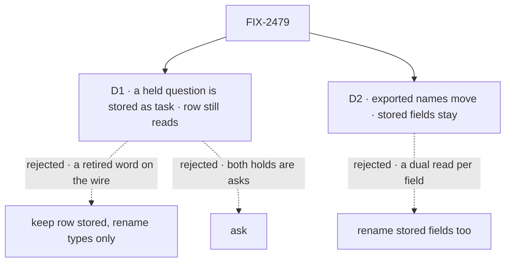

# FIX-2479 · Decisions

[Spec](SPEC.md) · **Decisions**

The owner decided the convention; it is not reopened here. Two decisions draw where the rename
stops: what a stored hold says, and whether stored data moves at all.

## The tree

Solid edges are what you're signing. Dashed edges lost, and the label says why.

## D1 · A question held on a task is stored as `source.kind: "task"`; a stored `"row"` still reads

| | |
|---|---|
| **Instead of** | Keeping `"row"` as the stored value and renaming only the types · or `"ask"` |
| **Because** | Every Inbox client (Shift Manager, the DevTool, an app's own) branches on this value to choose how to answer, so it is a word consumers read, not a storage detail. `"row"` is the store word the epic retires. `"ask"` doesn't say which hold it is: a suspended run's approval is a question to a person too, and FIX-1876's rule keeps *ask* for exactly that. `"task"` names where the hold lives, beside `"suspension"` |
| **Locks in** | `"task"` is a public wire value. `"row"` is accepted on read and never written (BP-030), until no store holds one. A client built on `"row"` updates when it upgrades; the changeset says so |

It comes down to what the value says: *ask* fits both holds, *row* names the store.

**What would change my mind:** evidence that no client outside this repository reads the hold
source. Then it is internal, and keeping `"row"` costs nothing.

## D2 · Exported names move; stored field names and storage keys stay

| | |
|---|---|
| **Instead of** | Renaming stored fields too: a worktree's and a place's `state` field to `status` |
| **Because** | Each stored field renamed is a dual read on data stores already hold, for a field only its own package's schema parses. Consumers read it through the renamed types. The hold marker in D1 is the exception because every client branches on its value |
| **Locks in** | A stored field name is treated like a storage key. A worktree record keeps a field called `state`, typed `WorktreeStatus`; the glossary's resource entry exempts stored field names |

It comes down to the data already stored: a field rename is a migration, a type rename isn't.

**What would change my mind:** a stored field that reaches a consumer's code the way the hold
marker does. That one moves, with its own dual read.

## Decided, not asked

- **Names follow the owner's table.** `xResourceStateSchema`, `XResourceState`, `XResourceRef`,
  `XCollectionRef`, `XStatus`. Name the noun for what is stored: a stored worker is
  `WorkerResourceState`, the worker's configuration, not the worker.
- **Where *row* means a task, it says task:** `RowDecision`, `ticketClaimsRow`,
  `HandedOverRowError`, `createRowDispatch`, `openRowHolds`.
- **Core's `WaitRow` is an address, not stored data**: it becomes `TaskAddress`.
- **The UI-row exemption is a path rule:** a `…Row` name stays only in a store adapter or a
  module under a UI package's `components/` or `surfaces/` that renders a list. A read model
  outside them (`InboxRow`, `TaskViewRow`, Shift Manager's `BoardRow`, the DevTool's
  `WorkerRow`) is renamed. `TaskRowState`, the view's status, becomes `TaskViewStatus`.
- **Client and React methods follow the type names:** `listCollectionResources`,
  `createCollectionResource`, `getCollectionResourceState`, `useCollectionResource`. The debug
  route's URL path stays.
- **No aliases** for moved exports (BP-034). One minor changeset (BP-022, pre-1.0).
- **The convergence point for the hold marker is the hold schema's parse.** Every reader (the
  collection, the Inbox read, the DevTool's wire shape, Shift Manager's derive) reads through it,
  so no reader branches on `"row"` itself.
- **This issue merges after FIX-2601** ([epic D3](../../epics/FIX-2600/DECISIONS.md#d3)). It turns
  the resource entry to the whole tree in the glossary, and edits no other rule file.
- **`architecture-reference.md` is shared with FIX-2354**; whichever lands second rebases.

## Considered and dropped

| Alternative | Why not |
|---|---|
| Rename by codemod across the tree | The noun for each stored thing is a judgement (a worker's stored data is its configuration). FIX-2071 renamed by hand, by table; the whole-tree rule is the check |
| Keep aliases for one release | BP-034: a moved published export's old path goes. Pre-1.0 |
| Rename the stored `state` fields with dual reads | D2 |

## Analysis

2026-11-07 · watermark 2026-11-07 · **Right approach, with one change.**

1. **Reuse** — no *Adds*: names change and one BP-030 read is added to an existing schema.
2. **Prior art** — the Kubernetes API calls an object in a collection a resource, and a phase
   field `status.phase`. The owner's convention matches it.
3. **Other shapes** — a codemod; aliases. Both dropped above.
4. **New factors** — FIX-2391 put `HarnessReadinessRow` on `main`; in scope. The count is about
   80 exported names, not the twenty the epic estimated. **Folded**: the epic's debt line is
   corrected, and the size here is large.
5. **Necessity** — earns its place: it is the owner's decision.
6. **Ergonomics** — one pattern, learned once; the changeset is the map.
7. **Concerns** — the epic left `RowHold`'s name to this issue. D1 decides it.

## How it got here

- **Drafted in the spec set (2026-11-07)** — `"task"` for the hold, stored fields left alone.
  The set review counted the names, and drew the UI-row line as a path rule so the whole-tree
  check can hold it.

**Open: none.**
