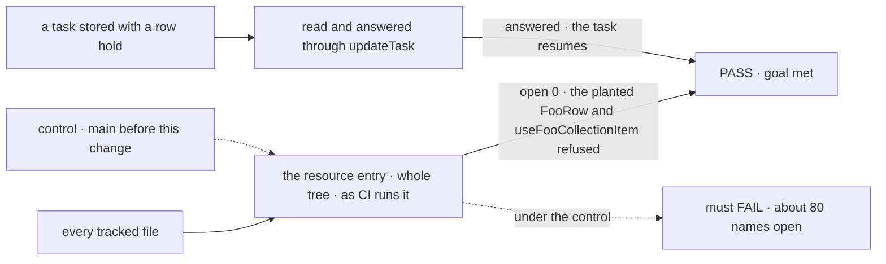

# FIX-2479 · Resource naming: a resource in a collection is a resource, and a lifecycle enum is a Status

**Spec** · [Decisions](DECISIONS.md)

## Six people, before and after

| Someone who… | Today | After |
|---|---|---|
| **builds an app on the packages** | Meets stored data as `WorkerRow`, `ProjectRow`, `WorktreeRow`, the client's handle as `CollectionItemHandle`, a lifecycle as `WorktreeState` | Meets `WorkerResourceState`, `ProjectResourceState`, `CollectionResourceHandle`, `WorktreeStatus`. The changeset lists each old name and its new one; the old names are gone |
| **writes an Inbox client** | Branches on a hold's `source.kind: "row"` | Branches on `"task"`. A hold stored as `"row"` reads as `"task"` and can still be answered ([D1](DECISIONS.md#d1)) |
| **reads the architecture or contributor docs** | "The task's row", "collection item" | "The task", "resource" |
| **adds a new `FooRow` type for a resource, anywhere in the tree** | Caught only on an added line in a collection module | Refused wherever it is: the resource rule reads the whole tree at zero open |
| **writes a store adapter or a UI list** | `VersionedRow`, `TaskRowActions`, `ToolRow` | Unchanged. *Row* stays there, and only there |
| **reads a stream** | `OutputItem`, `getItems` | Unchanged. *Item* now means only a stream item |

The owner settled the convention on 2026-11-06 ([epic](../../epics/FIX-2600/DECISIONS.md#decided-before-the-draft-and-in-review)).
Storage is abstract and `collection.get()` returns a `ResourceRef`, so *row* is a store
adapter's word used above the adapters, and *item* already means a stream item.

## The goal, and how we'll know it's met

**Someone building on the packages meets one word for a stored thing, *resource*, and *Status*
for a lifecycle, and no exported name outside the store adapters and UI lists says otherwise.**

| Is it the right goal? | |
|---|---|
| **The real need** | The owner's 2026-11-06 decision, applied ([epic ER-5, ER-6](../../epics/FIX-2600/DECISIONS.md#who-owns-what)) |
| **Smaller, and rejected** | "Rename the fifteen `*Row` types the issue lists." Measured on `main`, about 80 exported names say *row*, *item* or *state* for a resource or a lifecycle, client methods and hooks among them |
| **Bigger, and not this issue's** | Stored field names and storage keys ([D2](DECISIONS.md#d2)). Words that collide but aren't retired (`InboxItem`, *kind*) |
| **Not done if** | The resource rule passes on added lines only · an old name survives as an alias · a stored `"row"` hold no longer reads or can't be answered · *row* still means a task in an exported name (`RowDecision`, `ticketClaimsRow`) |



The rule reads the tree, not a list of known names. The stored hold is read through the
real collection and answered the way the Inbox answers it.

| How we verify | |
|---|---|
| **Goal check** | `goals/vocabulary/resource-names/a-consumer-meets-one-word/` · model-free · run by the implementer at completion · verdict in the implementation PR |
| **Signal** | The resource entry at whole-tree scope reports OPEN 0, and its `--control` reports a planted `FooRow` type and a `useFooCollectionItem` export. The integration leg: a task stored with a `kind: "row"` hold is listed by the Inbox read with `"task"`, answered through `updateTask`, and the hold closes |
| **Input** | The repository; a hold record written in the old shape. A planted name in another package, or a `confirm` hold instead of a question, must pass too |
| **Anti-game** | Don't assert on the rename list: assert on what the rule finds in the tree. The check also reads the resource entry and fails if it holds an exemption beyond the store-adapter and UI-list path rules ([decided](DECISIONS.md#decided-not-asked)) and stored field names ([D2](DECISIONS.md#d2)), so OPEN 0 can't be reached by widening one |
| **Control that must fail** | `main` before this change: FAIL on *OPEN 0*, with the open names listed |

## What changes


Read down the right column. Each name says what is stored; the bottom box didn't move.

**An app, after upgrading:**

```diff
- import type { WorkerRow, WorktreeRow, WorktreeState } from "…"
+ import type { WorkerResourceState, WorktreeResourceState, WorktreeStatus } from "…"
- const page = await client.resources.listCollectionItems(sessionId, "projects")
+ const page = await client.resources.listCollectionResources(sessionId, "projects")
- const { data } = useResourceCollectionItem(ref, topic)
+ const { data } = useCollectionResource(ref, topic)
- if (hold.source.kind === "row") answerOnBoard(hold)
+ if (hold.source.kind === "task") answerOnBoard(hold)
```

**Docs:** contributor and architecture docs say *resource* (or *task*) in the same PR. One
changeset (minor, pre-1.0) lists every rename for `/release-docs`, which updates the published
glossary ("a project is one row"), the collections pages and the task-substrate page's hold
kinds (ER-7). Package READMEs are written at release.

**Before the rule reads the whole tree, a `docs-fix` PR.** The resource entry's prose half
already reads published pages, and two released lines call stored data "a collection row": the
resources overview and core's README. A normal PR can't edit them, so a `docs-fix` PR rewords
them first, the route FIX-2354 takes for its three published lines. The names half reads code,
where every export moves in this PR. A published page that names a renamed export describes the
released API until `/release-docs` rewrites it from the changeset.

## What stays as it is

- **Store adapters and UI lists**: `VersionedRow`, `ResourceStateRow`, SQL rows, `ToolRow`,
  `TaskRowActions`, the flow navigator's and panels' rows.
- **Stream items**: `OutputItem`, `getItems`.
- **Definitions**: `worktreesCollection`, `janitorResource`. **`Task<I, O>`**, over `TaskResourceState`.
- **Stored field names, storage keys and HTTP paths** ([D2](DECISIONS.md#d2)).

## What's already here, and the debt

| Already here | What this does with it |
|---|---|
| The glossary's resource entry (FIX-2601), added-lines scope | **Extends** to the whole tree (ER-6) |
| `ResourceRef<T>` and `collection.get()` | **Builds on.** `XResourceRef = ResourceRef<XResourceState>` |
| The stored hold schema (FIX-2133, FIX-2317) | **Amended.** One more accepted value on read (BP-030) |
| The 2026-11-02 "rename `*Row` to `*Item`" direction | **Superseded** by the owner's 2026-11-06 convention |
| FIX-1876 D3: *ask* is a question to a person | **Kept.** `"ask"` lost on what it says, not on the rule ([D1](DECISIONS.md#d1)) |
| Anything else that renames by convention | **None.** Searched `codemod`, `rename` across `scripts/`; FIX-2071's renames were by hand, by table |

**Builds on / Adds: none.** Names change; nothing is added but the dual read in [D1](DECISIONS.md#d1).

| The debt | |
|---|---|
| **Removes** | About 80 off-convention exported names; *row* meaning a task; *item* meaning a resource |
| **Adds** | A dual read of `"row"` at the hold's parse boundary. **Permanent**: stored holds don't expire, and only a one-time rewrite of stored holds would let it go, which no issue plans. The same shape as every BP-030 read |
| **Leaves** | Stored fields named `state` that hold a status ([D2](DECISIONS.md#d2)). Words that collide but aren't retired (`InboxItem`) |

**Net: down.** One word per stored thing; one permanent dual read added.

## Sign off

**[The goal](#the-goal-and-how-well-know-its-met), at that size:** about 80 names, the whole
tree. If wrong: a breaking change for a word, or a partial one the rule can't hold at zero.

**[The debt](#whats-already-here-and-the-debt), net down:** one permanent dual read added. If
wrong: a read path for `"row"` that outlives every client that wrote it.

1. **[D1](DECISIONS.md#d1) · A question held on a task is stored as `"task"`; `"row"` still
   reads.** If wrong: every Inbox client updates for a word.
2. **[D2](DECISIONS.md#d2) · Exported names move; stored field names stay.** If wrong: a
   `WorktreeStatus` in a field still called `state`.

**Open: one rule for retired words on the wire** ([Open](DECISIONS.md#open)): rename both
`"row"` and `external-dispatcher` before 1.0, or keep both. D1 is the one to weigh: it fixes a
public value.

Improvement · `workforce`, `orchestration`, `client`, `react`, `harness-manager`, `workspace`, `devtool`, `shift-manager`, `engine`, `core`, `scheduled` · large · epic FIX-2600
