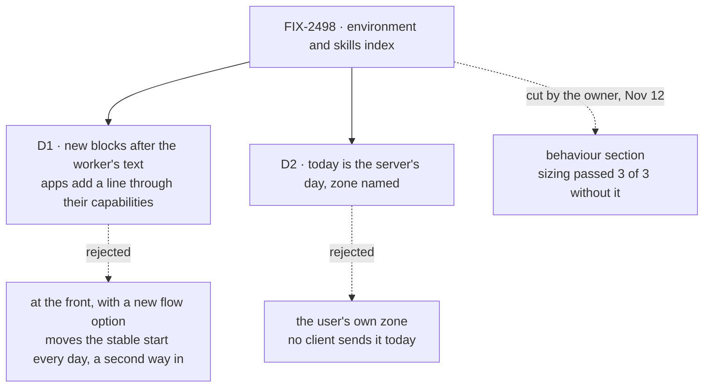

# FIX-2498 · Decisions

[Spec](SPEC.md) · **Decisions**

Two decisions are the sign-off surface. The rest is context for them, and the calls an
implementer must not re-derive. The epic's D1 (on by default, an opt-out each) and its ER-1
(the section shape) are the owner's and are not reopened here.

## The tree

Solid edges are what you sign. Dashed edges lost, and the label says why.

## D1 · The new blocks go after the worker's own text, as tagged context, and an app adds a line through the capabilities it already composes

| | |
|---|---|
| **Instead of** | The epic's [D4](../../epics/FIX-2490/DECISIONS.md#d4) as written: the sections inside the prompt's first entry, before the team's and the worker's text, with a new `defineAgentWorkerFlow` option for an app's extra fields |
| **Because** | The date changes every day, so at the front it changes the start of every worker's prompt, which the issue asks us not to disturb. After the worker's text, the start stays as it is. And the generator's context already merges contributions under one key, so an app's capability adds `environment` lines with no new option (tenet 2, few primitives). Kitchen Sink's assistant already puts its date in this slot |
| **Locks in** | The `environment` context key is public: any app or capability that writes under it shows inside the worker's block, and renaming it later breaks them. The default layer now has two places, the prompt and the context, so FIX-2500 must say which one its summary uses. An app line is free text; nothing checks it |

It comes down to the start of the prompt: at the front, the date changes it every day.

**What would change my mind:** a run where a worker ignores a date at the end of its prompt but
uses one at the front. Then the block moves up and the cache cost is paid.

## D2 · "Today" is the server's date, with its time zone named

| | |
|---|---|
| **Instead of** | The user's own time zone |
| **Because** | The server knows its clock and zone now. No client sends the user's zone, and adding that is a change to every app's client and the request contract, which no ask needs. Naming the zone lets the worker, and the user, see which day it means |
| **Locks in** | A user many hours from the server can see the wrong day near midnight, on every app, until a client sends a zone. An app that knows the zone can add it as an `environment` line ([D1](#d1)) |

It comes down to what the server can know with no client change.

**What would change my mind:** an app whose users are mostly far from its server's zone. Then
the user's zone is worth a client change, and that is its own issue.

## Decided, not asked

- **`defaults: false` gives today's prompt.** Both sections are off, and an unset
  `skills.activateTool` goes back to off. A value a worker set for `skills.activateTool` always
  wins over `defaults`, so a config that set it keeps it (BP-030). Identity is not under
  `defaults`; it is unchanged.
- **The ceiling has one convergence point.** Every section, and FIX-2500's later, goes through
  `workerDefaultLayer`. Its test composes the fixed text with the longest field values and fails
  past 1,600 characters (ER-1). An app's `environment` line and each skill's entry are outside it.
- **The skills line prints only when the list prints**, under the same `skills` key: the worker
  holds a skill it can load and the index is on. A worker with no skill pays nothing.
- **The block's fields:** the date with its weekday and zone, the user's id, and the
  conversation's project when one is set. A field the turn can't read is left out, never
  guessed. No clock time: it would change each turn and no ask needs it. The framework has no
  user name; an app that has one adds it as a line.
- **"Started on" is dropped** from the folded FIX-2497. No ask measures it and a block can't read
  when its session began.
- **Every worker gets both sections**: with or without an installation, and on the
  `coordinator` flow, which runs the same turn.
- **Kitchen Sink's `todaysDate` and its test go in the change that composes the block** (ER-3).
  The test moves to the exported block.

## Considered and dropped

| Alternative | Why not |
|---|---|
| A `defineAgentWorkerFlow({ environment })` option for app fields | A second way in beside `uses`, for something context keys already do |
| The "load a fitting skill" line in orchestration's own listing text | Changes every skills-library user, not only workers; the defaults live in workforce (epic D4, ER-2) |
| A capability per section | A second way in for fixed text (ER-1) |
| Rewriting each app's skill descriptions | App content, on the epic's *Not doing* list. The new page says to write them as what and when |

## Settled

- **A generator's own context key and a capability's merge into one tag, after the prompt** —
  **CONFIRMED** by `packages/core/test/generator-object-context.test.ts` (12 of 12 on this
  branch's base; "preserves placeholder ordering when a contributor fills it", and the combined
  system message is the prompt, then the tags). D1's "an app adds a line" rests on it. No POC.
- **No factual-base checker.** The spec's counts are the cut run's, which the closure's own
  `verdict/run.mts` derives. This spec counts nothing itself.

## Analysis

2026-11-12 · watermark 2026-11-04 (epic merged) · **Right approach, one concern recorded.** Run in the authoring session, not by a fresh agent: this dispatch had no
sub-agent tool. Weigh it as a self-check.

1. **Reuse** — `reuse-review` on [Builds on / Adds](SPEC.md#whats-already-here-and-the-debt):
   the block **extends** `capability` context keys; the skills line **extends** the `skills`
   listing; `workerDefaultLayer` is **new**, as ER-1 locks.
2. **Prior art** — Claude Code and Codex keep the date and working folder in an environment
   block apart from the instructions (Codex sends it as its own message), not inside them. Agrees with D1.
3. **Other shapes** — a recipe each app writes: the epic's D1 rejected it.
4. **New factors** — the cut run (Nov 9), the owner's cut (Nov 12), PR #5156 taking length out of
   the closure's sweep. None moves this direction.
5. **Necessity** — the date ask is 0 of 3 everywhere; the skill ask 2 of 3 in two apps.
6. **Ergonomics** — an app line is a short capability, longer than an option. Recorded.
7. **Concerns** — D1 amends the epic's D4. It is on the sign-off as D1; if approved, the epic's D4
   text gets a follow-up amendment PR. Recorded.

## How it got here

- **Draft** — framed on the owner's Nov 12 cut: two sections, environment and skills index, as
  tagged context after the worker's text, built on generator context keys and the skills listing.
