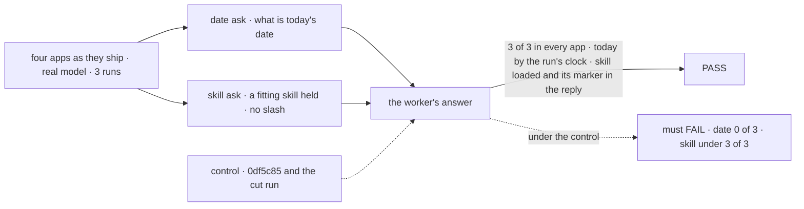
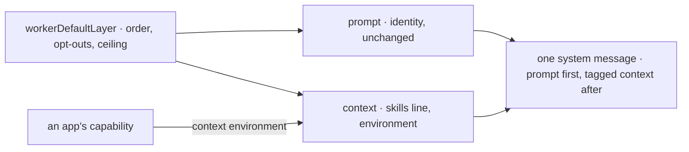

# FIX-2498 · Workers know today's date and where they are, and use the skills they hold

**Spec** · [Decisions](DECISIONS.md)

## Five people, before and after

| Someone who… | Today | After |
|---|---|---|
| **asks any worker "what's today's date?"** | Gets a guess. 0 of 3 runs right in all four apps on the [cut run](https://linear.app/fixpoint-labs/issue/FIX-2541#comment-725b3c1d) | Gets today's date, and the time zone it was read in |
| **asks a worker something about themselves or the project** ("my open work", "this repo") | Is not told the user, the project or the app | The worker is told the user, the conversation's project and the app it runs in, every turn |
| **asks a worker that holds a fitting skill, with no slash** | Sees no list of its skills unless the app turned one on. With it on, Teammates and Shift Manager still miss 1 run in 3 | The list is on, and the worker is told to load a skill that fits even partly before it answers |
| **builds a workforce app** | Writes its own date line, as Kitchen Sink's chat assistant does | Gets the date with no code, and adds a fact such as the surface through a capability it already composes |
| **wants the old prompt back** | n/a | Turns off one section, or both, with `defaults` in the worker config |

## The goal, and how we'll know it's met

**A user of any of the four apps can ask a worker for today's date and get it right, and a
worker that holds a fitting skill loads it without being told the skill's name, with no app
writing either line itself.**

| Is it the right goal? | |
|---|---|
| **The real need** | The epic's outcome: workers answer time-sensitive asks and see their skills "without each app writing that guidance itself" ([FIX-2490](../../epics/FIX-2490/SPEC.md#the-goal-and-how-well-know-its-met)). The owner kept these two sections on [Nov 12](https://linear.app/fixpoint-labs/issue/FIX-2498) |
| **Smaller, and rejected** | "Workers get a date line." Passes the date ask, leaves out the user, project and surface the epic names, and leaves the skill ask at 2 of 3 |
| **Bigger, and not this issue's** | Answers sized to the ask: cut, since sizing passed 3 of 3 everywhere without it |
| **Not done if** | The closure's wrap pass did not run · the block leaves out a user or project the turn has · the date ask passes only because a run set a switch · Kitchen Sink still carries its own date line · a worker that holds no skill pays for an empty skills line · the skill ask passes because the ask named the skill |



The check reads the worker's answer, never the prompt. The cut run is a second control, and
both asks already failed it.

| How we verify | |
|---|---|
| **Goal check** | `goals/closure-smarter-agents/` (FIX-2541), its **date** and **skill** asks, `GOAL_PASS=wrap` on each app's `run.mts`, then `verdict/run.mts`. Real model. The implementer runs it at completion; the verdict lands in the implementation PR |
| **Signal** | **Date:** every reply names today by the run's own clock and no other date, 3 of 3, in all four apps. **Skill:** the worker holds the skill, the ask has no slash, the turn loads it, the reply carries the skill's marker, 3 of 3, in all four apps |
| **Input** | The wall clock, never a seeded date; a skill marker drawn fresh each run |
| **Anti-game** | Nothing asserts on the section's text. The wrap pass sets no switch, so `skills.activateTool` must be on by default |
| **Control that must fail** | The pinned control `0df5c85`, and the cut run at `cadc16809`: **date** 0 of 3 in every app on both; **skill** short of 3 of 3 in Shift Manager on the control (1) and in Teammates and Shift Manager on the cut run (2 each). The implementation PR shows both before its PASS |

## What changes


Read the bottom of each stack: what the app and team wrote stays put, and the new blocks go
after it ([D1](DECISIONS.md#d1)).

**A worker config, to turn either off:**

```diff
  # a worker's WORKER.md frontmatter
+ defaults:
+   environment: false   # no date block for this worker
+   skillsIndex: false   # no skills list, no load tool, no load line
+ # or: defaults: false   (both off; the prompt is today's)
```

**An app that adds a fact to the environment block** (Shift Manager's surface):

```diff
  const agentFlow = defineAgentWorkerFlow({
    installation,
    ...agentTurn,
+   uses: [defineCapability({
+     name: "surface",
+     presets: { defaults: { context: () => ({ environment: "Surface: Shift Manager, in the browser" }) } }
+   })],
  });
```

**Kitchen Sink's chat assistant** (a standalone generator, not a worker) composes the same block:

```diff
  context: {
-   todaysDate: () => new Date().toLocaleDateString(),
+   environment: workerEnvironment,   // exported by @flow-state-dev/workforce
    voice: voiceContext
  },
```

**Docs:** create *What every worker is told* in `apps/docs/docs/workforce/`, right after
`workforce/built-in-worker` in the Workforce sidebar (the epic's page; FIX-2500 adds the summary
to it later). Update `built-in-worker.md` (*What a worker is told first*, and `activateTool` is
no longer "off by default"), the workforce README (the skill loader, the `defaults` key), and
`docs/architecture/workforce-default-worker-flow.md` C1 and C5. Changeset for
`@flow-state-dev/workforce` (minor).

## How it reaches the model



One module owns both sections; each renders after the worker's text, and an app line joins it.

## What stays as it is

- The identity layer's words, team and worker text, and their order (FIX-2334).
- Every per-worker length line in a `WORKER.md`. Nothing replaces them now.
- How a skill loads: the load tool, slash matching, the `active` list, the classifier switch.
- Skill descriptions. They are each app's content.

## What's already here, and the debt

| Already here | What this does with it |
|---|---|
| **Whatever tells a model the date**: Kitchen Sink's `todaysDate`, the only one (searched `todaysDate`, `today is`, `current date`, `toLocaleDateString` in `packages/`, `labs/`, `apps/kitchen-sink`) | **Replaced.** Still one way; Kitchen Sink composes the block (ER-3) |
| **Whatever lets a worker find a skill** (mechanism `skills`): the load tool and listing, slash matching, `skills.active`, the classifier | **Builds on.** The listing is on by default; nothing new loads a skill |
| Generator context keys that merge across contributors (mechanism `capability`) | **Builds on.** The block is the `environment` key; an app's capability adds to it |
| `skills.activateTool`, default off (contract C5) | **Amended.** Unset follows `defaults`; a set value wins. No skills, no cost |
| Epic [D4](../../epics/FIX-2490/DECISIONS.md#d4): the layer is "the prompt array's single default entry" | **Amended in part** by [D1](DECISIONS.md#d1): one module still, but its new sections render as tagged context after the worker's text |
| Epic [ER-1](../../epics/FIX-2490/DECISIONS.md#who-owns-what): sections, a `defaults` key, a 400-token ceiling | **Kept.** Two sections: `environment` and `skillsIndex` |
| FIX-2492's per-turn date in Kitchen Sink | **Superseded** by the exported block, in the same change |
| This issue's behaviour section | **Cut** by the owner on Nov 12. Not built |

| Adds | Existing piece considered | Why it doesn't fit / how composed |
|---|---|---|
| `workerDefaultLayer`, with the `defaults` key | `capability`; the prompt array; `workerConfigSchema` | New, as ER-1 locks: order, opt-outs, the ceiling |
| The environment block, exported | `capability` context keys; `todaysDate` | Composed: a function under the `environment` key, the shape `todaysDate` already has |
| The skills line | `skills` (`buildLoadCatalogContext`) | Composed: one line under the same `skills` key, only when the list prints |

| The debt | |
|---|---|
| **Removes** | Kitchen Sink's `todaysDate` and its test, rewritten against the block |
| **Adds** | A `defaults` key, two sections, a ceiling test. Tokens every turn, under ER-1's 400 |
| **Leaves** | The user's own time zone ([D2](DECISIONS.md#d2)). Session start time, which a block can't read. The worker flow's skills 2x2, which waits on a runtime toggle in orchestration |

**Net: flat.** One app date line goes and one shared block comes in; the per-turn tokens go up
under the ceiling.

## Sign off

**[The goal](#the-goal-and-how-well-know-its-met):** the date and skill asks pass 3 of 3 in all
four apps on the wrap pass. No ask reads the user, project or surface lines; the implementer's
tests are their only proof. If wrong: a block that gets the date right and the rest wrong passes.

**[The debt](#whats-already-here-and-the-debt), net flat:** Kitchen Sink's date line goes, a
`defaults` key and two sections come in. If wrong: every workforce worker pays tokens for
blocks few of them use.

1. **[D1](DECISIONS.md#d1) · The new blocks go after the worker's own text, and an app adds a
   line through its own capabilities.** If wrong: the date sits where the model weighs it less,
   and an app line nobody checks drifts from the block.
2. **[D2](DECISIONS.md#d2) · "Today" is the server's day, with its time zone named.** If wrong:
   a user far from the server sees yesterday's or tomorrow's date near midnight.

**Open: none.** D1 is the one to weigh: it amends the epic's D4.

Improvement · `workforce` + Kitchen Sink · small · epic FIX-2490
