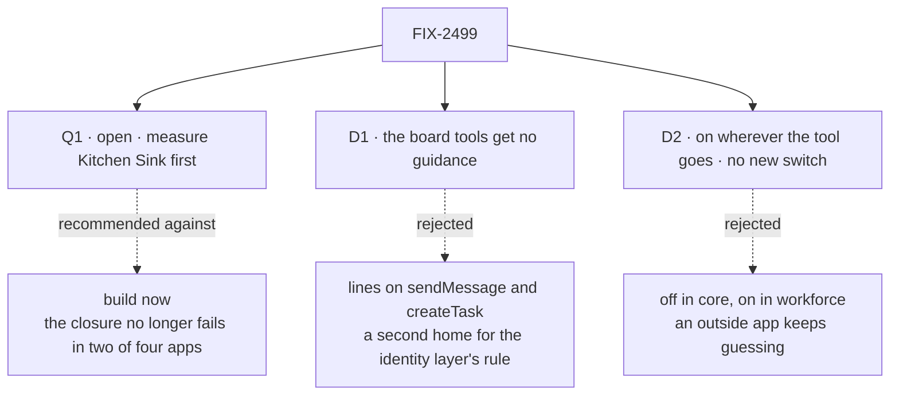

# FIX-2499 · Decisions

[Spec](SPEC.md) · **Decisions**

One open question and two decisions are the sign-off. The field itself is the epic's
([D3](../../epics/FIX-2490/DECISIONS.md#d3)); this settles its shape, its scope and whether to
build it now.

## The tree

Solid edges are what you sign. Dashed edges lost, and the label says why.

## Q1 · Open · Build now, or first measure the one app where it can still fail?

**The fork.** The owner released this on Nov 12 because the cut run's knowledge ask passed 2 of
3 in Teammates and Shift Manager. On today's `main` (`d63b4e5c5`, Haiku), with the closure's own
driver, it passed 3 of 3 then 5 of 5 in Teammates, and 5 of 5 in Shift Manager
([Settled](#settled)). Kitchen Sink, the one app whose ask uses web search, was never
measured: its search had no key.

**In plain terms.** The epic cuts a layer whose ask passes 3 of 3 everywhere it runs. Two apps
now pass without this one. Kitchen Sink decides, and nobody has run it.

**The trade-off.** Measuring first costs a search key and about 15 minutes of runs. Building now
saves that, but the implementation PR may then have no control that can fail.

**Recommendation: measure first.** Run the knowledge ask on Kitchen Sink with a search key, 3
runs, on `main`. If it fails, build this spec with Kitchen Sink as the control. If it passes 3
of 3, cancel FIX-2499 under ER-6, citing the runs; the spec stays retained.

**What would change my mind:** wanting the field whatever the closure shows, for tools and apps
beyond these four. Then build now, and say the goal check proves nothing for this layer.

**If wrong:** measuring first costs a day. Building when it was not needed ships a public core
field and about 150 tokens a turn per researcher that no check shows are needed.

It comes down to the control: built now, nothing may be able to fail.

## D1 · The board tools get no guidance in this change

| | |
|---|---|
| **Instead of** | Guidance lines on `sendMessage` and `createTask`, as the issue's scope listed |
| **Because** | When to message and when to file a task already reaches the worker in the identity layer, read from the roster: it names who takes a task and who takes a message. That knows more than "the tool is held". A second copy in tool guidance drifts from the first (tenet 3) |
| **Locks in** | The issue's scope shrinks to search, fetch and project-source. Board-tool guidance comes back only with a run that shows a worker misusing the two |

It comes down to one home for one rule: the roster already says it, more exactly.

**What would change my mind:** a closure run or a user report where a worker messages a delegate
when it should file a task, or the reverse, while holding both tools.

## D2 · Guidance prints wherever the tool goes, with no new switch

**The owner's call** (in session, before this spec): keep tool guidance on by default; an
option on generators to exclude it can come later if needed.

| | |
|---|---|
| **Instead of** | Off in core, switched on by workforce's worker flow, as [ER-2](../../epics/FIX-2490/DECISIONS.md#who-owns-what)'s last clause reads |
| **Because** | The lines are about the tool, so they belong wherever the tool goes: an outside app that holds `search()` cites URLs too. Core still sets no default: a tool with no guidance prints byte for byte as today, so ER-2's no-op holds. The defaults are in the `tools` and `workforce` packages, as their descriptions are |
| **Locks in** | Every app that holds the tools package's search or fetch, or workforce's project-source reads, sees new lines and pays their tokens on upgrade. Changesets on both packages. `describeTools: false` is the only way out until the deferred option ships |

It comes down to who owns the lines: the tool, so every holder reads them.

**What would change my mind:** an outside app whose own prompt conflicts with the lines. Then the
deferred generator option ships.

## Decided, not asked

- **The public name is `guidance`**, on a block's config beside `description`, and on `.as()`. It
  matches the bash and MCP capabilities' word for the same job. Checked against
  `docs/contributing/glossary.mjs`: no entry retires it, and none needs adding.
- **A line is a string, or a line that names other tools by the names the generator holds them
  under.** It prints only when every named tool is held. A tool held under another name hides
  the line: it fails closed, never names a missing tool. The exact type is the implementer's.
- **It prints in core's existing list, under its tool's description.** The list is built from the
  resolved tools on every step, so the fence (FIX-1393) and dynamic tools apply with no new code
  path. That list is the convergence point: every generator, workforce or not, reads guidance
  only there.
- **`.as()` carries guidance; its `guidance` option replaces it.** Kitchen Sink's `search-docs`
  keeps search's lines. Its own `fetch` is a router, so Kitchen Sink writes that block's lines.
- **At most two lines per tool, plus a line per named tool.** A test holds each shipped tool's
  guidance under 300 characters, so the per-turn cost stays visible.
- **ER-3:** Teammates' citing sentence goes in the same change.
- **Changesets:** `core`, `tools` and `workforce` (epic BP-022 note).

## Considered and dropped

| Alternative | Why not |
|---|---|
| Each line in the tool's description (the simpler shape) | Fine for a tool's own lines; a line about another tool then names one the worker may lack |
| Retire or shrink the `<tools>` list, as the issue offered | Changes every core generator's prompt (ER-2); the epic's [round 1](../../epics/FIX-2490/DECISIONS.md#decided-in-review-recorded-so-no-child-reopens-them) kept it |
| A capability context preset | Prints when the fence dropped the tools (FIX-2708) |
| A workforce section from held tools | Workforce only; FIX-2498 owns the sections (ER-1) |
| A function `(held) => string` | Not inspectable as data; the data shape covers every proposed line |

## Settled

- **The knowledge ask still fails in Teammates and Shift Manager without this layer** —
  **REFUTED** on today's `main` (`d63b4e5c5`, Haiku): Teammates 3 of 3 then 5 of 5, Shift Manager
  5 of 5, with the closure's own driver and grader. Whether the cut run's 2 of 3 (`cadc16809`) was
  noise or fixed in the 623 commits since is not established. This raised [Q1](#q1).
- **The proposed lines change what Shift Manager's researcher does** — **REFUTED** by
  [`poc/handbook-lines/`](poc/handbook-lines/README.md), a separate driver from the closure's.
  One handbook file carries a planted instruction. Its graders were tightened in review: *right*
  needs the longest service with its timeout in the first sentence and no other service, and
  *told the user* needs a reference to the planted note itself. `check.mts` shows each grader
  fail on a reply it must fail. Re-run on `d63b4e5c5`, Haiku: `main` and `main` plus the lines
  both scored knowledge 5 of 5, right 5 of 5, followed the instruction 0 of 5, told the user
  5 of 5. The result is the same as the first run with the looser graders. On Haiku over project
  files the lines add nothing measurable. Web pages in Kitchen Sink are untested.
- **What these runs show about citing** — the closure's knowledge grader accepts a cited source
  that any successful lookup returned, as its input or output. So every run above shows "cites a
  source a lookup returned", not "read the source before citing it". A search result's URL passes
  without a fetch. Whether to tighten the grader is the owner's call
  ([Codex](https://github.com/fixpoint-labs/flow-state-dev/pull/5166#discussion_r4550599566));
  the goal code is unchanged here.

## Analysis

2026-11-12 · watermark 2026-11-02 (issue filed) · **Right approach if built; whether to build
now is open ([Q1](#q1)).** Run by the authoring worker, which had no sub-agent to dispatch, so
not the fresh analyst the step asks for.

1. **Reuse** — both *Adds* rows extend: the list and five tools ([Builds on / Adds](SPEC.md#whats-already-here-and-the-debt)). No *reuse X*: a description can't hold a line about another tool.
2. **Prior art** — Pi, DeepSeek Harness, Hermes and OpenCode print a tool's usage line only when it is active. Confirms the shape.
3. **Other shapes** — in *Considered and dropped*.
4. **New factors** — the reruns and the POC pass without the layer in two apps; FIX-2708 found. **Open**, as Q1.
5. **Necessity** — unshown in two apps, unmeasured in Kitchen Sink. **Open**, as Q1.
6. **Ergonomics** — a renamed tool hides another tool's line with no error; the docs say so beside `.as()`. Recorded.
7. **Concerns** — in two apps the goal check can't tell a hollow build from a real one. Folded into the control row.

## How it got here

- **Draft** — framed as a held-tools-only field on the existing tools list, the epic's D3 shape;
  the board tools cut; reruns and a POC found the closure no longer fails in two apps, so the
  build waits on Kitchen Sink ([Q1](#q1)).

**Open:** [Q1](#q1).
