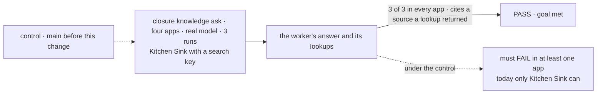
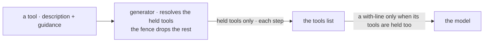

# FIX-2499 · Tools carry their own when-to-use guidance, shown only when the tool is present

**Spec** · [Decisions](DECISIONS.md)

## Six people, before and after

| Someone who… | Today | After |
|---|---|---|
| **asks Kitchen Sink's docs specialist a framework question** | Its tools say what they return, not what to cite. In the cut run, keyless, it guessed URLs and got 404s | Each tool says to cite the URL it read, and to read a result before citing it |
| **asks a researcher in Teammates or Shift Manager about the project's files** | Cites the file's path: Teammates because its WORKER.md says so, Shift Manager unprompted | The same, from the read tool's own line. Teammates' copy goes |
| **hands a worker a page or file that tells the model what to do** | Nothing in the prompt says that text is data | The tool that returned it says: data, not instructions |
| **builds a worker that holds search but not fetch** | n/a | Gets search's own line, never a line that names fetch |
| **writes a tool** | Puts usage advice in the description, read by every holder | Writes `guidance`; a line naming another tool prints only when that tool is held too |
| **uses `search()` in a generator outside workforce** | The description only | The same lines, on by default ([D2](DECISIONS.md#d2)). `describeTools: false` drops them with the list |

**Read the hardest line first.** On today's `main` the closure's knowledge ask already passes in
Teammates (8 of 8 runs) and Shift Manager (10 of 10). Only Kitchen Sink can still show this layer
is needed, and it has not been measured ([Q1](DECISIONS.md#q1)).

## The goal, and how we'll know it's met

**A worker that holds a lookup tool answers a question that needs several lookups with a source
it actually read, in all four apps, because each tool it holds says what to cite and how to
treat what it returns, and no tool it lacks is named.**

| Is it the right goal? | |
|---|---|
| **The real need** | The epic's "asks a knowledge worker → looks it up and cites what it read" ([epic](../../epics/FIX-2490/SPEC.md#five-teams-before-and-after)), with the guidance shipped by the tool, never named for a tool the worker lacks ([D3](../../epics/FIX-2490/DECISIONS.md#d3)). Kept because the cut run's knowledge ask failed ([results](https://linear.app/fixpoint-labs/issue/FIX-2541/closure-workers-in-all-four-apps-answer-time-sensitive-multi-file-and#comment-725b3c1d)) |
| **Smaller, and rejected** | "The field exists and search and fetch carry lines." True the day it merges, whether or not any answer changes |
| **Bigger, and not this issue's** | Workers that resist a hostile page. A prompt line is not a defence; isolation and approvals are. Rewriting every tool's description is out of the issue's scope |
| **Not done if** | Kitchen Sink is counted while its search has no key · the control never failed (then the layer is cut, not shipped) · an app still carries its own citing line · a line naming another tool prints without that tool |



The check reads what the worker answered and what its lookups returned, never the prompt.

| How we verify | |
|---|---|
| **Goal check** | FIX-2541's knowledge ask, `GOAL_ASKS=knowledge GOAL_HAIKU=1 GOAL_PASS=cut pnpm tsx goals/closure-smarter-agents/<app>/run.mts`, all four apps, Kitchen Sink with a search key. Run by the implementer at completion; verdict in the implementation PR. The wrap runs it again |
| **Signal** | The closure's grader: at least 3 lookups that succeeded, and a cited URL or path that one of them returned. 3 of 3 in each app |
| **Input** | Drawn per run: three handbook files with different timeouts (labs, Shift Manager); a docs question from a pool (Kitchen Sink). Another draw must pass too |
| **Anti-game** | No app's WORKER.md carries a citing line. A blocked Kitchen Sink cell is not a pass. Nothing asserts on prompt text |
| **Control that must fail** | The same command on the branch base. It must fail the signal in at least one run of one app. Teammates and Shift Manager no longer fail, so Kitchen Sink must, or the kill line cuts this ([Q1](DECISIONS.md#q1)) |

## What changes


The same list, the same descriptions. Read the green boxes: they are new, and each one sits
under the tool it belongs to. The dashed line at the bottom is the rule: it names fetch, so a
worker without fetch never sees it.

**What a tool author writes:**

```diff
  handler({
    name: "search",
    description: "Search the web for information. Returns titles, URLs, and snippets…",
+   guidance: [
+     "Cite the URL of each result you use.",
+     { with: ["fetch"], text: "A snippet is not the page: read it with fetch before you cite it." },
+   ],
```

**And the app copy it replaces** (Teammates' researcher, ER-3):

```diff
- search the web with `search` and `fetch`. Say where each fact came from: the file's path, or the
- page's URL.
+ search the web with `search` and `fetch`.
```

**Docs:** update `apps/docs/docs/fundamentals/blocks.md` (blocks as tools: `guidance` beside
`description`, and `.as()` carrying it), `apps/docs/docs/configuration/blocks.md` (a `guidance`
row; `describeTools` drops it too), `apps/docs/docs/tools/search.md` and `tools/fetch.md` (what
each tells the model), and the `core`, `tools` and `workforce` READMEs. No new page. The
workforce page FIX-2498 publishes is not this issue's.



Guidance rides the tool into the one list built from held tools, so the fence and per-step
tools apply with no new rule.

## What stays as it is

- Descriptions. A tool with no guidance prints exactly as today (epic ER-2).
- `describeTools` and its default. No new switch ([D2](DECISIONS.md#d2)).
- The board tools. Their message-or-task rule stays in the identity layer ([D1](DECISIONS.md#d1)).
- Capability context such as the bash guidance preset.

## What's already here, and the debt

| Already here | What this does with it |
|---|---|
| **Whatever already does this job** (tell the model how to use a tool it holds): `bundled-tools` descriptions; field `.describe()`; core's `<tools>` list; `capability` presets (bash, MCP guidance); `TOOL_USE_RULE` and identity's message-or-task rule; WORKER.md bodies; `skills`' `whenToUse`, the same shape for skills. Searched `whenToUse`, `guidance`, `describeTools`, `promptSnippet` in `packages/`. The eighth place such text can live | **Extends** the closest, the `<tools>` list, with a field beside `description` |
| Teammates researcher's citing sentence | **Removes** (ER-3) |
| Epic [D3](../../epics/FIX-2490/DECISIONS.md#d3), [ER-2](../../epics/FIX-2490/DECISIONS.md#who-owns-what), Adds row "a guidance field on a tool" | **Kept.** The field is the epic's; this settles its shape and scope |

| Adds | Existing piece considered | Why it doesn't fit / how composed |
|---|---|---|
| `guidance` on a block, and on `.as()` | `bundled-tools` description · `capability` context · `skills` `whenToUse` | A description prints for every holder, so a line about another tool names one it may lack. A preset is not fenced. Composed into the existing list |
| Lines on search, fetch and the three project-source reads | Their descriptions | Description says what it does; guidance says what to cite and how to treat output |

| The debt | |
|---|---|
| **Removes** | Teammates' citing sentence |
| **Adds** | A second field a tool author chooses between: what the tool does goes in `description`, what to cite and when goes in `guidance`. Permanent by design. Per-turn tokens: about 150 for a researcher holding all five tools |
| **Leaves** | Capability context that prints when the fence dropped its tools (FIX-2708) · long descriptions elsewhere |

**Net: up, slightly.** One field and per-turn tokens; one app sentence goes.

## Sign off

**[The goal](#the-goal-and-how-well-know-its-met):** cited answers in all four apps, proved by a
control that fails. If wrong: a core field ships that no check shows is needed.

**[The debt](#whats-already-here-and-the-debt), net up slightly:** one tool field and its tokens.
If wrong: authors split usage text across two fields and both drift.

- **Open: [Q1](DECISIONS.md#q1) · measure Kitchen Sink before building.** Recommended. If wrong:
  a day's delay, or a layer built on 2-of-3 noise.
1. **[D1](DECISIONS.md#d1) · the board tools get no guidance.** If wrong: workers misuse
   message and task, and the fix lands in a second place later.
2. **[D2](DECISIONS.md#d2) · on wherever the tool goes, no new switch.** The owner's. If wrong:
   an outside app's prompt gains lines it did not ask for.

Q1 is the one to weigh.

Feature · `core` + `tools` + `workforce` + `labs/teammates` + `apps/kitchen-sink` · small · epic FIX-2490
