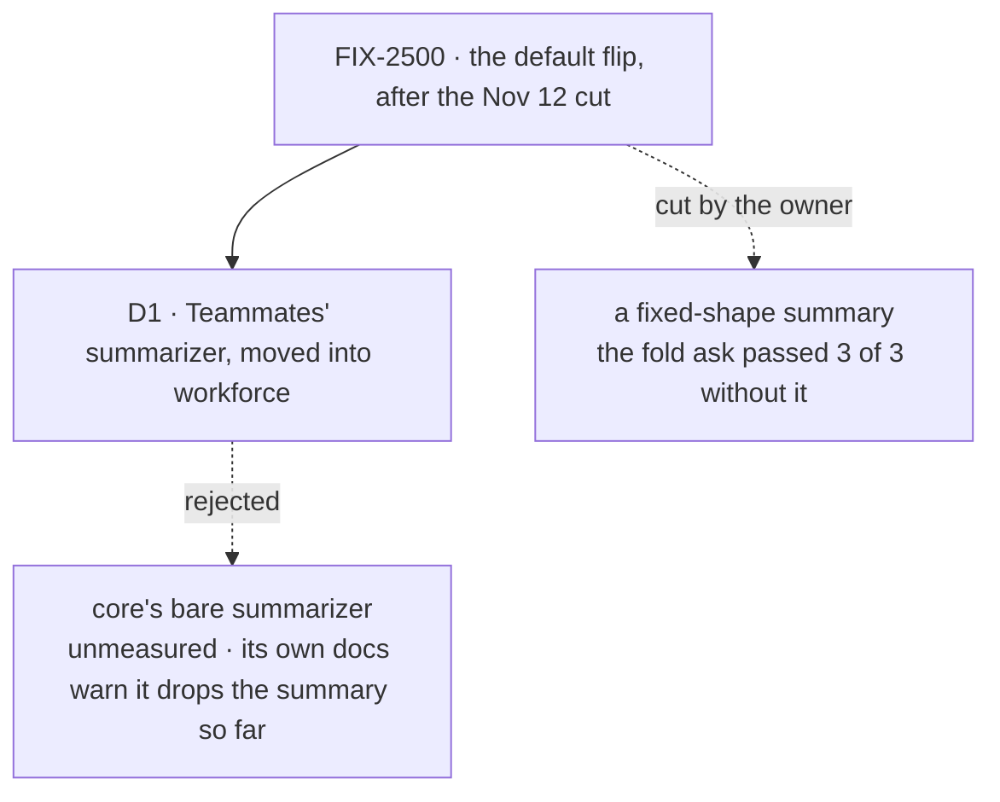

# FIX-2500 · Decisions

[Spec](SPEC.md) · **Decisions**

One decision is the sign-off surface. The rest is context for it, and the engineering calls
the implementer must not re-decide.

## The tree

Solid edges are what you're signing. Dashed edges lost, and the label says why.

## D1 · The default summary is Teammates' summarizer, moved into workforce as it is

| | |
|---|---|
| **Instead of** | Core's `summarizer` with no objectives, the shortest default |
| **Because** | Teammates' summarizer is what passed the fold ask 3 of 3 on the cut run, so it is the only summary this epic has measured. Core's own docs say a summarizer without its first objective sometimes summarizes only the newer turns and drops the summary so far on a small model. The owner cut the fixed shape, not the summary: moving proven lines is not new content (ER-6) |
| **Locks in** | Every built-in worker's summary keeps every name, date, code and number word for word, and replaces the summary so far rather than appending to it. An app that wants other wording brings its own summary. Workforce now owns three lines of summarizer wording |

It comes down to what the cut run measured: the bare summarizer was never run on this ask.

**What would change my mind:** core's bare summarizer passing the fold ask 3 of 3 in both labs.
Then the three lines are dropped.

## Decided, not asked

- **Where it is set:** in the worker turn the `agent`, `coordinator` and error-reporter flows
  share (`agentWorkerTurn`), so a worker built with no options, or without an installation,
  folds. Not core ([ER-2](../../epics/FIX-2490/DECISIONS.md#who-owns-what)), and not the prompt
  array.
- **It is a section of `workerDefaultLayer`, in the context half** (ER-1;
  [FIX-2498's D1](https://github.com/fixpoint-labs/flow-state-dev/pull/5163) asks which half).
  Core already renders the summary as an `<earlier-conversation>` context section. The section
  carries its fold the way `skillsIndex` carries its tool. Its content is outside the 400-token
  ceiling, as ER-1 says.
- **One reader decides both halves**, the fold and the summary in the context: the layer's
  opt-out reader, the convergence point. Gating one half alone breaks: core's summary refuses to
  render once turns have left the window and no fold has run. The fold is a `.tapIf` on that
  reader; the context half is a per-turn `uses` entry, with the resource declared statically.
- **The opt-out is `defaults: { historySummary: false }`,** named after the thing it controls,
  like `date` and `skillsIndex`. `defaults: false` turns it off with the rest, and the
  docs say so: it also stops keeping the thread. Absent, `{}` or `true` means on (BP-030).
  FIX-2498 owns the key and its validation, and blocks this implementation.
- **An app's own summary replaces the default:** fold, context section and all. No refusal and
  no second summary. Matched on core's `historySummaryStateSchema`, by reference, in the flow's
  one reading of `uses` (`catalogWorkerCapabilities`). A dynamic `uses` entry, or a summary
  not built from core's piece, is not seen and doubles; the docs say so.
- **It runs on the worker's own model,** the one it answers with. Not `intent/utility`: some
  apps map no such intent, and a failed fold is only a warning each turn. The price is in the
  debt: an Opus worker's fold is an Opus call.
- **The resource keeps the name `historySummary`.** FIX-2541's fold precondition, Teammates'
  adapter and any divider in a UI read it by that name.
- **Teammates deletes its wiring in the same change** (ER-3), and reads the same resource it
  reads today.
- **A conversation already past its window when this ships** folds on its next turn with
  `complete: false`, core's mark for turns already lost. No error; nothing is recovered.
- **Switched off after folding,** the summary leaves the prompt and history reads the whole
  window again. The stored summary is kept. Switched back on, folding resumes at its mark.
- **A short conversation pays one store read per turn,** the fold's check of the session's
  turns, and no model call.
- **A workforce changeset** (BP-022): a default behaviour change for every outside workforce app.

## Considered and dropped

| Alternative | Why not |
|---|---|
| The fixed-shape summary: eight sections, files touched, "tools still active" | Cut by the owner, Nov 12. The fold ask passed without it |
| An app-level switch on `defineAgentWorkerFlow` | Epic D4 refuses a new flow option. An app's own summary covers "different"; the worker key covers "off" |
| Refuse a flow that brings its own summary while the default is on | With no app-level switch, an app could then never keep its own summarizer |
| Fold in core's generator, for every app | ER-2: core gains mechanism, not defaults |
| Leave it opt-in and document it | The owner chose "on by default, opt-out" (epic D1). The frameworks the analysis checked are opt-in; the harnesses the issue surveyed are not, and workforce is our harness layer |
| The proven objectives as a core factory, for every caller | Fixes the trap outside workforce too, and is a no-op for today's callers. Dropped on scope, not on ER-2: the owner cut this issue to the default. It moves Teammates' copy, so the count of copies stays three. Raised to the epic as its own issue |
| `intent/utility` where the app maps it, else the worker's model | Cheaper folds, but workforce can't tell at build time whether an intent resolves, so a miss becomes a warning every turn |

## Analysis

2026-11-12 · watermark 2026-11-04 (the epic's analysis) · **Right approach, with changes.**
A forked `analysis` run, with `reuse-review`, on the first draft.

1. **Reuse** — the summary extends `historySummary`; the objectives move. Three verdicts:
   reuse FIX-2498's opt-out reader, not a second one; match an app's own summary on core's state
   schema in the flow's one reading of `uses`, not by name; and the summary is a section of
   `workerDefaultLayer`, as ER-1 says. All folded. See
   [Builds on / Adds](SPEC.md#whats-already-here-and-the-debt).
2. **Prior art** — LangChain's summarization middleware, the OpenAI Agents SDK's compaction
   session and Mastra's observational memory are opt-in, often on a cheaper model. The
   harnesses the issue surveyed are on by default. Recorded.
3. **Other shapes** — the proven objectives as a core factory. Recorded in *Considered and
   dropped*, on scope.
4. **New factors** — FIX-2498's spec (#5163) asks which half the summary uses; answered. FIX-2688
   wants one cache break per batch: a fold moves the history start less often than a full
   window does. FIX-2636 and FIX-2681 put documents in history, so a fold can be large.
   Recorded in the debt.
5. **Necessity** — earns its place: nothing else makes the lab's wrap ask pass.
6. **Ergonomics** — key renamed `historySummary` (folded); `defaults: false` also stops the
   summary, a docs line (recorded).
7. **Concerns** — the lab is measured only at the wrap: the implementation PR runs its fold ask
   once (folded). The fold's model cost is now priced in the debt (folded).

## How it got here

- **Draft** — framed as the default flip the Nov 12 cut kept; the summary Teammates proved,
  installed in workforce's shared worker turn, off per worker through ER-1's `defaults` key.
- **Analysis** — the summary became a context section of `workerDefaultLayer` with that layer's
  reader, the key `historySummary`, and a named match for an app's own summary, because the
  first draft read the opt-out twice and matched an app's summary on nothing named.

**Open: none.**
