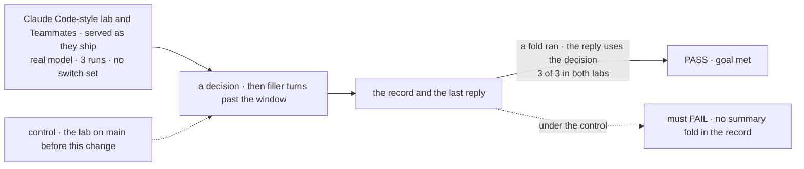
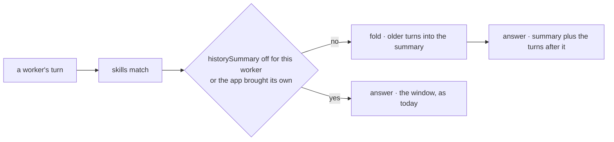

# FIX-2500 · Long conversations keep the thread: workers summarize older turns by default

**Spec** · [Decisions](DECISIONS.md)

## Five people, before and after

| Someone who… | Today | After |
|---|---|---|
| **talks to a worker for a long time** in the Claude Code-style lab, Kitchen Sink or Shift Manager | Past 50 turns the oldest drop out, and the worker forgets what was decided at the start | Older turns go into a running summary before they drop, and an early decision is still used |
| **talks to a Teammates worker for a long time** | Keeps the thread, because the lab wires its own summary | The same summary, now from workforce. The lab's own wiring is gone |
| **writes a worker that must not summarize** (cost, or what gets written down) | Nothing to do: nothing summarizes | Writes `defaults: { historySummary: false }` in its `WORKER.md`. `defaults: false` turns it off with every other default |
| **runs an app that brings its own history summary** | Its own summary | Its own summary still, and no second one beside it |
| **runs an app that relied on there being no summary** | Old turns drop; no extra model calls | Past about 38 turns, one extra model call per 12 turns, on the worker's own model, and a summary in the worker's context. Off per worker in one line |

The owner cut the fixed-shape summary on Nov 12, after the fold ask passed 3 of 3 on Teammates
without it ([the cut run](https://linear.app/fixpoint-labs/issue/FIX-2541/closure-workers-in-all-four-apps-answer-time-sensitive-multi-file-and#comment-725b3c1d)).
This spec is the default flip the epic's cut rule keeps ([ER-6](../../epics/FIX-2490/DECISIONS.md#who-owns-what)).

## The goal, and how we'll know it's met

**In every workforce app, a decision made early in a long conversation is still used after
older turns are summarized, with no app wiring, and any worker can turn that off in one line.**

| Is it the right goal? | |
|---|---|
| **The real need** | The epic's "keeps the thread" ([Q1](../../epics/FIX-2490/DECISIONS.md#q1), ask 3): a decision made before a summary fold is used after it, in both labs. The owner's Nov 12 cut keeps "on by default, opt-out" |
| **Smaller, and rejected** | "The default is on in the code." True the moment it merges, and it passes while the Claude Code-style lab, the one app that has never folded, still loses the thread |
| **Bigger, and not this issue's** | Compaction near the context limit, overflow retry and a manual compact: [FIX-2174](https://linear.app/fixpoint-labs/issue/FIX-2174), under epic FIX-2688. The fixed-shape summary: cut |
| **Not done if** | The lab's fold ask did not run · it passed with a switch set · Teammates still wires its own summary · a worker with `historySummary: false` still makes the extra call |



The check reads the run record and the worker's reply, never the summary's text. On `main` the
lab has no fold, so the same ask must fail its precondition there first.

| How we verify | |
|---|---|
| **Goal check** | FIX-2541's fold leg, `goals/closure-smarter-agents/{claude-code-style,teammates}/run.mts` with `GOAL_ASKS=fold GOAL_PASS=wrap`. The closure runs it at the epic's wrap. The implementer runs it once in the implementation PR too, on Haiku (`GOAL_HAIKU=1`), and posts both verdicts there |
| **Signal** | Per run: a fold is in the run record before the last ask, and the reply names the decision and not the option it replaced. 3 of 3 in each lab |
| **Input** | FIX-2541's fold fixture, a fresh draw per run. Any decision and filler must pass |
| **Anti-game** | The run sets no switch (`wrap`). Nothing asserts on the summary's words. A run with no fold fails, never passes |
| **Opt-out** | A workforce test, the implementer's: a worker with `defaults: { historySummary: false }` past its window makes no summary call and has no summary in its context; one with no key folds; an app that brings its own summary gets exactly one |
| **Control that must fail** | The Claude Code-style lab on `main` before this change (`GOAL_COMMIT=<that main sha>`, same pass): FAIL on *no summary fold in the record*. The implementation PR shows it before the PASS |

**How the Claude Code-style lab is covered.** It has no fold on `main`, so FIX-2541 runs its
fold ask only at the wrap, and this issue's cut was read on Teammates alone
([the alignment](../../epics/FIX-2490/DECISIONS.md#on-fix-2541s-alignment)). Only this default
can make that ask pass, so the implementation PR runs it early, to find a failure before the
wrap. Kitchen Sink and Shift Manager run no fold ask (epic Q1): they get the same shared turn,
and the workforce test covers it there.

## What changes

![Today and after, as a worker's turn: today the history window drops turns past 50 and only Teammates folds, by its own wiring. After, workforce's shared worker turn folds older turns into a summary before the answer, by default, for every worker on the agent, coordinator and error-reporter flows. It is a section of workforce's default layer, in the context. Three paths skip it: a worker's defaults historySummary false, defaults false, or an app that brings its own summary, which replaces the default. Teammates' wiring is removed](figures/what-changes.svg)

Read the middle lane: the fold now sits in the turn every built-in worker flow shares. The
bottom lane is the three ways out.

**What a worker file writes to turn it off:**

```diff
 ---
 description: Answers billing questions.
+defaults:
+  historySummary: false
 ---
```

**What Teammates stops writing:**

```diff
-  const earlier = utility.historySummary({ summarize: utility.summarizer({ ... }) });
   defineAgentWorkerFlow({
-    uses: [mem.capability.presets({ ... }), earlier.capability, consultSessionsCapability(installation), ...],
-    beforeAnswer: earlier.fold,
+    uses: [mem.capability.presets({ ... }), consultSessionsCapability(installation), ...],
```

**Docs:** update the workforce page *what every worker is told* (FIX-2498 creates it) with the
summary: what it keeps, when it folds, what it costs, how to turn it off. Update
`apps/docs/docs/workforce/built-in-worker.md` (the history line and the `beforeAnswer` and
`uses` rows: an app's own summary replaces the default), one line in
`apps/docs/docs/advanced/generator-context.md` → *Summarizing turns past the window*, and the
same rows in `packages/workforce/README.md`. No new page.



`workerDefaultLayer`'s opt-out reader decides both halves, the fold and the summary in the
context. Nothing below the worker turn learns the default exists.

## What stays as it is

- Core's `historySummary` and `summarizer`: when a fold happens, the quarter-window batch, the
  failure rescue. No core change ([ER-2](../../epics/FIX-2490/DECISIONS.md#who-owns-what)).
- The history window, 50 turns by default.
- Worker flows that are not built on the shared turn: harness coding threads, Shift Manager's
  EM, any app's own worker flow. They compose a summary themselves, as today.
- Kitchen Sink's chat assistant, a standalone generator. Memory's tiers.

## What's already here, and the debt

| Already here | What this does with it |
|---|---|
| Core's `historySummary` and `summarizer` (`packages/core/src/utility/`, FIX-1613) | **Builds on.** The default is one instance of it. FIX-1613's "the engine knows nothing about summaries" is kept |
| Teammates' summary (`labs/teammates/host.mts`) | **Removes**, per [ER-3](../../epics/FIX-2490/DECISIONS.md#who-owns-what). Its three summarizer objectives move to workforce ([D1](DECISIONS.md#d1)) |
| workforce's `beforeAnswer` and `uses` | **Leaves alone.** Still how an app brings its own summary, which now replaces the default |
| FIX-2498's `workerDefaultLayer` and its `defaults` key ([ER-1](../../epics/FIX-2490/DECISIONS.md#who-owns-what); in review on [#5163](https://github.com/fixpoint-labs/flow-state-dev/pull/5163), not on `main`) | **Extends** with a third section, `historySummary`, in the context half. That answers FIX-2498 D1's "prompt or context": context, where core already puts `<earlier-conversation>` |
| The agent turn's note "older turns fall out rather than being summarized" | **Superseded** |
| Whatever keeps one conversation's earlier turns in view | **One way, and this turns it on.** Core's `historySummary` (under mechanism `utility-block`). Memory's tiers work across conversations, `consultSessionHistory` reads another one, FIX-2174 is not built. Searched `historySummary`, `summar`, `compact`, `fold`, `earlier` across `packages/` |
| Epic: "FIX-2500 reuses `historySummary`'s `outputSchema` and `objectives`" ([Adds](../../epics/FIX-2490/SPEC.md#whats-already-here-and-the-debt)) | **Amended by the cut.** `objectives` are reused; `outputSchema` stays core's |

| Adds | Existing piece considered | Why it doesn't fit / how composed |
|---|---|---|
| A `historySummary` section, with its fold | `utility-block` · `historySummary`; FIX-2498's `workerDefaultLayer`; workforce's `beforeAnswer` and `uses` | Composed: the instance an app would have wired, as a section of the one default layer, carrying its fold the way `skillsIndex` carries its tool. Its opt-out goes through that layer's reader |
| The rule that an app's own summary replaces it | Capability names; `catalogWorkerCapabilities`, the flow's one reading of `uses` | Matched on core's state schema (`historySummaryStateSchema`), in that one reading. A name match fails both ways: the same name refuses to build, another name doubles |
| Three summarizer objectives in workforce | Teammates' summarizer; `summarizer`'s `objectives` | Moved, not written: they leave the lab |

| The debt | |
|---|---|
| **Removes** | Teammates' summary wiring. The agent turn's stale note |
| **Adds** | Every long conversation on a built-in worker flow pays one model call per 12 turns past about 38, on the worker's own model, reading up to 12 turns, documents included. Permanent by design (epic [D1](../../epics/FIX-2490/DECISIONS.md#d1)); an app that wants a cheaper model brings its own summary. One rule that steps aside for an app's own summary. Permanent, with a stated limit: a summary passed as a dynamic `uses` entry, or not built from core's piece, still doubles |
| **Leaves** | FIX-2174's mechanics. No app-wide off switch for the defaults: epic [D4](../../epics/FIX-2490/DECISIONS.md#d4) refuses a flow option, so an app turns it off worker by worker. Core's summarizer still needs its first objective on a small model, copied by the docs example and the `history-window` goal; this moves Teammates' copy, so the count stays three (not filed: raised to the epic). FIX-2688's one-cache-break budget: a fold moves the history start once per 12 turns, where a full window moves it every turn |

**Net: flat in code, up in model calls for long conversations.** One app's wiring goes; one
default and one opt-out name come in.

## Sign off

**[The goal](#the-goal-and-how-well-know-its-met):** an early decision survives a fold in both
labs, with no switch set, and one line turns it off. If wrong: the default ships and the
Claude Code-style lab still loses the thread, and we learn that at the wrap.

**[The debt](#whats-already-here-and-the-debt), flat in code, up in calls:** Teammates' wiring
goes; long conversations pay a call per 12 turns. If wrong: every long conversation pays for a
summary its app never wanted.

1. **[D1](DECISIONS.md#d1) · The default summary is Teammates' summarizer, moved into workforce
   as it is.** If wrong: the lab's fold ask fails at the wrap, or every worker keeps detail it
   should have let go.

**Open: none.** D1 is the one to weigh. Reasoning, what lost and the engineering calls:
[DECISIONS.md](DECISIONS.md).

Improvement · `workforce` + `labs/teammates` · small · epic FIX-2490, also under FIX-2688
