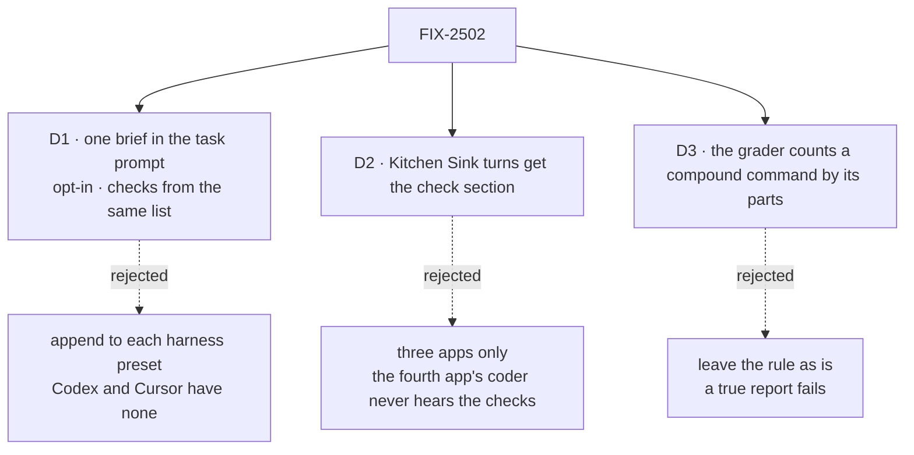

# FIX-2502 · Decisions

[Spec](SPEC.md) · **Decisions**

What was considered, what was chosen, why, and what each choice locks in. Three decisions are
the sign-off surface. D3 is about the closure's grader, not the product, and ships separately.

## The tree

Solid edges are what you're signing. Dashed edges lost, and the label says why.

## D1 · One brief in the task prompt, opt-in, and its check section fed by the list the app runs

| | |
|---|---|
| **Instead of** | Appending the brief to each harness's system preset (the epic's Adds row as worded), or each app keeping its builder and adding a "run the checks" line |
| **Because** | Only Claude Code takes an appended system prompt; Codex and Cursor, which every lab offers as a coder, take only the prompt. One helper means one place a brief changes. A check list typed into the prompt by hand is a second list beside `commandCheck`'s, which ER-4 forbids; one option on the same check options makes the two the same value |
| **Locks in** | harness-manager owns the words of a coding brief: the task, the app's parts, where to work, the report shape, the check section. Both pieces are opt-in, so a harness-manager user outside our apps sees no change (FIX-2369 ER-2, kept). An app that wants a different brief writes its own `buildPrompt`, as today |

It comes down to Codex and Cursor: an appended system prompt never reaches them.

**What would change my mind:** every harness we ship taking an appended system prompt. Then the
brief could move there and stay out of the run's visible turn.

## D2 · Kitchen Sink's coding sessions get the check section on every turn

| | |
|---|---|
| **Instead of** | The issue's scope as filed: Shift Manager and the two labs only |
| **Because** | The epic's goal is the coder ask in every app, and Kitchen Sink's coder is a harness session, not a harness-manager task, so a task brief never reaches it. It already runs checks after each turn (`verify`) and never tells the agent which. Same option, same list, on the session's turn |
| **Locks in** | Every turn of a Kitchen Sink coding session whose host names checks carries a short section, including a turn that only asks a question. It says "if you change code"; a question turn pays the tokens and ignores it |

It comes down to the epic's goal: without it Kitchen Sink can't pass the coder ask.

**What would change my mind:** the coder ask counting only where a task is handed over. Then
Kitchen Sink drops out of the leg, and this is not needed.

## D3 · The closure's coder grader counts a compound command by its parts

| | |
|---|---|
| **Instead of** | Today's rule, where a whole code span must match a recorded check |
| **Because** | The cut run failed a true report: Claude Code ran `node check.mjs; echo "exit code: $?"`, the app recorded `node check.mjs` and it passed, and the grader called the span unrun. The POC shows the rule also fails `node check.mjs 2>&1` and `pnpm test \| tail -20`. Splitting at shell separators and grading each part that reads as a command keeps every hollow case failing: an unrecorded `pnpm lint`, alone or after `&&`, still fails |
| **Locks in** | FIX-2541's goal.md rule reads "a command part in a code span" instead of "a code span". A recorded check named inside plumbing passes. Owned by FIX-2541 (epic ER-7), so it ships as a `fix(goals)` change with a *decided in build* line there, not in the product PR |

It comes down to the Kitchen Sink report: it was true, and the rule failed it.

**What would change my mind:** a report seen naming a recorded check inside a compound whose
other command part did not run, passing anyway. The POC's `&&` case says the rule catches that;
a real run that slips past would reopen it.

## Decided, not asked

- **One list's convergence point is the check options object.** Both writers of the check
  section (`commandCheck`'s prompt, `harnessSessionFlow`'s turn) read `commands` from it; no
  helper argument takes a list. A resolver now also runs at prompt time, before the checkout
  exists, so the Claude Code-style lab's completion-only "changed files" filter must not hide
  the list there.
- **The check section says:** these commands run after you and decide done; run them first,
  and name each by its command with its result. The report shape adds what changed and what
  you could not check.
- **Conventions are the app's part** (Shift Manager: skills and standing brief). The default is
  one line pointing at the repository's `AGENTS.md` or `CLAUDE.md`; the helper reads no file.
- **The cut run's Kitchen Sink tool-permission errors** are traced in the leg a run: a driver
  cause is FIX-2541's, an app cause a Kitchen Sink bug.
- **Collision:** open PR #5156 edits `asks.mts` and `graders/run.mts`; the goal-code item
  rebases on it.

## Considered and dropped

| Alternative | Why not |
|---|---|
| `commandCheck` adds the check section by default | Changes the prompt of every harness-manager user who wraps a phase, which the epic keeps neutral (FIX-2369 ER-2) |
| The helper takes a `checks` list | A second place the list is typed; drifts from what runs (ER-4) |
| A brief per harness | Three texts for one job; the brief says nothing harness-specific |
| Lowering the grader to "names any recorded check" | Loses the false-success catch for an unrun command, which the record exists to give |

## Settled

- **The grader fails a true compound report today** — **CONFIRMED** by
  `poc/compound-check-span/run.mts` (`pnpm tsx specs/issues/FIX-2502/poc/compound-check-span/run.mts`):
  today's `gradeCoder` refuses the Kitchen Sink report with "names `node check.mjs; echo "exit
  code: $?"`, which did not run". The proposed rule passes it, the redirect and the pipe, and
  still fails all three hollow cases. Seven of seven cases as expected; the control ran red.

## Analysis

2026-11-12 · watermark 2026-11-09 (the cut run) · **Right approach, scope widened.**

Run inline by the author, not a fresh analyst: this dispatch had no sub-agent tool.

1. **Reuse** — every Adds row composes an existing piece ([Builds on / Adds](SPEC.md#whats-already-here-and-the-debt)).
2. **Prior art** — Codex and Cline tie completion to observed evidence (the epic's comparison).
3. **Other shapes** — a system-prompt append and a default-on section; both dropped.
4. **New factors** — the cut run; FIX-2498's behaviour section was cut, so the brief's report
   shape is the only "finish with evidence" a coder gets. Folded.
5. **Necessity** — 2 of 12 coder runs passed.
6. **Ergonomics** — one call and one option line per app.
7. **Concerns** — Teammates had no checks at the wrap; Kitchen Sink was outside the issue's
   scope. Both folded (the goal-code item, D2).

## How it got here

- **Draft** — framed as the closure's coder ask failing in all four apps; one harness-manager
  brief in the task prompt, its check section fed by the check options, reaching Kitchen Sink's
  sessions too; the grader's compound rule and Teammates' wrap checks split out as goal code
  under FIX-2541.

**Open: none.**
