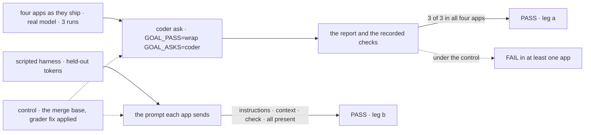
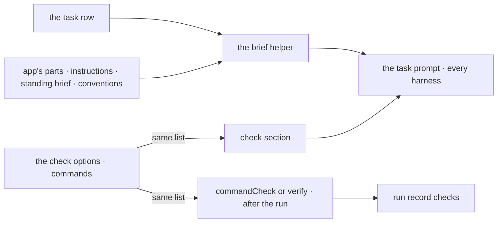

# FIX-2502 · One coding brief for every harness worker: instructions, context, conventions, and a check before done

**Spec** · [Decisions](DECISIONS.md)

## Five people, before and after

| Someone who… | Today | After |
|---|---|---|
| **edits a coder's WORKER.md in the Claude Code-style lab** | The run never sees it, nor the task's context | The run starts from both |
| **hands a coder a task in any app** | The coder stops when it thinks it is done; 2 of 12 cut-run coder runs passed | The brief names the checks the app runs after, by command, and says they decide done. The report names each with its result |
| **types a change into Kitchen Sink's Claude Code mode** | The app runs checks after the turn; the agent is never told which | Each turn names them, so the agent runs them first |
| **uses Codex or Cursor as a coder** | Shift Manager's report rule reaches Claude Code only | Gets the same brief: it is the task prompt |
| **builds the next harness-manager app** | Writes a fourth coding prompt by hand | Calls one helper with its own parts, and turns the checks on in one line |

## The goal, and how we'll know it's met

**A coder in each of the four apps, handed a coding task, works from its worker's instructions
and the task's full context, and ends with a report that names each check the app ran, by
command, with the result the app recorded.**

| Is it the right goal? | |
|---|---|
| **The real need** | The epic's coder row: "one brief in every app: the worker's instructions, the task, the conventions, and the checks it ran with their result" ([epic](../../epics/FIX-2490/SPEC.md#five-teams-before-and-after)). The coder ask scored 1, 0, 1 and 0 of 3 ([cut run](https://linear.app/fixpoint-labs/issue/FIX-2541/closure-workers-in-all-four-apps-answer-time-sensitive-multi-file-and#comment-725b3c1d)) |
| **Smaller, and rejected** | "Three prompts become one helper." A refactor: the coder fails stay, and Kitchen Sink is never reached |
| **Not done if** | The coder ask passes only because the grader was loosened · Teammates has no checks at the wrap · an app keeps its own coding prompt or report rule (ER-3) · the brief names checks the app does not run (ER-4) |



Leg a reads the report against what the app recorded; leg b reads the prompt each app sends.
Neither looks for a phrase in the brief.

| How we verify | |
|---|---|
| **Goal check** | **a** The closure's coder ask ([FIX-2541](../FIX-2541/SPEC.md)): `GOAL_PASS=wrap GOAL_ASKS=coder pnpm tsx goals/closure-smarter-agents/<app>/run.mts` per app, then `verdict/run.mts`; real model. **b** A model-free goal per app on the scripted harness, shaped like `goals/devforce-lab/it-commits-from-the-workers-own-file`. Run by the implementer; verdicts in the implementation PR |
| **Signal** | **a** 3 of 3 in each app by the closure's coder rule. **b** The prompt holds three held-out tokens, planted in the WORKER.md body, the task's context and a check command (Kitchen Sink: the check only) |
| **Input** | Fresh tokens and check each run; any other task and list must pass too |
| **Anti-game** | Leg a never reads the brief. Leg b's tokens live in the app's files and task, so hard-coding fails the next draw |
| **Control that must fail** | The merge base, with the [goal-code item](#the-goal-code-item-separate) applied: **a** fails *names no check the run recorded* in at least one app; **b** fails *the prompt lacks* the instructions token in the Claude Code-style lab and the check token in Teammates |

## What changes


Every red cell on the left comes from one place on the right; an app supplies only its own parts.

**What an app writes:**

```diff
  const phase = commandCheck(
    {
      phase: "code",
-     buildPrompt: ({ task, feedback }) => [task.goal, "Work in this directory only…", feedback].join("\n\n"),
+     buildPrompt: (run) => codingBrief(run, { instructions: workerConfigOf(run.ctx).instructions }),
      isDone: ({ stopReport }) => stopReport === "finished",
    },
-   { commands: projectChecks(), timeoutMs: CHECKS_TIMEOUT_MS },
+   { commands: projectChecks(), timeoutMs: CHECKS_TIMEOUT_MS, inBrief: true },
  );
```

```diff
  // Kitchen Sink, lib/harness-session-flow.ts
- verify: { commands: [...checks], timeoutMs: HARNESS_CHECKS_TIMEOUT_MS },
+ verify: { commands: [...checks], timeoutMs: HARNESS_CHECKS_TIMEOUT_MS, inBrief: true },
```

`codingBrief` and `inBrief` are placeholders; the implementer names them.

**Docs:** update `packages/harness-manager/README.md` (a *Briefing a coding run* section after
*What a phase supplies*; one line each under *Checking the work with commands* and *A harness as
a session*) and extend `apps/docs/docs/orchestration/harness-manager.md` the same way. No new
page. A `@flow-state-dev/harness-manager` changeset.



One `commands` value feeds what the coder reads and what decides done, so they cannot drift
(epic [ER-4](../../epics/FIX-2490/DECISIONS.md#who-owns-what)).

### The goal-code item, separate

Its own `fix(goals)` change under FIX-2541, which owns how the closure asserts (ER-7), before
the wrap; not in the product change.

- **A compound command counts by its parts** ([D3](DECISIONS.md#d3),
  [POC](poc/compound-check-span/run.mts)). The grader failed a true Kitchen Sink report naming
  `` `node check.mjs; echo "exit code: $?"` ``. Each command part of a span must be recorded;
  `echo`, `tail` and redirects are ignored.
- **Teammates' checks are fixture data on every pass.** Today they are set on the control and
  the cut run only, so the wrap's Teammates coder has no record and fails whatever the brief
  does. Kitchen Sink's and the project rows' checks already are (`goal.md` → *Switches*).

## What stays as it is

- **Each harness's preset** (ER-5), and **what decides done**: `commandCheck` and `verify` still
  decide; the report is never the verdict (epic D5).
- **The manager's own sections** (issue spec, held work, steers) and every `isDone`.
- **A harness-manager caller that sets neither the helper nor the option.**

## What's already here, and the debt

| Already here | What this does with it |
|---|---|
| **Whatever builds a coding run's prompt** (the job): the Claude Code-style lab's `codePhase`, Teammates' `PHASE`, Shift Manager's `buildWorkerPrompt` and `buildAnswerPrompt`. No mechanism row fits (searched `mechanisms.yaml` for `prompt`, `brief`, `harness`; `buildPrompt` across `packages/`, `labs/`, `apps/`). Closest: Shift Manager's, all but the checks. The helper is a fifth way that replaces the other four | **Replaces** them (ER-3) |
| Shift Manager's appended system text (FIX-2494), Claude Code only | **Removes** it; the preset stays (ER-5) |
| `CommandCheckOptions`, shared by `commandCheck` and `verify` | **Extends** with one opt-in option (FIX-2369 ER-2 kept) |
| `PromptRunContext` (`task`, `answers`, `feedback`) | **Builds on** |
| Epic [D5](../../epics/FIX-2490/DECISIONS.md#d5), ER-3 to ER-5 | **Kept**; ER-4 by construction |
| The epic's Adds row, "appended to the harness preset" | **Amended in wording** by [D1](DECISIONS.md#d1): the prompt, so Codex and Cursor get it |
| FIX-2541's rule, "only a code span can name a check the record lacks" | **Amended in part** by [D3](DECISIONS.md#d3): a span's command parts |

| Adds | Existing piece considered | Why it doesn't fit, or how it is composed |
|---|---|---|
| One brief helper in harness-manager | Shift Manager's `buildWorkerPrompt`; `PromptRunContext` | Composed: Shift Manager's task section lifted, the app's parts passed in |
| An opt-in check-section option on the check options | A `checks` argument to the helper; `commandCheck` adding it by default | One list by construction; a default would change every caller's prompt ([D1](DECISIONS.md#d1)) |
| Kitchen Sink's turns get the check section | `harnessSessionFlow`'s issue-spec turn section | Same seam, same option ([D2](DECISIONS.md#d2)) |

| The debt | |
|---|---|
| **Removes** | Four hand-built coding prompts, Shift Manager's appended rule, the per-app copies of the feedback and answers sections |
| **Adds** | One helper and one option. The check section costs tokens on every run and Kitchen Sink turn that sets it. Permanent by design |
| **Leaves** | Per-worker harness routing in each app (FIX-2467). Kitchen Sink's untraced tool-permission errors in the cut run ([decided, not asked](DECISIONS.md#decided-not-asked)) |

**Net: down.** Four builders and one rule go; one helper and one option come in.

## Sign off

**[The goal](#the-goal-and-how-well-know-its-met):** the coder ask 3 of 3 in all four apps at the
wrap, and each app's prompt carries its own parts. If wrong: coders pass a script and still skip
the checks a person cares about.

**[The debt](#whats-already-here-and-the-debt), net down:** four builders go, one helper and one
option come in. If wrong: apps work around the helper and a new builder appears.

1. [D1](DECISIONS.md#d1) · one brief in the task prompt, opt-in, with the check section fed by
   the same list the app runs. If wrong: Codex and Cursor coders keep a weaker brief, or every
   harness-manager user's prompt changes unasked.
2. [D2](DECISIONS.md#d2) · Kitchen Sink's coding sessions get the check section on every turn. If
   wrong: Kitchen Sink stays the one app whose coder never hears the checks, or every turn of a
   chat pays for a section it rarely needs.
3. [D3](DECISIONS.md#d3) · the closure counts a compound command by its parts. **The one to
   weigh**: it changes the proof the owner approved. If wrong: a report passes on a command it
   did not run, or a true report keeps failing.

**Open: none.**

Feature · `harness-manager` + three apps + Kitchen Sink, plus a goal-code fix under FIX-2541 · medium · epic FIX-2490
