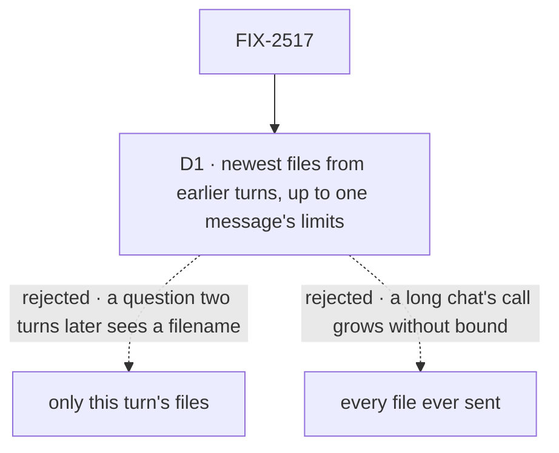

# FIX-2517 · Decisions

[Spec](SPEC.md) · **Decisions**

Where the files ride, and that they are references, the epic settled ([D3](../../epics/FIX-2516/DECISIONS.md#d3),
[D4](../../epics/FIX-2516/DECISIONS.md#d4)). It left this issue the history rule: what a model
call carries from earlier turns.

## The tree

Solid edges are what you're signing. Dashed edges lost, and the label says why.

## D1 · A model call carries the newest files from earlier turns, up to one message's limits; older ones are named as text

| | |
|---|---|
| **Instead of** | Only the current turn's files; or every file the session ever held |
| **Because** | People refer back: "the error in that screenshot" two turns later. A filename alone makes them attach it again. Every file ever sent grows each call past the provider's request limit |
| **Locks in** | Counting back from the newest turn, through the newest-first budget walk `history.ts` already has (`selectRequestsByLimit`), a call carries up to 10 images and 5 documents, the same numbers as one message. An older file becomes one line on its turn, `[image: shot.png, not re-sent]`. Chats with files cost more per turn, re-sent and billed each call. A flow can't change the rule in v1 |

It comes down to a question two turns later: this-turn-only shows the model a filename.

**What would change my mind:** providers keeping files across calls (FIX-891's upload-once).
Then re-sending is free and the cap only bounds the request.

## Decided, not asked

- **The limits are checked once, at the request's parse step**, for every flow, the worker door
  and every harness turn. It is the convergence point for ER-4: the client, React, the worker
  door and the harness session flow all reach it, and a hand-built request too.
- **An action with no `userMessage` refuses files by name.** There is no user line to put them on.
  The harness `steer` action is one, so it needs no file check of its own (FIX-2519).
- **The parse step claims each reference into the turn's session** through FIX-824's claim, after
  the session check, and before any block runs.
- **A block reads the request's attachments from its context**, in reference form. The harness
  turn (FIX-2519) is the first reader. Input schemas never see them.
- **The model gets bytes inline**, resolved by FIX-824's resolver into the AI SDK part's `data`.
  There is no public URL a provider could fetch (ER-3).
- **Order is the person's**: the text part first, then the files in the order attached.
- **Images go as image parts**; a document's per-target form is FIX-2520's.

## Considered and dropped

| Alternative | Why not |
|---|---|
| Files on `UserMessageEcho` | The echo is the flow's view of input; files are the request's and checked before the flow runs |
| A flow-level history option now | No caller needs it yet; a flow that does can ask, and the default holds |
| Replace older files with a model-written description | A second model call per file, and a description is not what the person sent |

## Analysis

2026-11-08 · watermark 2026-11-05 · **Right approach.** Run over the set by `epic-agent`.

1. **Reuse** — extends the user-line write, the history build, the request parse and the two
   send surfaces; nothing new but the field. See [Builds on / Adds](SPEC.md#whats-already-here-and-the-debt).
2. **Prior art** — the AI SDK's own `useChat` sends files on the user message and keeps them in
   history; ChatGPT and Claude.ai re-show earlier images to the model. Confirms D1's direction.
3. **Other shapes** — this-turn-only, the simpler rule, in the tree.
4. **New factors** — none.
5. **Necessity** — the one path every app needs.
6. **Ergonomics** — one option on send; nothing for a flow author.
7. **Concerns** — re-send cost on long chats. Recorded in D1.

## Notes from review

- *The Architect, #4941:* "Counting back from the newest turn with a cap works for linear chats.
  Name what happens on branch or retry … A retried turn can drop the newest files out of the
  window while the user is looking at them." Below the bar: the implementer's tests own it.

## How it got here

- **Drafted (Nov 8)** in the epic's spec set.
- **Fold (Nov 8), the set's first independent read.** D1 reuses `history.ts`'s newest-first
  budget walk (reuse review). The goal check's variant inputs moved to unit tests.

**Open: none.**
