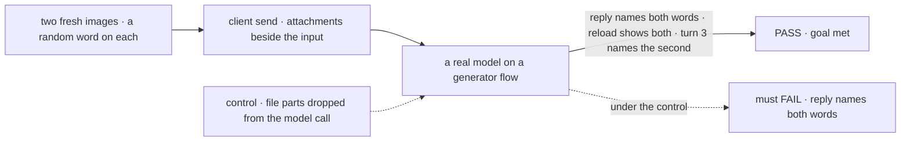
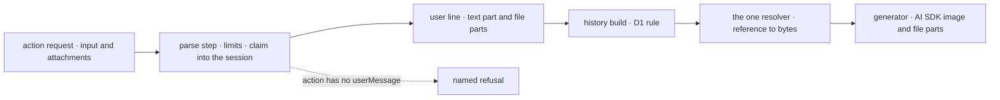

# FIX-2517 · Framework: a sent message carries files to the model and shows them in the conversation

**Spec** · [Decisions](DECISIONS.md)

## Five people, before and after

| Someone who… | Today | After |
|---|---|---|
| **sends a message with two screenshots to a generator flow** | Has to hand-roll base64 into the flow's input; the model gets text | The model gets the text and both images on one user message |
| **asks about one of them two turns later** | n/a | The model still sees it ([D1](DECISIONS.md#d1)) |
| **reloads the conversation** | n/a | The user line still holds both files, as references the page can draw |
| **hand-builds a request with an 11th image** | n/a | A named refusal before any block runs |
| **sends files to an action with no user line** | n/a | A named refusal: that action takes no files |

## The goal, and how we'll know it's met

**A person's message with files reaches the model as one turn with the text and every file,
and the conversation shows those files on their line, live, after a reload, and to the model on
later turns.**

| Is it the right goal? | |
|---|---|
| **The real need** | Every chat in the epic sends files through this one path ([epic D3](../../epics/FIX-2516/DECISIONS.md#d3)) |
| **Smaller, and rejected** | "The request accepts `attachments`." Passes while the model never sees them, which is today's Kitchen Sink bug one layer down |
| **Bigger, and not this issue's** | Documents per target (FIX-2520); harness hand-off (FIX-2519); the composer (FIX-2518) |
| **Not done if** | A stubbed model sees the parts but a real one is never asked · the reply names the files but the reloaded line drops them · history re-sends past the limits |



The check reads the model's reply and the reloaded session, not the message the engine built.

| How we verify | |
|---|---|
| **Goal check** | `goals/attachments/reach-the-model/` · `openai/gpt-6-luna` · the implementer at completion · verdict in the implementation PR |
| **Signal** | The reply contains both words; the session read after a reload has one user item with a text part and two `file` parts whose `data` is `fsd-blob:`; turn 3, "what word was on the second image?", is answered. An 11th image gets the named limit error and no request record |
| **Input** | Two PNGs drawn per run with random words. The other image types and counts are unit tests |
| **Anti-game** | Don't assert on `itemToLLMMessages`' output or on a stubbed model; both pass while a real call drops the parts |
| **Control that must fail** | `GOAL_CONTROL=drop-file-parts` (the history build keeps text only): FAIL on *reply names both words*. Today's `main` fails at the send |

## What changes


Read the rows as one message's path, request to model call.

**An app's send:**

```diff
  await session.sendAction("run", { message: text, mode }, {
    userMessage: text,
+   attachments, // FileContent[] in reference form, from FIX-2518's composer or the upload route
  })
```

**A flow author writes nothing new.** An action with `userMessage` takes files; its block's input
schema is untouched. A block that needs the files itself (a harness turn) reads the request's
attachments from its context, never from its input.

**Docs:** the shared story the epic names, *A user turn can carry files*, a new guide page:
sending files from the client and React, what the model receives, the history rule, the limits
and refusals. FIX-824, FIX-2519, FIX-2520 and FIX-2518 add their sections to it. The client and
React READMEs gain the option.

## How the files reach the model



The limits are checked once, at the parse step, so no path past it can skip them.

## What stays as it is

- Every flow's input schema and the worker door's `{ message }` ([epic D3](../../epics/FIX-2516/DECISIONS.md#d3)).
- `UserMessageEcho` and `userMessage`'s signature. The files are the request's, not the echo's.
- Steering stays text; a line with files waits for the next turn.
- Assistant lines carry no files (the epic's *not doing*).

## What's already here, and the debt

| Already here | What this does with it |
|---|---|
| `runAction`'s user line (`engine/src/execution/runAction.ts`, the `userMessage` echo) | **Extends.** It writes a `file` part per attachment after the text |
| `itemToLLMMessages` (`engine/src/context/history.ts`) | **Extends.** User file parts become AI SDK parts, through the resolver |
| `FileContent` | **Builds on**, reference form ([epic D4](../../epics/FIX-2516/DECISIONS.md#d4)) |
| The action route's body parse (`engine/src/routes/action-routes.ts`) | **Extends.** One more field, checked against the limits set |
| `flow.send` (`client/src/client.ts`) and `sendAction` (`react/src/hooks/useSession.ts`) | **Extends** their options |
| FIX-137's `attachment` item type | **Not built** ([epic](../../epics/FIX-2516/SPEC.md#whats-already-here-and-the-debt)); FIX-137 stays open |
| Anything else that puts files in a model call | **None.** Searched `image`, `file`, `FilePart`, `ImagePart` across `engine/src` and `core/src/models` |

| Adds | Existing piece considered | Why it doesn't fit / how composed |
|---|---|---|
| `attachments` on the request and send options | Each flow's input schema | Beside the input, so one check covers every flow (epic D3) |
| The history rule ([D1](DECISIONS.md#d1)) | The history visibility rules; the newest-first budget walk in `engine/src/context/history.ts` (`selectRequestsByLimit`) | Composed: runs after visibility, on user items only, as that walk with files as the budget |
| The request's attachments on the block context | Block input | Input stays the flow's; the context already carries request fields |

| The debt | |
|---|---|
| **Removes** | Nothing in the repo: no flow here hand-rolls base64 input (searched `base64`, `readAsDataURL`, `data:image` across `apps/` and `labs/`). An adopter's own workaround stops being needed |
| **Adds** | A second channel into a request beside the input, permanent by design (epic D3). Re-sent files on later turns ([D1](DECISIONS.md#d1)), billed each call; prompt caching cuts it, and [FIX-2636](https://linear.app/fixpoint-labs/issue/FIX-2636) would shrink it |
| **Leaves** | Assistant-side files, FIX-137's wider scope |

**Net: up, by one field.** Every app's send gains it; no flow changes.

## Sign off

**[The goal](#the-goal-and-how-well-know-its-met), at that size:** the model sees every file,
now and later, and the reload shows them. If wrong: a framework path that passes its tests while
a real model sees text.

**[The debt](#whats-already-here-and-the-debt), net up:** one field beside the input. If wrong:
a field we deprecate in a minor.

1. **[D1](DECISIONS.md#d1) · A model call carries the newest files from earlier turns, up to one
   message's limits; older ones are named as text.** If wrong: long chats with files cost more
   per turn than they need to.

**Open: none.**

Feature · `contracts` + `core` + `engine` + `client` + `react` · medium · epic FIX-2516
