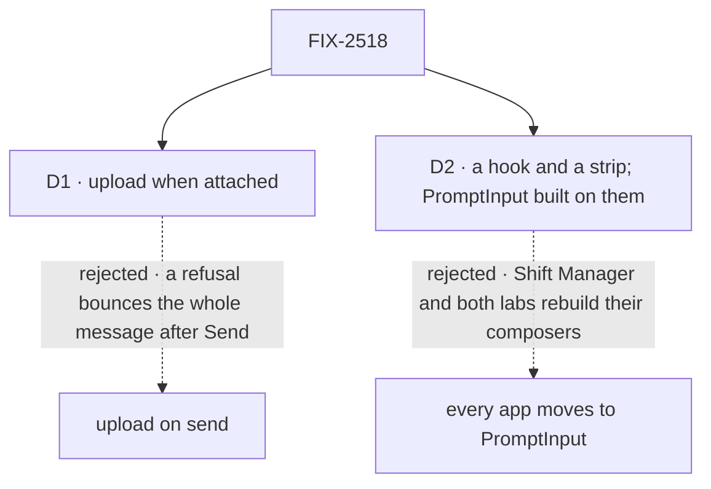

# FIX-2518 · Decisions

[Spec](SPEC.md) · **Decisions**

The limits, the refusal rule and the registry as the only source of composer pieces are the
epic's ([ER-4](../../epics/FIX-2516/DECISIONS.md#who-owns-what),
[ER-6](../../epics/FIX-2516/DECISIONS.md#who-owns-what)). Two calls are this issue's.

## The tree

Solid edges are what you're signing. Dashed edges lost, and the label says why.

## D1 · A file uploads the moment it is attached, not when the message is sent

| | |
|---|---|
| **Instead of** | Uploading every file when Send is pressed |
| **Because** | The server's type check (FIX-824 D2) can refuse a file. Refused at attach, the chip says why and the typed message is untouched; refused at send, the whole message bounces. Send with ten photos also goes at once |
| **Locks in** | Every attach is a call to the server, so an offline composer can't attach. An abandoned draft leaves uploads no one claimed; FIX-824 sweeps them after a day. A chip shows a spinner until its upload lands, and Send waits only for those still in flight |

It comes down to a file the server refuses: on send, the whole message comes back.

## D2 · The pieces ship as a hook and a strip any composer can hold; PromptInput is built from them

| | |
|---|---|
| **Instead of** | Every app moves its composer to PromptInput |
| **Because** | Shift Manager's `ComposerShell` and the two labs' composers carry their own keys, drafts and styles. A hook they drop in keeps those; a move to PromptInput redoes them |
| **Locks in** | `useAttachments` and `AttachmentStrip` are public registry names, installed as one item, `attachments`. Apps copy registry code, so a later change to the hook is a migration in each copy. PromptInput keeps working, now on the same state |

It comes down to the apps' own composers: moving them to PromptInput redoes their keys and styles.

## Decided, not asked

- **Downscale before upload**, images to 1,568 px on the longest side, keeping the type; GIFs are
  not resized. The limit check reads the size as picked (20 MB), per the epic.
- **The refusal lines' wording** names the file and the limit; the server's named errors map onto
  the same lines.
- **Drafts.** A draft's files are kept as references in the page's memory per session, so a
  session switch keeps them; a reload drops them. No bytes in `localStorage` (ER-2).
- **The user line** draws a `file` part as a thumbnail (images) or a chip (name, type, size),
  read through FIX-824's read route. A file whose read fails shows a chip that says so.
- **Kitchen Sink's copy** follows the registry by `pnpm registry:refresh`; FIX-2521 runs it.

## Considered and dropped

| Alternative | Why not |
|---|---|
| A headless package outside the registry | Apps own their copies by convention; a package is a second distribution channel |
| Previews from data URLs, upload on send | D1's refusal problem, and bytes held in the page |
| Downscale on the server | The upload already crossed the wire at full size |

## Analysis

2026-11-08 · watermark 2026-11-05 · **Right approach.** Run over the set by `epic-agent`.

1. **Reuse** — `reuse-review` says **extend** for the hook: the state already lives in
   PromptInput's provider, and PromptInput is rebuilt on it rather than duplicated. See
   [Builds on / Adds](SPEC.md#whats-already-here-and-the-debt).
2. **Prior art** — ChatGPT and Claude.ai upload on attach and show a per-file spinner. AI
   Elements, where our PromptInput came from, converts to data URLs on submit; D1 is the change
   from it.
3. **Other shapes** — every app on PromptInput, in the tree.
4. **New factors** — none.
5. **Necessity** — ER-6 needs a source.
6. **Ergonomics** — one install, one hook, one component.
7. **Concerns** — none.

## How it got here

- **Drafted (Nov 8)** in the epic's spec set.
- **Set review (Nov 8).** The user line's file parts were drawn by no one; this issue took them,
  in the registry `message` component (found writing FIX-2521 and FIX-2523).

**Open: none.**
