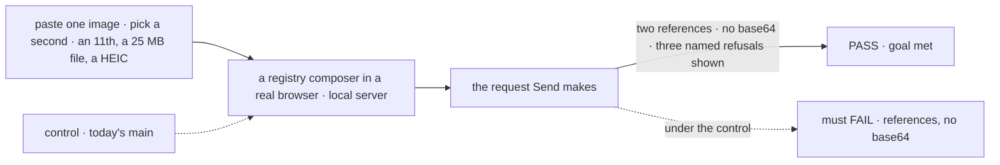

# FIX-2518 · UI library: the + button, paste, drop, previews and refusals, for every composer

**Spec** · [Decisions](DECISIONS.md)

## Six people, before and after

| Someone who… | Today | After |
|---|---|---|
| **pastes a screenshot into a chat box** | It is held where no one sees it, and in Kitchen Sink lost on send | A thumbnail appears above the text at once, with a remove button |
| **clicks + or drops three files** | No app shows the button; dropping does nothing visible | A picker, multi-select on; a drop target while dragging; a chip per file |
| **attaches an 11th image, a 25 MB PDF or a HEIC photo** | Silent | A plain line in the composer: "Only 10 images per message", "report.pdf is over 20 MB", "photo.heic isn't supported" |
| **sends ten phone photos** | n/a | Each is downscaled to 1,568 px and already uploaded, so Send goes at once ([D1](DECISIONS.md#d1)) |
| **uses only a keyboard or a screen reader** | n/a | + and every remove button are Tab stops with labels; Backspace in an empty box removes the last file; refusals are announced |
| **builds their own composer (Shift Manager, the labs, an adopter)** | Rebuilds paste, picker and previews, or goes without | Installs `useAttachments` and `AttachmentStrip` with `fsdev ui add attachments` ([D2](DECISIONS.md#d2)) |

## The goal, and how we'll know it's met

**In any composer built from the registry, a person can attach images by paste, + or drop, see
and remove each one before sending, hear a plain reason for every file refused, and send a
message whose request carries references, not bytes.**

| Is it the right goal? | |
|---|---|
| **The real need** | The epic's composer half, in every chat, from one place ([ER-6](../../epics/FIX-2516/DECISIONS.md#who-owns-what)) |
| **Smaller, and rejected** | "PromptInput shows thumbnails." Leaves Shift Manager and both labs to rebuild it, which ER-6 forbids |
| **Bigger, and not this issue's** | Each app's wiring (FIX-2521 to 2523); documents' types (FIX-2520 widens `accept`) |
| **Not done if** | Previews show but the request carries data URLs · a refusal only logs · PromptInput keeps its own copy of the attachment state |



The check reads the request on the wire and what the composer shows, not the hook's state.

| How we verify | |
|---|---|
| **Goal check** | `goals/attachments/composer-attaches-and-refuses/` · model-free · real browser against a local server · the implementer at completion · verdict in the implementation PR |
| **Signal** | Two thumbnails before Send; the request body holds two `fsd-blob:` references and no base64 run over 1 KB; each refused file shows its line and is announced (`aria-live`); Send with no text and two files is enabled; Tab reaches + and both remove buttons |
| **Input** | Fresh images per run; a 25 MB file; a real HEIC. Pasting three images at once must pass too |
| **Anti-game** | Don't assert on the hook's state or on a story's props: both pass while Send ships data URLs |
| **Control that must fail** | Today's `main`: FAIL on *references, no base64* and on *thumbnails before Send* |

## What changes


The bottom row is [D2](DECISIONS.md#d2): the same pieces outside PromptInput.

**An app with its own composer:**

```diff
+ // fsdev ui add attachments
+ const attachments = useAttachments({ client, sessionId })   // limits default to contracts/attachments
  <ComposerShell
+   onPaste={attachments.onPaste} onDrop={attachments.onDrop}
+   above={<AttachmentStrip attachments={attachments} />}
-   onSend={() => send(text)}
+   onSend={() => send(text, attachments.take())}
  />
```

**Docs:** the registry page for `attachments` and the updated `prompt-input` page (the +
button, the strip, refusals, drafts); a section in the shared story on building your own
composer. `PromptInput`'s README entry.

## What stays as it is

- `PromptInput`'s props and its `onSubmit(message)` shape. `message.files` now holds references.
- The conversation's scroll chrome (FIX-2456's).
- The composer never decides what a target takes; it reads the limits set ([ER-4](../../epics/FIX-2516/DECISIONS.md#who-owns-what)).

## What's already here, and the debt

| Already here | What this does with it |
|---|---|
| `PromptInput`, `usePromptInputAttachments`, `PromptInputActionAddAttachments`, paste in `PromptInputTextarea`, `globalDrop`, `accept`/`maxFiles`/`maxFileSize`/`onError` (`ui/registry/components/prompt-input.tsx`) | **Builds on.** PromptInput's attachment state moves into `useAttachments`; `usePromptInputAttachments` reads it. No second copy |
| `convertBlobUrlToDataUrl` in the same file | **Removes.** Send carries references |
| The registry `message` component | **Extends.** A user line's `file` parts draw as thumbnails and chips, read through FIX-824's read route, with the same piece `AttachmentStrip` draws |
| Any other paste or drop handling | **None outside apps.** Searched `clipboardData`, `onDrop`, `dataTransfer` across `packages/`; the app copies are FIX-2521 to 2523's to remove |

| Adds | Existing piece considered | Why it doesn't fit / how composed |
|---|---|---|
| `useAttachments` | `usePromptInputAttachments` | That one reads PromptInput's context; this is the same state without PromptInput, and PromptInput is built on it |
| `AttachmentStrip` and its thumbnail-or-chip piece | None in the registry | New: the previews nothing draws today. One piece draws a file in the strip and on the user line |
| Downscaling to 1,568 px | None | New and small: a canvas resize in the browser |

| The debt | |
|---|---|
| **Removes** | The data-URL conversion on submit; the invisible paste |
| **Adds** | Two ways into one state, PromptInput and the bare hook ([D2](DECISIONS.md#d2)), permanent by design; PromptInput holds no copy |
| **Leaves** | Kitchen Sink's text-draft store, text only |

**Net: flat.** One conversion goes; a hook and a strip arrive, and PromptInput shrinks onto them.

## Sign off

**[The goal](#the-goal-and-how-well-know-its-met), at that size:** every registry composer, with
refusals heard and references on the wire. If wrong: each app gets its own half of it.

**[The debt](#whats-already-here-and-the-debt), net flat.** If wrong: two entry points drift.

1. **[D1](DECISIONS.md#d1) · A file uploads the moment it is attached.** If wrong: abandoned
   drafts leave unclaimed uploads for at least a day.
2. **[D2](DECISIONS.md#d2) · The pieces ship as a hook and a strip any composer can hold;
   PromptInput is built from them.** If wrong: two ways in to keep working.

**Open: none.** D1 is the one to weigh.

Feature · `ui` (registry) · medium · epic FIX-2516
