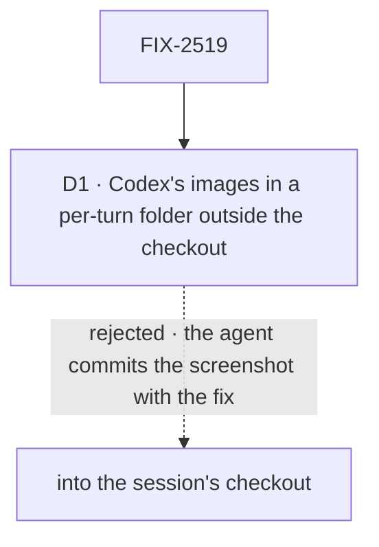

# FIX-2519 · Decisions

[Spec](SPEC.md) · **Decisions**

The shape a harness receives, and that a target says what it can't take, are the epic's
([ER-1](../../epics/FIX-2516/DECISIONS.md#who-owns-what),
[ER-5](../../epics/FIX-2516/DECISIONS.md#who-owns-what)). One call is this issue's: Codex reads
images only from disk, so where do they go?

## The tree

Solid edges are what you're signing. Dashed edges lost, and the label says why.

## D1 · Codex gets a turn's images as files in a per-turn folder outside the checkout, removed when the turn ends

| | |
|---|---|
| **Instead of** | Writing them into the session's checkout, where Codex already reads |
| **Because** | A coding agent runs `git add -A`. A screenshot in the tree ships in someone's pull request |
| **Locks in** | The Codex adapter writes each image to a fresh folder under the OS temp directory, passes the paths as `local_image`, and removes the folder when the turn ends, failed or not. A host whose sandbox limits reads must allow that folder. Claude Code and Cursor take bytes and write nothing |

It comes down to `git add -A`: in the checkout, the screenshot ships with the fix.

**What would change my mind:** the Codex SDK taking image bytes. Then nothing is written at all.

## Decided, not asked

- **A refused type refuses the turn**, before the run starts, with the file and the harness named
  in the conversation. Running without it is the text-only fallback ER-5 forbids.
- **What each harness takes in v1:** Claude Code PNG, JPEG, WebP, GIF; Codex and Cursor the
  types their SDKs document for images. Each adapter declares its list; the session flow checks
  it before the run.
- **The resolver is the only reader of bytes** (ER-1); each adapter calls it.
- **A steer with files is refused by the `steer` action**, and `useHarnessLines` sends the line as
  the next turn instead, so a person sees one queued line, not an error.
- **A task's brief files** go to every run of the task: the board run reads the task row's
  `attachments` (FIX-2522's) and puts them on `HarnessRunInput`, after the run's own turn files.
- **`HarnessRunInput` stays in `core/harness`** (FIX-2448's move); nothing lands on core's root.

## Considered and dropped

| Alternative | Why not |
|---|---|
| A data URL in the Codex prompt text | Codex reads it as text; the model sees a long string, not an image |
| One shared per-session folder | Files outlive their turn, and a later turn sees an earlier one's images unasked |
| Image support for Claude Code only, in this issue | Two of the three Kitchen Sink pages stay blind; the goal names all three |

## Analysis

2026-11-08 · watermark 2026-11-05 · **Right approach.** Run over the set by `epic-agent`.

1. **Reuse** — extends the run input, the session flow and each adapter; the workspace host was
   considered for Codex's files and doesn't fit. See [Builds on / Adds](SPEC.md#whats-already-here-and-the-debt).
2. **Prior art** — the Codex CLI's own `--image` flag takes paths; Claude Code's SDK documents
   image blocks on streaming input; the Cursor SDK takes `images` on `send`. The spec follows each.
3. **Other shapes** — Claude Code only, in *considered and dropped*.
4. **New factors** — none.
5. **Necessity** — the epic's harness row.
6. **Ergonomics** — one option on `lines.send`.
7. **Concerns** — SDK churn per release; each adapter's test pins the call shape.

## How it got here

- **Drafted (Nov 8)** in the epic's spec set.
- **Set review (Nov 8).** `useHarnessLines.send` was owned by no one; this issue took it (found
  writing FIX-2521).

**Open: none.**
