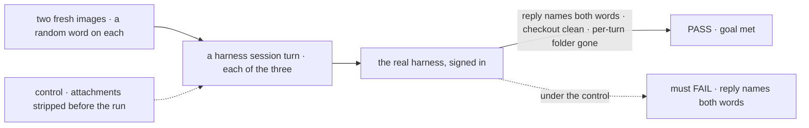
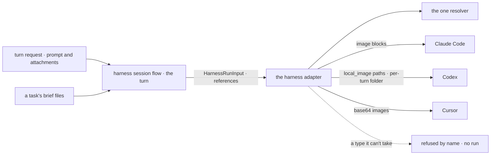

# FIX-2519 · Harnesses: a turn's images reach Claude Code, Codex and Cursor

**Spec** · [Decisions](DECISIONS.md)

## Five people, before and after

| Someone who… | Today | After |
|---|---|---|
| **pastes a screenshot of a bug into a Claude Code, Codex or Cursor session** | Describes it in words; the image never leaves the browser | The harness gets the image with the prompt; the reply describes it |
| **sends a line with a file while a turn runs** | Text steers the turn | The line waits for the next turn; steering stays text |
| **sends a PDF to Codex or Cursor** | n/a | The agent gets its text, extracted on our side (FIX-2520 [D1](../FIX-2520/DECISIONS.md#d1)); a type a harness can't take refuses the turn by name ([ER-5](../../epics/FIX-2516/DECISIONS.md#who-owns-what)) |
| **runs Codex in a session's checkout** | n/a | The image sits in a per-turn folder outside the checkout, gone when the turn ends; the agent can't commit it ([D1](DECISIONS.md#d1)) |
| **files a task with a screenshot for a coding worker** | The worker gets the brief's text | Every run of the task gets the brief's files too ([ER-7](../../epics/FIX-2516/DECISIONS.md#who-owns-what)) |

## The goal, and how we'll know it's met

**A turn's images reach whichever coding harness runs it, in the form that harness reads, and
the reply shows the harness saw them; a type it can't take is refused by name.**

| Is it the right goal? | |
|---|---|
| **The real need** | The coding team's row in the epic: the screenshot that matters most reaches the agent |
| **Smaller, and rejected** | "Claude Code takes images." Codex and Cursor stay blind, and two of the three Kitchen Sink pages lose the image |
| **Bigger, and not this issue's** | Documents to each harness (FIX-2520); files in a steer |
| **Not done if** | A stubbed SDK gets the parts but a real harness never runs · Codex's file is left in the checkout · a refused type runs the turn without it |



The check reads each harness's reply and the checkout after the turn, not the SDK call.

| How we verify | |
|---|---|
| **Goal check** | `goals/attachments/reach-each-harness/` · each real harness where signed in · the implementer at completion · verdict in the implementation PR, with a harness not signed in named, not skipped |
| **Signal** | Per harness, the reply contains both words; after a Codex turn, `git status` in the checkout shows no image and the per-turn folder is gone; a task re-run hands its brief's image to the run |
| **Input** | Two PNGs drawn per run. JPEG, WebP and GIF are each adapter's unit tests |
| **Anti-game** | Don't assert on the stubbed SDK call alone: it passes while the real CLI drops `--image` |
| **Control that must fail** | `GOAL_CONTROL=strip-attachments` (the turn drops them before `HarnessRunInput`): FAIL on *reply names both words*, per harness |

## What changes


Each harness row is one adapter's change; the last two rows are rules every adapter shares.

**What a harness's caller hands it:**

```diff
  export interface HarnessRunInput {
    prompt: string;
+   /** The turn's files, in reference form. The adapter resolves them. */
+   attachments?: FileContent[];
  }
```

**An app's harness page:**

```diff
- await lines.send(prompt)
+ await lines.send(prompt, { attachments })   // useHarnessLines: a line with files never steers
```

**Docs:** the harness table in the shared story: what each harness takes, how a file reaches it,
and what it refuses. Each harness package's README gains a line.

## How a turn's files reach a harness



The adapter is the one place that knows its SDK's form; everything above it carries references.

## What stays as it is

- `steer` stays text. A line with files sent while a turn runs is queued as the next turn.
- Resume, working directory and the harness resolver; block input still strips unknown keys.
- Each adapter's event-to-item helper (the epic's *leaves*).

## What's already here, and the debt

| Already here | What this does with it |
|---|---|
| `HarnessRunInput` and `harnessRunInputSchema` (`core/src/types/harness.ts`, exported from `core/harness`) | **Extends** with optional `attachments` |
| The harness session flow's `turn` (`harness-manager/src/session-flow.ts`) | **Extends.** `turn` passes the request's attachments. `steer` is untouched: it has no `userMessage`, so FIX-2517 already refuses its files |
| `useHarnessLines` (`react/src/hooks/useHarnessLines.ts`) | **Extends.** `send(prompt, { attachments })` |
| Claude Code's streaming input (`claude-code/src/sdk/agent.ts`) | **Extends.** A user message with image blocks |
| Codex `runStreamed` (`codex/src/agent.ts`), Cursor `agent.send` (`cursor/src/agent.ts`) | **Extends** to each SDK's image input |
| The workspace host that places checkouts | **Considered.** It places checkouts, not files; the per-turn folder is the adapter's |
| `ownLinkRoot` (`cursor/src/workspace-alias.ts`), a private per-user temp folder; the `mkdtemp` probe in `harness-manager/src/guards.ts` | **Extends.** `ownLinkRoot` is lifted into one shared private-temp-root helper; Cursor's links and Codex's per-turn folder both use it, not a third copy |
| The board run that starts a task's harness run | **Extends.** Hands the task row's `attachments` (FIX-2522) in |

| Adds | Existing piece considered | Why it doesn't fit / how composed |
|---|---|---|
| `HarnessRunInput.attachments` | The prompt string | Images aren't text; the field is ER-1's shape |
| Per-turn files for Codex | The workspace host; `ownLinkRoot` | Composed: a folder per turn under the shared private temp root, removed after ([D1](DECISIONS.md#d1)) |
| Each adapter's entry in the accepts list | The limits set | Composed: one accepts-list type in `contracts/attachments`, shared with FIX-2520, that each target fills; no per-adapter list type |

| The debt | |
|---|---|
| **Removes** | Nothing |
| **Adds** | Three adapter-specific conversions, one per SDK, permanent by nature. A per-turn temp folder for Codex |
| **Leaves** | Files in a steer, not asked for |

**Net: up, a little.** Three conversions behind one field.

## Sign off

**[The goal](#the-goal-and-how-well-know-its-met), at that size:** all three harnesses, with real
replies. If wrong: the harness pages, where a screenshot matters most, stay blind.

**[The debt](#whats-already-here-and-the-debt), net up a little.** If wrong: a conversion per SDK
to keep in step with each SDK's releases.

1. **[D1](DECISIONS.md#d1) · Codex gets a turn's images as files in a per-turn folder outside the
   checkout, removed when the turn ends.** If wrong: a host with a tight sandbox must open the
   folder to Codex.

**Open: none.**

Feature · `core` + `harness-manager` + `react` + `claude-code` + `codex` + `cursor` · medium · epic FIX-2516
