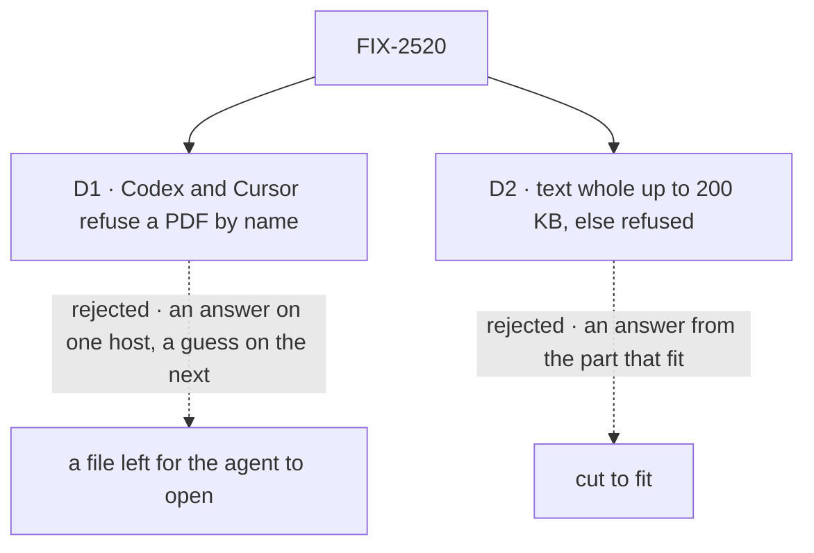

# FIX-2520 · Decisions

[Spec](SPEC.md) · **Decisions**

The epic set the outline: text-like files as text headed by the filename, a PDF as a file part
where the provider takes PDFs, else a named refusal, no extraction library in v1
([decided in review](../../epics/FIX-2516/DECISIONS.md#decided-in-review-recorded-so-no-child-reopens-them)).
Two calls inside it shape what a person sees.

## The tree

Solid edges are what you're signing. Dashed edges lost, and the label says why.

## D1 · Codex and Cursor refuse a PDF by name; they never get it as a file to open

| | |
|---|---|
| **Instead of** | Writing the PDF into the turn's folder (FIX-2519 D1) and naming its path in the prompt |
| **Because** | Neither SDK takes documents. A file on disk is read only if the host happens to have a PDF tool the agent finds; elsewhere the agent guesses from the filename. A refusal is honest everywhere |
| **Locks in** | On the Codex and Cursor pages, and for a Codex or Cursor worker, a PDF is refused before the turn starts. The closure's leg b passes there on that refusal (an epic amendment). Text-like files still go to both, as text |

It comes down to the answer: a file left on disk is read on one host and guessed on the next.

**What would change my mind:** Codex or Cursor taking documents in their SDKs, or an extraction
step joining in v2. Either turns the refusal into a real read.

## D2 · A text-like file goes in whole, as text headed by its name, up to 200 KB; a bigger one is refused, never cut

| | |
|---|---|
| **Instead of** | Cutting a long file to fit and sending the start |
| **Because** | The part that matters is often the end of a log. An answer from the start, with nothing saying it was cut, is worse than a refusal the person can act on |
| **Locks in** | A 200 KB text cap in the limits set (about 50,000 tokens), read by the composer and the server alike. A 300 KB CSV can't be sent whole; the person splits it, or asks a coding run to read it from the repo |

It comes down to where the answer is: cut, a log's failure at the end is never seen.

## Decided, not asked

- **Text-like** means the v1 list in the issue: `.txt`, `.md`, `.csv`, `.json`, `.yaml`,
  `.html`, `.xml` and common source files; checked as UTF-8 at upload (FIX-824 D2).
- **A text file's heading** is `### <filename>`, then its text as is, one text part per file.
- **Which generators take a PDF** is read from the model's provider (Anthropic, OpenAI, Google in
  v1); any other gets ER-5's refusal.
- **PDFs over 100 pages** are refused by the server's count, and the composer shows the page
  count on the chip when it can read it.
- **History** counts a document against FIX-2517 D1's "5 documents".

## Considered and dropped

| Alternative | Why not |
|---|---|
| Extract PDF text for every target | A new dependency; the epic ruled extraction out of v1 |
| Text files as file parts with `text/plain` | Not every provider reads them; text parts work everywhere |
| One cap for every type (20 MB) | 20 MB of text is millions of tokens; it would always fail at the model |

## Analysis

2026-11-08 · watermark 2026-11-05 · **Right approach.** Run over the set by `epic-agent`.

1. **Reuse** — every row extends a list or a path the other children build. See
   [Builds on / Adds](SPEC.md#whats-already-here-and-the-debt).
2. **Prior art** — Claude.ai refuses a file past its length limit rather than cutting it.
   Confirms D2.
3. **Other shapes** — extraction for all, in *considered and dropped*.
4. **New factors** — none.
5. **Necessity** — the epic's leg b.
6. **Ergonomics** — nothing new for an app.
7. **Concerns** — D1 makes documents uneven across the harness pages. Raised as the one to weigh.

## How it got here

- **Drafted (Nov 8)** in the epic's spec set. D1 amends the epic's leg b signal for the Codex
  and Cursor pages; D2 adds a cap to FIX-824's limits set.

**Open: none.**
