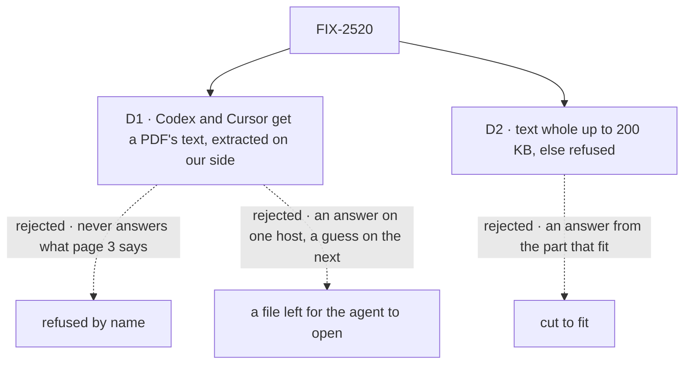

# FIX-2520 · Decisions

[Spec](SPEC.md) · **Decisions**

The epic set the outline: text-like files as text headed by the filename, a PDF as a file part
where the provider takes PDFs
([decided in review](../../epics/FIX-2516/DECISIONS.md#decided-in-review-recorded-so-no-child-reopens-them)).
The owner's call of Nov 8 replaced its "no extraction library in v1" with D1. Two calls inside
it shape what a person sees.

## The tree

Solid edges are what you're signing. Dashed edges lost, and the label says why.

## D1 · Codex and Cursor get a PDF's text, extracted on our side; a scanned page is a stated limit

| | |
|---|---|
| **Instead of** | Refusing a PDF by name on those two (this spec's first draft); or writing the PDF into the turn's folder (FIX-2519 D1) for the agent to open |
| **Because** | Neither SDK takes documents. A refusal never answers the question. A file on disk is read only where the host happens to have a PDF tool. Text extracted once on our side reads the same on every host |
| **Locks in** | One PDF text library, this issue's only new dependency (FIX-824's kill line still forbids one there). The engine extracts at upload and stores the text in the blob store beside the PDF, same owner, deleted with it (ER-2). Codex, Cursor, and a generator whose provider can't read PDFs get that text headed by the filename, page by page; a page with no text layer says so in the text. The same pass counts the pages, so the 100-page cap holds server-side before any model call (ER-4). The closure's leg b passes there on the code word |

**The owner's call, 2026-11-08**, reversing the spec set's refusal.

It comes down to the question asked: a refusal never answers it, the text does on every host.

**What would change my mind:** Codex or Cursor taking documents in their SDKs. Then they get the
PDF itself.

## D2 · A text-like file goes in whole, as text headed by its name, up to 200 KB; a bigger one is refused, never cut

| | |
|---|---|
| **Instead of** | Cutting a long file to fit and sending the start |
| **Because** | The part that matters is often the end of a log. An answer from the start, with nothing saying it was cut, is worse than a refusal the person can act on |
| **Locks in** | A 200 KB text cap in the limits set (about 50,000 tokens), read by the composer and the server alike. A 300 KB CSV can't be sent whole; the person splits it, or asks a coding run to read it from the repo |

It comes down to where the answer is: cut, a log's failure at the end is never seen.

## Decided, not asked

- **Text-like** means the v1 list in the issue: `.txt`, `.md`, `.csv`, `.json`, `.yaml`,
  `.html`, `.xml` and common source files; on FIX-824's allowlist, checked as UTF-8 with no NUL
  bytes at upload.
- **A text file's heading** is `### <filename>`, then its text as is, one text part per file.
- **What a target reads natively** goes in the one accepts-list type in `contracts/attachments`,
  shared with FIX-2519, which each target fills. Generators read it from the model's provider
  (Anthropic, OpenAI, Google take PDFs in v1); any other gets the PDF's text.
- **PDFs over 100 pages** are refused at upload by the extractor's count, read from the page
  tree, compressed objects included. The 100-page cap bounds a PDF's text; the 200 KB cap is for
  text-like files.
- **History** counts a document against FIX-2517 D1's "5 documents".

## Considered and dropped

| Alternative | Why not |
|---|---|
| PDF text for every target, Claude Code and PDF-reading providers too | They read the PDF itself, figures and layout included; text loses both |
| Count pages from the trailer, no library | The trailer points at the catalog, not a count, and newer PDFs use cross-reference streams (Codex, #4941) |
| Text files as file parts with `text/plain` | Not every provider reads them; text parts work everywhere |
| One cap for every type (20 MB) | 20 MB of text is millions of tokens; it would always fail at the model |

## Analysis

2026-11-08 · watermark 2026-11-05 · **Right approach.** Run over the set by `epic-agent`.

1. **Reuse** — every row extends a list or a path the other children build. See
   [Builds on / Adds](SPEC.md#whats-already-here-and-the-debt).
2. **Prior art** — Claude.ai refuses a file past its length limit rather than cutting it.
   Confirms D2.
3. **Other shapes** — extraction for all, in *considered and dropped*.
4. **New factors** — none.
5. **Necessity** — the epic's leg b.
6. **Ergonomics** — nothing new for an app.
7. **Concerns** — D1 adds a dependency; a scanned PDF reads as empty pages on Codex and Cursor, said so.

## How it got here

- **Drafted (Nov 8)** in the epic's spec set. D1 refused PDFs on Codex and Cursor; D2 adds a cap
  to FIX-824's limits set.
- **Fold (Nov 8).** The owner reversed D1: extract the text on our side, so leg b passes on the
  code word everywhere. PDF moved into FIX-824's v1 list for the kill line (gitar); the page
  count reads the page tree (Codex). Cut: the chip's page count, the 90-page goal input.

**Open: none.**
