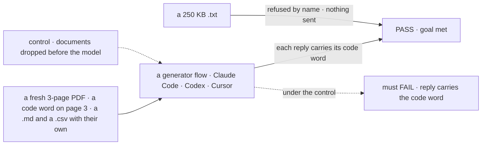

# FIX-2520 · Documents: attach PDFs, text, Markdown, CSV and code files, and the model reads them

**Spec** · [Decisions](DECISIONS.md)

## Five people, before and after

| Someone who… | Today | After |
|---|---|---|
| **attaches a spec PDF and asks what page 3 says** | Can't attach it | Every chat answers: from the PDF itself where the provider or Claude Code reads PDFs, from its text everywhere else |
| **attaches a log, a CSV or a `.ts` file** | Can't attach it | Every target gets it as text, headed by its filename |
| **sends a PDF on the Codex or Cursor page** | n/a | The agent gets the PDF's text, extracted on our side; a scanned page with no text says so ([D1](DECISIONS.md#d1)) |
| **attaches a 2 MB log** | n/a | Refused with its size: text files go in whole, up to 200 KB ([D2](DECISIONS.md#d2)) |
| **attaches a 150-page PDF or a `.docx`** | n/a | Refused by name: PDFs to 100 pages; Word, Excel and PowerPoint are out (the epic's cut) |

## The goal, and how we'll know it's met

**A person can attach a PDF or a text-like file in any chat, and the reply shows the model or
harness read it; a file over a limit is refused before anything is sent.**

| Is it the right goal? | |
|---|---|
| **The real need** | The epic's second leg: the PDF of the spec, the log of the failure |
| **Smaller, and rejected** | "PDFs reach generator flows." The harness pages, where a spec PDF is most useful, stay shut, and text files are never decided |
| **Bigger, and not this issue's** | Reading scanned pages (OCR); Word and Excel (cut by the owner) |
| **Not done if** | A PDF answer comes from the filename · a long file is cut and answered anyway · Codex or Cursor gets the PDF without its text |



The code word is only in the document, so a reply that carries it read the document.

| How we verify | |
|---|---|
| **Goal check** | `goals/attachments/read-a-document/` · a PDF-reading provider's model and each real harness where signed in · the implementer at completion · verdict in the implementation PR |
| **Signal** | The PDF's, the `.md`'s and the `.csv`'s code words in the generator's reply and in each harness's; a 250 KB `.txt` is refused in the composer, and by the server on a hand-built request |
| **Input** | Documents generated per run, with random code words. Each type, the page cap and a scanned page are unit tests |
| **Anti-game** | Don't assert on the parts the model call held: a part can be present and unread. The reply is the evidence |
| **Control that must fail** | `GOAL_CONTROL=drop-documents`: FAIL on *reply carries the code word* |

## What changes


Read down the right column: one row per target, and the last row is every target.

**A text-like file, as the model receives it:**

```diff
+ ### errors.csv
+ ts,level,message
+ 2026-11-08T10:02:11Z,error,code word: TANGERINE
```

**Docs:** the documents table in the shared story (type by target, and that a scanned page
has no text for Codex and Cursor), and the limits line for PDFs and text files in the contracts
README.

## What stays as it is

- Images, exactly as FIX-2517 and FIX-2519 send them.
- One new dependency, the PDF text library, and only here; FIX-824's kill line still forbids one.
- Word, Excel and PowerPoint stay refused.

## What's already here, and the debt

| Already here | What this does with it |
|---|---|
| The limits set's type list (FIX-824, `contracts/attachments`, PDF and its 100-page cap already listed for the kill line) | **Extends**: text-like types and the 200 KB cap; PDF's per-target handling |
| FIX-2518's `accept` default | **Extends**, by the same list; nothing else in the composer changes |
| FIX-2517's history build | **Extends**: a PDF as a file part, text as a text part |
| FIX-2519's adapters and the shared accepts list | **Extends**: Claude Code's document block; Codex and Cursor take a PDF as its text |
| Anything that reads a PDF's pages today | **None.** Searched `pdf` across `packages/*/src`. The page count comes from the extractor's page tree, not the trailer |

| Adds | Existing piece considered | Why it doesn't fit / how composed |
|---|---|---|
| Native PDF in the accepts list, per provider | The provider tables keyed by `providerNames` (`core/src/models/providerDetection.ts`); FIX-2519's accepts-list type | Composed: one type in `contracts/attachments` each target fills, on the same keys |
| A PDF text extractor | None in the repo; Trading Desk uses `unpdf` | New: one library, run at upload; the text goes to the blob store beside the PDF ([D1](DECISIONS.md#d1)) |
| Text-as-text formatting | None | New and small: a filename heading and the file's text; a PDF's text uses it too, page by page |

| The debt | |
|---|---|
| **Removes** | Nothing |
| **Adds** | One PDF text library to keep current, and a stored text copy per PDF ([D1](DECISIONS.md#d1)) |
| **Leaves** | Scanned pages: no OCR, a stated limit; not filed until someone asks |

**Net: up, a little.** One dependency and one extraction pass; lists and caps widen.

## Sign off

**[The goal](#the-goal-and-how-well-know-its-met), at that size:** read, or refused before send,
everywhere. If wrong: documents work only on the targets that were easy.

**[The debt](#whats-already-here-and-the-debt), net up a little.** If wrong: a library we keep
current for two harnesses.

1. **[D1](DECISIONS.md#d1) · Codex and Cursor get a PDF's text, extracted on our side.** The
   owner's call. If wrong: a scanned PDF reads as empty pages on those two.
2. **[D2](DECISIONS.md#d2) · A text-like file goes in whole, up to 200 KB; over it is refused,
   never cut.** If wrong: a useful big log can't be sent.

**Open: none.**

Feature · `contracts` + `engine` + `ui` + `claude-code` + `codex` + `cursor` · small · epic FIX-2516
