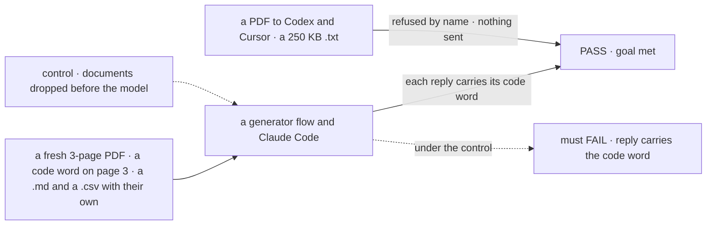

# FIX-2520 · Documents: attach PDFs, text, Markdown, CSV and code files, and the model reads them

**Spec** · [Decisions](DECISIONS.md)

## Five people, before and after

| Someone who… | Today | After |
|---|---|---|
| **attaches a spec PDF and asks what page 3 says** | Can't attach it | A generator whose provider reads PDFs, or Claude Code, answers from the PDF |
| **attaches a log, a CSV or a `.ts` file** | Can't attach it | Every target gets it as text, headed by its filename |
| **sends a PDF on the Codex or Cursor page** | n/a | A plain refusal before the turn starts: this harness can't read PDFs ([D1](DECISIONS.md#d1)) |
| **attaches a 2 MB log** | n/a | Refused with its size: text files go in whole, up to 200 KB ([D2](DECISIONS.md#d2)) |
| **attaches a 150-page PDF or a `.docx`** | n/a | Refused by name: PDFs to 100 pages; Word, Excel and PowerPoint are out (the epic's cut) |

## The goal, and how we'll know it's met

**A person can attach a PDF or a text-like file in any chat, and the reply shows the model read
it; where a target can't read it, the person is told before anything is sent.**

| Is it the right goal? | |
|---|---|
| **The real need** | The epic's second leg: the PDF of the spec, the log of the failure |
| **Smaller, and rejected** | "PDFs reach generator flows." The Claude Code page, where a spec PDF is most useful, stays shut, and text files are never decided |
| **Bigger, and not this issue's** | Text extraction from PDFs for Codex and Cursor; Word and Excel (cut by the owner) |
| **Not done if** | A PDF answer comes from the filename · a long file is cut and answered anyway · Codex silently drops the PDF |



The code word is only in the document, so a reply that carries it read the document.

| How we verify | |
|---|---|
| **Goal check** | `goals/attachments/read-a-document/` · a PDF-reading provider's model and real Claude Code · the implementer at completion · verdict in the implementation PR |
| **Signal** | The PDF's code word in the generator's and Claude Code's replies; the `.md` and `.csv` code words in all three harnesses' replies and the generator's; a PDF to Codex and to Cursor shows the named refusal and starts no run; a 250 KB `.txt` is refused in the composer, and by the server on a hand-built request |
| **Input** | Documents generated per run, with random code words. A 90-page PDF with the word on its last page must pass too |
| **Anti-game** | Don't assert on the parts the model call held: a part can be present and unread. The reply is the evidence |
| **Control that must fail** | `GOAL_CONTROL=drop-documents`: FAIL on *reply carries the code word* |

## What changes


Read down the right column: one row per target, and the last row is every target.

**A text-like file, as the model receives it:**

```diff
+ ### errors.csv
+ ts,level,message
+ 2026-11-08T10:02:11Z,error,code word: TANGERINE
```

**Docs:** the documents table in the shared story (type by target), and the limits line for
PDFs and text files in the contracts README.

## What stays as it is

- Images, exactly as FIX-2517 and FIX-2519 send them.
- No extraction library and no new dependency (the epic's call).
- Word, Excel and PowerPoint stay refused.

## What's already here, and the debt

| Already here | What this does with it |
|---|---|
| The limits set's type list (FIX-824, `contracts/attachments`) | **Extends**: PDF, text-like types, the 100-page and 200 KB caps |
| FIX-2518's `accept` default | **Extends**, by the same list; nothing else in the composer changes |
| FIX-2517's history build | **Extends**: a PDF as a file part, text as a text part |
| FIX-2519's adapters and their "takes" lists | **Extends**: Claude Code's document block; Codex and Cursor list no PDF |
| Anything that reads a PDF's pages today | **None.** Searched `pdf` across `packages/*/src`. The page count reads the PDF's trailer, no library |

| Adds | Existing piece considered | Why it doesn't fit / how composed |
|---|---|---|
| A per-provider "reads PDFs" list | The provider tables keyed by `providerNames` (`core/src/models/providerDetection.ts`) | Composed: one more table on the same keys |
| Text-as-text formatting | None | New and small: a filename heading and the file's text |

| The debt | |
|---|---|
| **Removes** | Nothing |
| **Adds** | A PDF that works on two of five targets ([D1](DECISIONS.md#d1)), by design until Codex or Cursor take documents |
| **Leaves** | Extraction for Codex and Cursor; not filed until someone asks |

**Net: flat.** Lists and caps widen; one small formatter.

## Sign off

**[The goal](#the-goal-and-how-well-know-its-met), at that size:** read, or refused before send,
everywhere. If wrong: documents work only on the targets that were easy.

**[The debt](#whats-already-here-and-the-debt), net flat.** If wrong: a PDF that half the targets
refuse looks broken to people who don't read the refusal.

1. **[D1](DECISIONS.md#d1) · Codex and Cursor refuse a PDF by name.** If wrong: a Codex user can't
   send the spec they're coding against.
2. **[D2](DECISIONS.md#d2) · A text-like file goes in whole, up to 200 KB; over it is refused,
   never cut.** If wrong: a useful big log can't be sent.

**Open: none.** D1 is the one to weigh.

Feature · `contracts` + `engine` + `ui` + `claude-code` + `codex` + `cursor` · small · epic FIX-2516
