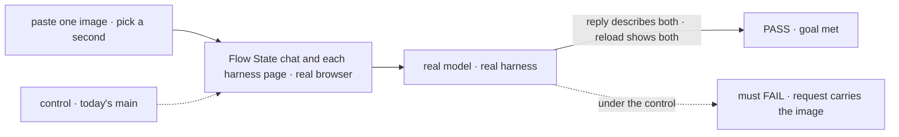

# FIX-2521 · Kitchen Sink: attach files in Flow State chat and the Claude Code, Codex and Cursor pages

**Spec** · [Decisions](DECISIONS.md)

## Five people, before and after

| Someone who… | Today | After |
|---|---|---|
| **pastes a screenshot into Flow State chat and sends** | The image is held where no one sees it, then lost: only the text is sent | A thumbnail before Send; the reply describes the image |
| **does the same on the Claude Code, Codex or Cursor page** | The same silent loss | The harness gets the image; its reply describes it |
| **reloads, or switches to another session and back** | Their text draft is kept | The line shows its images after a reload; an unsent draft keeps its files across a switch |
| **attaches a PDF on the Codex or Cursor page** | n/a | The harness's plain refusal, before anything is sent (FIX-2520 D1) |
| **attaches an 11th image or a HEIC** | n/a | The composer says why; nothing is sent |

Kitchen Sink is glue: every behaviour here is a package's, and this issue wires it in and removes
the app's own half-copies.

## The goal, and how we'll know it's met

**In Flow State chat and each harness page, a person can paste, pick or drop images and
documents, see and remove them, and the reply shows the model or harness saw them, live and after
a reload.**

| Is it the right goal? | |
|---|---|
| **The real need** | Two of the epic's five chats, and the bug a person hits today |
| **Smaller, and rejected** | "Fix the silent drop in Flow State chat." The harness pages keep the same bug |
| **Bigger, and not this issue's** | Kitchen Sink's other composers (artifact forms, settings); none takes a person's message to a model |
| **Not done if** | The reproduction test was never red · the composer shows files the request doesn't carry · a page keeps its own paste handler |



The check reads the reply and the reloaded page, the way a person would.

| How we verify | |
|---|---|
| **Goal check** | `goals/attachments/kitchen-sink-chats/` · real model and each signed-in harness · real browser, the implementer first, `fsd-qa` over the mailbox if it can't · verdict in the implementation PR |
| **Signal** | Per page: the reply describes both images; after a reload both thumbnails show on the user line; an unsent draft's files survive a session switch; leg c's three refusals show and nothing is sent; a PDF on Flow State chat is answered (FIX-2520) and refused by name on Codex and Cursor |
| **Input** | Images drawn per run with a random word each |
| **Anti-game** | Don't assert on the composer's state; the reproduction test reads the request on the wire |
| **Control that must fail** | Today's `main`: the reproduction test, red on *request carries the image*, shown before the fix |

## What changes


The red lines are today's bug; every green line is a package's piece, wired in.

```diff
  // app/flow-state/page.tsx
- await session.sendAction("run", { message: text, mode, thinkingStyle, features }, { userMessage: text });
+ await session.sendAction("run", { message: text, mode, thinkingStyle, features }, { userMessage: text, attachments: msg.files });

  // components/harness-session.tsx
- const outcome = await lines.send(prompt);
+ const outcome = await lines.send(prompt, { attachments: msg.files });
```

**Docs:** no documentation impact. Kitchen Sink isn't documented page by page; the shared story
links its Flow State chat as the live example.

## What stays as it is

- Every flow's input schema, the `run` action's `userMessage`, and each harness mode's block.
- The app's other `PromptInput` uses that send no message to a model.

## What's already here, and the debt

| Already here | What this does with it |
|---|---|
| `app/flow-state/page.tsx` and `components/harness-session.tsx`, both on the registry `PromptInput` | **Extends.** Send passes `msg.files` |
| `components/flow-state/` registry copies | **Refreshed** by `pnpm registry:refresh` after FIX-2518; the drift test proves it |
| Kitchen Sink's stored text draft (`clearDraft`, `SESSION_DRAFT`) | **Leaves alone.** Files ride FIX-2518's in-memory draft beside it |
| Hand-rolled base64 input anywhere in the app | **None found.** Searched `readAsDataURL`, `base64` in `apps/kitchen-sink`: the registry copy, which FIX-2518 changes, and the artifact viewer's image `src`, which draws an artifact and stays |

| Adds | Existing piece considered | Why it doesn't fit / how composed |
|---|---|---|
| Nothing to a package | The packages' pieces | Composed: two call sites change and the registry copies refresh |

| The debt | |
|---|---|
| **Removes** | The silent drop on two composers |
| **Adds** | Nothing |
| **Leaves** | Nothing in this area |

**Net: down.** A bug goes; no code is added beyond two call sites.

## Sign off

**[The goal](#the-goal-and-how-well-know-its-met), at that size:** Flow State chat and the three
harness pages, proved through a reload. If wrong: a person still loses a pasted image somewhere
in the reference app.

**[The debt](#whats-already-here-and-the-debt), net down.** If wrong: nothing; it is wiring.

**No decisions of its own.** Each call it rests on is a package's or the epic's; see
[DECISIONS.md](DECISIONS.md).

**Open: none.**

App · `apps/kitchen-sink` · small · epic FIX-2516
