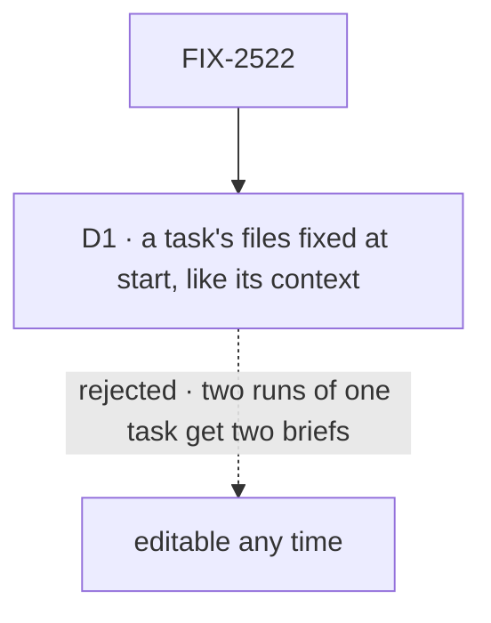

# FIX-2522 · Decisions

[Spec](SPEC.md) · **Decisions**

That a task's files are its brief's, owned by the board's scope and deleted with the task, is the
epic's ([ER-7](../../epics/FIX-2516/DECISIONS.md#who-owns-what)). One call is this issue's: when
the brief stops changing.

## The tree

Solid edges are what you're signing. Dashed edges lost, and the label says why.

## D1 · A task's files are fixed when it starts, like its context; a later screenshot is a line to the worker

| | |
|---|---|
| **Instead of** | Letting a person add files to the brief at any time |
| **Because** | A re-run is the reason a brief exists: it should get what the first run got. `context` already follows this rule (`until-start`), so the brief stays one thing |
| **Locks in** | `attachments` takes `context`'s field rule. A screenshot found mid-run is sent as a line to the worker; it reaches that run, not a later re-run. Changing the rule later changes it for both fields |

It comes down to the re-run: an editable brief gives two runs of one task two briefs.

## Decided, not asked

- **A task filed during a turn carries all of that turn's files.** The coordinator's create-task
  tool doesn't pick among them; a model can't name references it never saw as text.
- **Filing copies.** Each file is claimed again into the board's scope, so the session's copy and
  the task's live and die separately (the epic's seam *A reference's owner*).
- **Every composer** (task, `@worker` in a workstream, Inbox reply, Coordinator chat, new task)
  uses FIX-2518's `useAttachments` inside `ComposerShell`. No composer keeps its own handler.
- **Deleting a task deletes its files** through FIX-824's owner delete.
- **The brief line** draws the files under the folded text, through the registry message piece.

## Considered and dropped

| Alternative | Why not |
|---|---|
| The task references the message's files, no copy | Two owners for one file; a session deleted under a live task takes its brief's images |
| The model picks which files join a task | It sees no references; it would need a new tool argument for little gain |

## Analysis

2026-11-08 · watermark 2026-11-05 · **Right approach.** Run over the set by `epic-agent`.

1. **Reuse** — `attachments` follows `context`'s field rule rather than inventing one; the copy is
   FIX-824's claim. See [Builds on / Adds](SPEC.md#whats-already-here-and-the-debt).
2. **Prior art** — issue trackers (Linear, GitHub) keep a task's attachments on the task, not the
   comment that mentioned them. Confirms ER-7.
3. **Other shapes** — editable briefs, in the tree.
4. **New factors** — none.
5. **Necessity** — the epic's Shift Manager row.
6. **Ergonomics** — nothing new to learn in the app.
7. **Concerns** — none.

## How it got here

- **Drafted (Nov 8)** in the epic's spec set. The set review found FIX-824's claim named only a
  session as owner; FIX-824 now takes a board's scope too.

**Open: none.**
