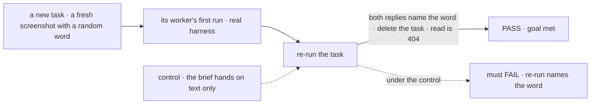

# FIX-2522 · Shift Manager: files in every composer, and a task's files in its brief

**Spec** · [Decisions](DECISIONS.md)

## Six people, before and after

| Someone who… | Today | After |
|---|---|---|
| **writes to a worker in a task, a workstream or the Inbox** | Text only | +, paste and drop in every composer; the worker gets the files with the line |
| **files a new task with a screenshot of the bug** | The worker never sees it | The screenshot is in the task's brief; the worker's first run gets it |
| **re-runs that task next morning** | The brief's text only | The same screenshot again: a task's files are its brief's, for every run ([ER-7](../../epics/FIX-2516/DECISIONS.md#who-owns-what)) |
| **asks the Shift Coordinator, with an image, to file a task for it** | The task gets the words | The task gets the words and that turn's images |
| **finds another screenshot after the task started** | n/a | Sends it as a line to the worker; the brief stays as filed ([D1](DECISIONS.md#d1)) |
| **loses the connection on Send** | The draft is kept for Retry (FIX-2371) | The draft's files are kept for Retry too |

## The goal, and how we'll know it's met

**In every Shift Manager composer a person can attach files the worker sees, and a task filed
with files hands them to every run of that task, until the task is deleted.**

| Is it the right goal? | |
|---|---|
| **The real need** | The epic's Shift Manager row: the image is in the task's brief, for every run |
| **Smaller, and rejected** | "The composers take files." A re-run, the reason a brief exists, loses the screenshot |
| **Bigger, and not this issue's** | A file library across tasks (the epic's *not doing*) |
| **Not done if** | The first run sees the file and a re-run doesn't · a deleted task's file still reads · a composer keeps its own paste handler |



The check reads both runs' replies and a read after delete, through the browser.

| How we verify | |
|---|---|
| **Goal check** | `goals/attachments/shift-manager-brief/` · real model and harness · real browser, the implementer first, `fsd-qa` over the mailbox if it can't · verdict in the implementation PR |
| **Signal** | First run and re-run both name the word; a Coordinator chat turn with an image that files a task gives that task's worker the word too; a line with an image in the Inbox and in a workstream reaches its worker; after delete, a read of the task's file is 404; a failed send keeps its files for Retry |
| **Input** | Screenshots drawn per run. A generator worker and a coding worker must both pass |
| **Anti-game** | Don't assert on the task row alone: a row can hold the files that no run receives |
| **Control that must fail** | `GOAL_CONTROL=brief-text-only`: FAIL on *re-run names the word* |

## What changes


The middle rows are ER-7, the rest is wiring FIX-2518's pieces into Shift Manager's shell.

```diff
  // src/lib/send.ts
  export async function sendTurn(
    client, target: TurnTarget,
    message: string,
+   attachments?: FileContent[],
  )
-   actions.send(target.door, { message, taskId }, { sessionId })
+   actions.send(target.door, { message, taskId }, { sessionId, attachments })

  // the task row (orchestration)
    context: z.string().optional(),
+   attachments: z.array(/* FileContent, reference form */).optional(),   // field rule "until-start"
```

**Docs:** Shift Manager's README, *Attaching files* (composers, a task's brief, re-runs). The
orchestration README's task-row fields gain the line.

## What stays as it is

- The worker door's `{ message }` ([epic D3](../../epics/FIX-2516/DECISIONS.md#d3)).
- `ComposerShell`'s keys and layout; the strip goes above the text.
- The brief's text and how `TaskBrief` folds it; the brief line also draws its files.

## What's already here, and the debt

| Already here | What this does with it |
|---|---|
| `ComposerShell` / `TurnComposer` (`shift-manager/src/components/TurnComposer.tsx`) | **Extends** with FIX-2518's hook and strip |
| `sendTurn` (`shift-manager/src/lib/send.ts`) | **Extends**: attachments in the send options |
| The task row's `context` and its `until-start` field rule (`orchestration/src/tasks/schema/task.ts`, `collection/field-rules.ts`) | **Builds on**: `attachments` takes the same rule ([D1](DECISIONS.md#d1)) |
| The coordinator's create-task tool (`orchestration/src/skills/task-tools-capability.ts`) | **Extends**: a task filed during a turn carries that turn's files |
| `TaskBrief` / `taskBriefOf` (`workforce/src/conversation-board/task-brief.ts`, `shift-manager/src/components/TaskBrief.tsx`) | **Extends**: the brief's user line holds the files too |
| FIX-2371's draft-until-the-send-lands | **Extends** to files |

| Adds | Existing piece considered | Why it doesn't fit / how composed |
|---|---|---|
| `attachments` on the task row | `context` (a string) | A reference list beside it, same field rule; no task noun in core (ER-7) |
| Copying a turn's files into the board's scope | FIX-824's claim | Composed: a claim into another owner; a reference is never shared (the epic's seam) |

| The debt | |
|---|---|
| **Removes** | Nothing |
| **Adds** | A second copy of a file when a task is filed from a message, by design (one owner per file) |
| **Leaves** | Editing a running task's brief, not supported today for `context` either |

**Net: up, a little.** One task-row field, one copy path.

## Sign off

**[The goal](#the-goal-and-how-well-know-its-met), at that size:** every composer, and every run
of a task. If wrong: the screenshot that started the task is gone by the re-run.

**[The debt](#whats-already-here-and-the-debt), net up a little.** If wrong: the copies cost
storage nobody planned for.

1. **[D1](DECISIONS.md#d1) · A task's files are fixed when it starts, like its context.** If
   wrong: a person can't add to a running task's brief, only send it as a line.

**Open: none.**

Feature · `shift-manager` + `orchestration` + `workforce` · medium · epic FIX-2516
