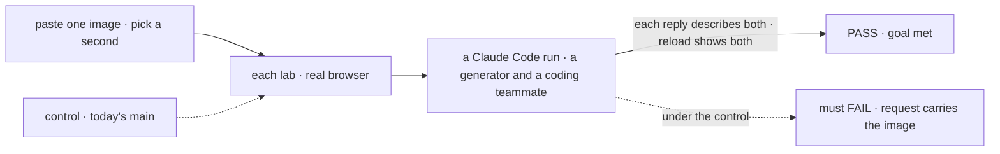

# FIX-2523 · Both labs: attach files in the Claude Code-style and Teammates composers

**Spec** · [Decisions](DECISIONS.md)

This spec covers **FIX-2523 and FIX-2524**. The epic set a collapse trigger: if neither lab spec
had a decision of its own, the spec set merges them ([epic D1](../../epics/FIX-2516/DECISIONS.md#d1)).
Neither has one: both labs replace a plain textarea with FIX-2518's pieces and send through the
same worker door. FIX-2524 is closed as a duplicate of this issue when the set is approved.

## Five people, before and after

| Someone who… | Today | After |
|---|---|---|
| **pastes a screenshot to a Claude Code run in the Claude Code-style lab** | Can't: the composer is a plain textarea | A thumbnail before Send; the run's reply describes it |
| **sends an image to a generator teammate in the Teammates lab** | Can't | The teammate's reply describes it |
| **sends one to a coding teammate** | Can't | The same, through the harness |
| **reloads either lab** | n/a | Their line shows its images |
| **drives the Claude Code-style lab from the keyboard** | Its shortcuts (`keys.ts`) | The same shortcuts; + is a Tab stop |

## The goal, and how we'll know it's met

**In both labs a person can paste, pick or drop files, see and remove them, and the reply shows
the worker saw them, live and after a reload.**

| Is it the right goal? | |
|---|---|
| **The real need** | Two of the epic's five chats |
| **Smaller, and rejected** | One lab now, the other later: the same work twice, reviewed twice |
| **Bigger, and not this issue's** | The other labs (knowledge-hub, design-system); the epic names these two chats only |
| **Not done if** | A lab keeps its own paste handler · the coding teammate gets the text only · the lab's shortcuts break |



The check reads each reply and the reloaded thread.

| How we verify | |
|---|---|
| **Goal check** | `goals/attachments/lab-composers/` · real model and real Claude Code · real browser, the implementer first, `fsd-qa` over the mailbox if it can't · verdict in the implementation PR |
| **Signal** | Each of the three replies describes both images; a reload shows both on the line; leg c's three refusals show and nothing is sent; every shortcut in `keys.ts` still fires |
| **Input** | Images drawn per run with a random word each |
| **Anti-game** | Don't assert on the adapter call alone: it can carry files the worker's flow drops |
| **Control that must fail** | Today's `main`: FAIL on *request carries the image* (no way to attach) |

## What changes


The two composer rows are the same change in two styles; the adapter row is the same in both.

```diff
  // labs/<lab>/src/adapter.ts, both labs
- send: async (sessionId, text) => {
-   await flow.send("respond", { message: text }, { sessionId, stream: true });
+ send: async (sessionId, text, attachments) => {
+   await flow.send("respond", { message: text }, { sessionId, stream: true, attachments });
```

**Docs:** each lab's README gains one line. No user docs: labs aren't documented.

## What stays as it is

- The worker door `respond` and its `{ message }`.
- The Teammates lab's queued line ("reads it after this turn"): a line with files waits like any
  other.
- Each lab's thread renderer, except that a user line draws its files through the registry piece.

## What's already here, and the debt

| Already here | What this does with it |
|---|---|
| `labs/claude-code-style/src/components/Composer.tsx`, `labs/teammates/src/components/Composer.tsx` | **Extends** with `useAttachments` and `AttachmentStrip` |
| Each lab's `adapter.send` | **Extends**: one argument, forwarded |
| `use-draft-send.ts` (Claude Code-style) | **Extends**: the draft keeps its files until the send lands |
| Anything in the labs that reads files | **None.** Searched `clipboardData`, `onDrop`, `readAsDataURL` in `labs/` |

| Adds | Existing piece considered | Why it doesn't fit / how composed |
|---|---|---|
| Nothing to a package | FIX-2518's pieces, FIX-2517's send option | Composed |

| The debt | |
|---|---|
| **Removes** | One issue: FIX-2524 folds in |
| **Adds** | Nothing |
| **Leaves** | Nothing in this area |

**Net: flat.** Wiring in two labs.

## Sign off

**[The goal](#the-goal-and-how-well-know-its-met), at that size:** both labs, generator and coding
workers. If wrong: a lab chat stays text-only.

**[The debt](#whats-already-here-and-the-debt), net flat.** If wrong: nothing; it is wiring.

**No decisions of its own**, which is why the two lab issues are one. See
[DECISIONS.md](DECISIONS.md).

**Open: none.**

App · `labs/claude-code-style` + `labs/teammates` · small · epic FIX-2516 · covers FIX-2524
