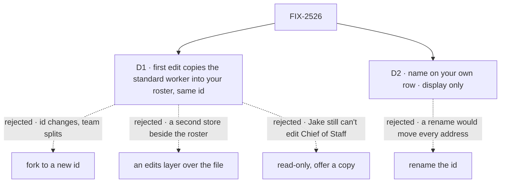

# FIX-2526 · Decisions

[Spec](SPEC.md) · **Decisions**

Inputs, not reopened: FIX-1790's worker row, `fork` and `edit`; FIX-1959's display names;
FIX-2334's identity line; FIX-2525's panel and form.

## The tree

Dashed edges lost, for the reason on the label.

## D1 · Editing a standard worker makes your own copy of it, under the same id

Jake, on the spec PR: *"The worker config should just be its own copy in the user's scope
anyway… I thought the whole point to having worker templates was to do this."*

| | |
|---|---|
| **Instead of** | Fork to a new id · a separate per-user edits collection laid over the file · read-only with "Make my own copy" |
| **Because** | Standard workers are templates; a user's working copy belongs on their own roster. Today nothing copies them: every user's turn reads the file (`standard-workers.ts`). The first `edit` makes the copy `fork` already makes, but keeps the standard id, so Chief of Staff's conversation, tasks, teammates' messages and every `WORKER.md` that names it as a delegate still reach it. The turn already reads the user's own row before the file (`lookupWorker`), so the copy takes over with no new read path. An edits collection would be a second store beside the roster for the same thing |
| **Locks in** | A user's own row may carry a standard worker's id, with `forkedFrom` equal to it; `hire` and `fork` onto a standard id stay refused, so only `edit` makes one. Both roster reads list that worker once, as the user's copy, with `edited: true`. `reset(id)` deletes the copy. The copy is a snapshot (FIX-1790 D3): a later deploy of the file stops reaching that user, tools and skills included, until they reset. A flow kept for standard workers (`standardOnly`) refuses a copy, so those workers stay read-only |

**What would change my mind:** deploys to standard workers' tools needing to reach users who
edited them. Then the copy would hold name and instructions only and follow the file for the
rest.

**If wrong:** a copy is an ordinary own row; `reset` or deleting it puts the user back on the file.

## D2 · Your own workers carry a display name, separate from the id

| | |
|---|---|
| **Instead of** | Renaming the id |
| **Because** | The id is the address for messages, tasks, sessions and delegates. A display name is what FIX-1959 gave standard workers; this gives your own the same field |
| **Locks in** | `name: string \| null` on the worker row, `.nullable().default(null)`, so every stored row still reads (BP-030). Whitespace saves as `null`. `hire` and `edit` take it; `edit` with `name: null` clears it. The roster shows `name`, and the client's row projection exposes it. Names are not unique and are never resolved as an address. The copy D1 makes takes the file's name; `fork` to a new id does not copy one |

## Decided, not asked

- **Instructions stay server-only.** The client still can't read a worker's instructions, so the
  form sets them whole, as FIX-2525's does. Reading them back is a separate change.
- **Per user, per organization.** The copy is on the user-scoped roster, so no other user's read
  or turn reaches it.
- **Running turns keep their own.** Rows are read when the turn starts, as today.
- **The org inventory keeps the file's name.** It is org-scoped; the lab names teammates from
  `roster()`.
- **The lab's hire still makes the id from the typed name**, lowercased; the display name starts
  `null`, so the list shows the id until renamed.

## Notes from review

- Gitar, round 1: the first draft named two read sites and missed the client's `roster()` and the
  org inventory. Both are covered above.
- Jake, round 1: replace the edits collection with the user's own copy. D1 redrafted.
