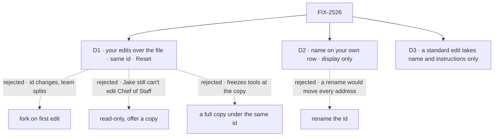

# FIX-2526 · Decisions

[Spec](SPEC.md) · **Decisions**

Inputs, not reopened: FIX-1790's worker row and `edit`; FIX-1959's display names; FIX-2334's
identity line; FIX-2525's panel and form.

## The tree

Dashed edges lost, for the reason on the label.

## D1 · Editing a standard worker lays your edits over its file, under the same id

**This is the decision put to Jake** (the issue's open question, options a, b and c).

| | |
|---|---|
| **Instead of** | (a) fork on first edit · (c) read-only with "Make my own copy" · a full copy stored under the standard id |
| **Because** | Only an edit under the **same id** keeps what the issue asks to keep. Chief of Staff's conversation, its tasks, the other teammates' messages to it and every `WORKER.md` that names `chief-of-staff` as a delegate all address the id. A fork gets a new id, so the edited copy starts with no conversation and nobody's messages reach it, while the original keeps running beside it. A full copy under the same id keeps the id, but freezes the file's tools, skills and team text at the copy (FIX-1790 D3), so a deploy stops reaching that user for everything, not only the two fields they changed |
| **Locks in** | A user-scoped `workforce/worker-edits/<id>` row with `name` and `instructions`, each `null` for "the file's". `resolveWorker`, the server roster and the client's `roster()` read it (the client at each read, the other two at the start of every turn). The org inventory keeps the file's name. Its existence is `edited` on the roster. `reset(id)` deletes it. The file is never written, so FIX-1786's *"a standard worker always matches its file"* becomes *"matches its file, except the name and instructions a user set for themselves"* |

**What would change my mind:** a need to edit a standard worker's tools or skills too. Then a full
copy under the same id is the cheaper shape, and this layer should go rather than grow.

**If wrong:** delete the collection and its three read sites; nobody's id or session moved.

The Architect earlier leaned to fork-on-edit (FIX-2309 gap 1). It is rejected here for the id
alone: under it, acceptance criterion 1 (*"leaves its id, conversation, tasks and message history
intact"*) can't hold for Chief of Staff.

## D2 · Your own workers carry a display name, separate from the id

| | |
|---|---|
| **Instead of** | Renaming the id |
| **Because** | The id is the address for messages, tasks, sessions and delegates. A display name is what FIX-1959 gave standard workers; this gives your own the same field |
| **Locks in** | `name: string \| null` on the worker row, `.nullable().default(null)`, so every stored row still reads (BP-030). Whitespace saves as `null`. `hire` and `edit` take it; `edit` with `name: null` clears it. The roster shows `name`, and the client's row projection exposes it. Names are not unique and are never resolved as an address. `fork` does not copy a name |

## D3 · A standard worker's edit takes name and instructions only

Decided, not asked. `edit` on a standard id with `flow`, `description`, `skills` or `settings`
is refused, naming the fields, and writes nothing: *"fork it to change those"*. `hire`, `fork`
onto a standard id and `fire` stay refused as today. `reset` on a worker that isn't standard, or
has no edits, is refused.

## Decided, not asked

- **Instructions stay server-only.** The client still can't read a worker's instructions, so the
  form sets them whole, as FIX-2525's does. Reading them back is a separate change.
- **Per user, per organization.** The edits row is user-scoped like the worker collection, so no
  other user's read or turn reaches it.
- **Running turns keep their own.** Both reads happen when the turn starts, as every worker row is
  read today. No new mechanism.
- **The lab's hire still makes the id from the typed name**, lowercased; the display name starts
  `null`, so the list shows the id until renamed.

## Notes from review

- Gitar, round 1: the spec named two read sites and missed the client's `roster()` and the org inventory. Fixed: three read sites; the inventory keeps the file's name, on purpose.
