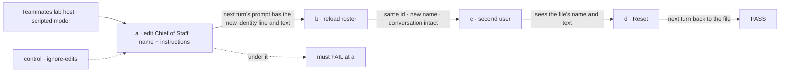
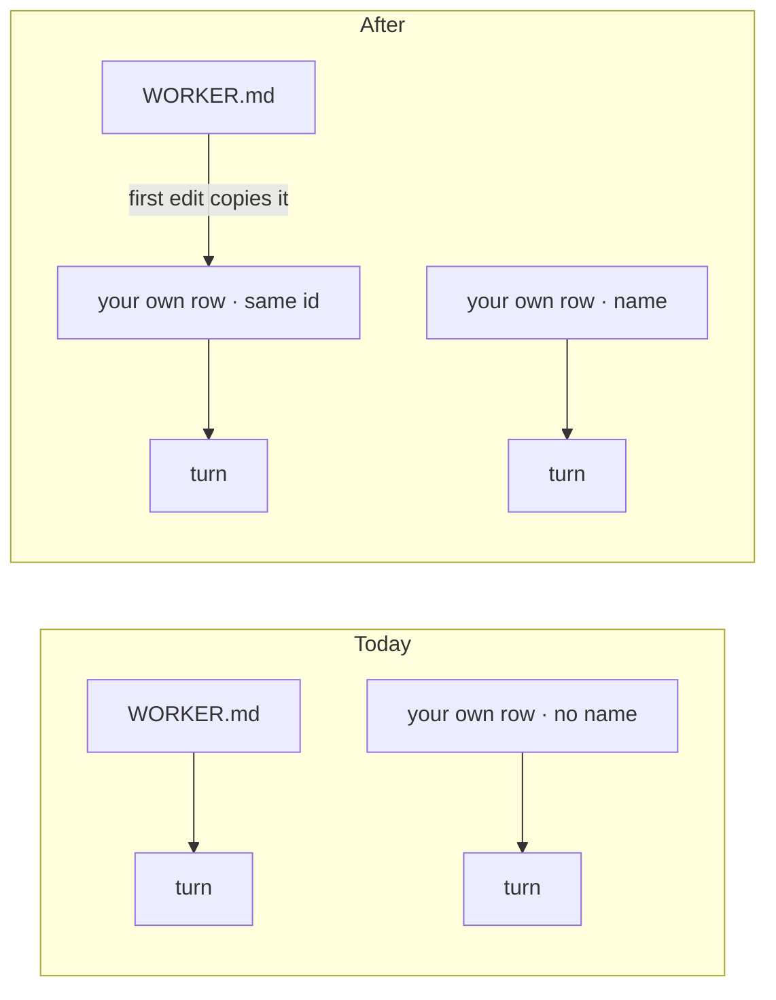

# FIX-2526 · Edit any teammate's name and instructions

**Spec** · [Decisions](DECISIONS.md)

Child of epic [FIX-2152](../../epics/FIX-2152/SPEC.md), split from FIX-2525 (the teammate panel,
Done). Jake, 2026-11-03: *"We can also have teammate info in the right sidebar, where I can edit
the name and the instructions using an edit button."* FIX-2525 shipped the panel and the Edit
form; the form edits instructions for a teammate you hired and shows the name read only, with
*"Renaming a teammate isn't possible yet"*. Standard teammates (Chief of Staff, researcher,
writer) can't be edited at all.

## Who feels it, before and after

| Someone who… | Today | After |
|---|---|---|
| **renames a teammate they hired** ("tester" → "QA Bot") | Can't: the name is its id, and the id is its address | The new name shows in the list, the header, task lines and *Messaged …* lines, and survives a reload. The id, its conversation, tasks and messages stay as they were |
| **edits Chief of Staff's instructions** | Can't: *"comes from the lab's files"* | Saves. Chief of Staff's **next** turn follows them; a turn already running keeps its own |
| **renames Chief of Staff** | Can't | Its next turn says *"You are &lt;new name&gt;"*; the other teammates' rosters list it by the new name, in this user's roster only |
| **wants Chief of Staff back as shipped** | Nothing to undo | **Reset to default** deletes their copy; the file's Chief of Staff is back from the next turn |
| **another user in the same organization** | Sees the file's Chief of Staff | Still does: the copy is in the editor's own scope |
| **deploys a change to Chief of Staff's file** | Reaches every user | Reaches every user who hasn't edited it. A user who has keeps their copy, tools and all, until they reset ([D1](DECISIONS.md#d1)) |

## The goal, and how we'll know it's met

**Every teammate in the lab, standard or hired, can be renamed and given new instructions from its
panel, without changing who it is: its id, conversation, tasks and messages stay, and its next
turn uses the new name and instructions.**

- **The real need:** Jake edits the team he works with every day, starting with Chief of Staff.
- **Smaller, and rejected:** renaming hired teammates only. Chief of Staff is the one Jake talks to.
- **Bigger, and not this issue's:** showing a teammate's current instructions in the panel (they
  stay on the server; the form still sets them whole). The lab's form edits name and instructions
  only, though `edit` on a standard worker's copy takes any field but its flow, which stays the file's because board tasks are routed by it.
- **Not done if:** a rename changes an id or loses a conversation; a name shows in one place and
  not another; an edit reaches a turn already running; one user's edit reaches another user;
  Reset leaves the copy behind; the roster lists Chief of Staff twice.



The check reads the prompt the scripted model received and the roster, never the adapter's calls.

**How we verify.**

- **Workforce tests:** `hire`/`edit` with `name` round-trip through `roster()`; the id is unchanged
  after a rename; a row stored before `name` existed still reads (BP-030); `edit` on a standard id
  writes the user's own copy under that id, and `resolveWorker` and both rosters use it, listing
  the worker once; a later `edit` of the copy's skills or settings round-trips like any own row; `reset` deletes the copy; another user's roster is untouched.
- **Goal, `goals/teammates-lab/a-standard-teammate-takes-your-edits/`**, model-free, run with
  `pnpm tsx goals/teammates-lab/a-standard-teammate-takes-your-edits/run.mts`. Legs as in the
  figure, plus a hired teammate's rename leg. **Control** `GOAL_CONTROL=ignore-edits` builds the
  host so the turn reads the file, not the edit: leg a FAILS.
- **Lab screen test:** the renamed teammate's new name in the list, header, a task line and a
  *Messaged …* line.

## What changes



Your first edit to a standard worker copies it into your own roster under the same id; your own
rows gain a name.

```diff
 // @flow-state-dev/workforce, WorkforceClient
-hire({ id, flow?, description?, instructions?, skills?, settings? })
+hire({ id, name?, flow?, description?, instructions?, skills?, settings? })
-edit({ id, flow?, description?, instructions?, skills?, settings? })  // rejects a standard id
+edit({ id, name?, flow?, description?, instructions?, skills?, settings? })
+  // a standard id: copies it to your roster under the same id first
+reset(id)  // deletes your copy of a standard worker
 // RosterEntry
-name: string | null   // only a standard worker has one
+name: string | null   // your row's, else the file's
+edited: boolean       // a standard worker you have your own copy of
```

- **Workforce:** the worker row gains `name`. `edit` on a standard id copies the file's worker
  into the user's own roster under the **same id** (the copy `fork` already makes, with
  `forkedFrom` set to that id), then applies the change. The turn already reads the user's own row
  before the file, so nothing changes in `resolveWorker`. The two roster reads (the server's and
  the client's) list such a worker once, as the user's copy, marked `edited`. `reset` deletes the
  copy. Rows are read at the start of a turn, so a running turn keeps its own.
- **Not changed:** the organization's worker inventory keeps each file's name. It is org-scoped,
  and the lab names teammates from `roster()`.
- **Lab:** the Edit form takes name and instructions for every teammate, and shows **Reset to
  default** on an edited standard teammate. Hiring still makes the id from the typed name.
- **Docs:** none in this PR (release docs). The changeset names `name`, standard-worker `edit` and
  `reset`.

## What's already here, and the debt

| Kind | What | Verdict |
|---|---|---|
| Builds on | `edit` and the user-scoped worker collection (FIX-1790); `workerDisplayName` and the roster's `name` (FIX-1959); the identity line (FIX-2334); FIX-2525's form | Reused |
| Amends | FIX-1786 ER-1 and its concept (*"You can't customize a standard worker"*) | You can: your edit makes your own copy under its id. The file is still never written |
| Builds on | `fork`'s copy (`rowFromStandard`) and the turn's own-row-first lookup | Reused: the copy keeps the standard id instead of taking a new one ([D1](DECISIONS.md#d1)) |
| Adds | One verb (`reset`), one roster field (`edited`) | New, small |
| Removes | The lab's read-only name and *"can't be changed here yet"* lines | — |

**Net:** a small addition that amends one epic rule on purpose. **If wrong:** a user's copy is an
ordinary own row; deleting it puts them back on the file, and no id or session moves.
