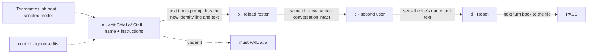
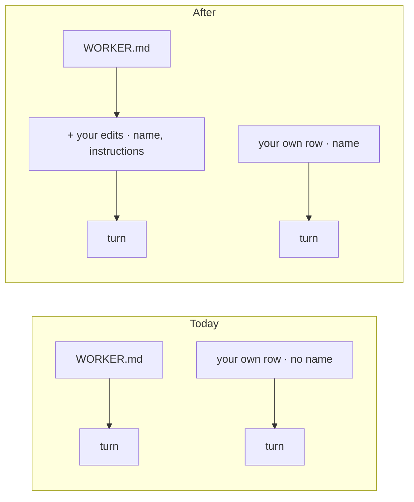

# FIX-2526 · Edit any teammate's name and instructions

**Spec** · [Decisions](DECISIONS.md)

Child of epic [FIX-2152](../../epics/FIX-2152/SPEC.md), split from FIX-2525 (the teammate panel,
Done). Jake, 2026-11-03: *"We can also have teammate info in the right sidebar, where I can edit
the name and the instructions using an edit button."* FIX-2525 shipped the panel and the Edit
form; the form edits instructions for a teammate you hired and shows the name read only, with
*"Renaming a teammate isn't possible yet"*. Standard teammates (Chief of Staff, researcher,
writer) can't be edited at all.

## Who feels it, before and after

| Someone who… | Today | After |
|---|---|---|
| **renames a teammate they hired** ("tester" → "QA Bot") | Can't: the name is its id, and the id is its address | The new name shows in the list, the header, task lines and *Messaged …* lines, and survives a reload. The id, its conversation, tasks and messages stay as they were |
| **edits Chief of Staff's instructions** | Can't: *"comes from the lab's files"* | Saves. Chief of Staff's **next** turn follows them; a turn already running keeps its own |
| **renames Chief of Staff** | Can't | Its next turn says *"You are &lt;new name&gt;"*; the other teammates' rosters list it by the new name, in this user's roster only |
| **wants Chief of Staff back as shipped** | Nothing to undo | **Reset to default** drops their edits; the file's name and instructions are back from the next turn |
| **another user in the same organization** | Sees the file's Chief of Staff | Still does: edits are per user, per organization |
| **deploys a change to Chief of Staff's file** | Reaches every user | Reaches every user for everything a user can't edit (tools, skills, team text, flow). For a user who edited its instructions, their text holds until they reset ([D1](DECISIONS.md#d1)) |
| **edits a standard worker's tools or skills** | Refused: fork it | Still refused, with the same advice |

## The goal, and how we'll know it's met

**Every teammate in the lab, standard or hired, can be renamed and given new instructions from its
panel, without changing who it is: its id, conversation, tasks and messages stay, and its next
turn uses the new name and instructions.**

- **The real need:** Jake edits the team he works with every day, starting with Chief of Staff.
- **Smaller, and rejected:** renaming hired teammates only. Chief of Staff is the one Jake talks to.
- **Bigger, and not this issue's:** showing a teammate's current instructions in the panel (they
  stay on the server; the form still sets them whole), editing a standard worker's tools or skills.
- **Not done if:** a rename changes an id or loses a conversation; a name shows in one place and
  not another; an edit reaches a turn already running; one user's edit reaches another user;
  Reset leaves either field edited; a standard worker's tools can be changed through `edit`.



The check reads the prompt the scripted model received and the roster, never the adapter's calls.

**How we verify.**

- **Workforce tests:** `hire`/`edit` with `name` round-trip through `roster()`; the id is unchanged
  after a rename; a row stored before `name` existed still reads (BP-030); `edit` on a standard id
  with `name`/`instructions` saves and `resolveWorker` uses it; `edit` on a standard id with any
  other field is refused and writes nothing; `reset` clears it; another user's roster is untouched.
- **Goal, `goals/teammates-lab/a-standard-teammate-takes-your-edits/`**, model-free, run with
  `pnpm tsx goals/teammates-lab/a-standard-teammate-takes-your-edits/run.mts`. Legs as in the
  figure, plus a hired teammate's rename leg. **Control** `GOAL_CONTROL=ignore-edits` builds the
  host so the turn reads the file, not the edit: leg a FAILS.
- **Lab screen test:** the renamed teammate's new name in the list, header, a task line and a
  *Messaged …* line.

## What changes



A standard worker's turn reads its file with your edits laid over two fields; your own worker's
row gains a name.

```diff
 // @flow-state-dev/workforce, WorkforceClient
-hire({ id, flow?, description?, instructions?, skills?, settings? })
+hire({ id, name?, flow?, description?, instructions?, skills?, settings? })
-edit({ id, flow?, description?, instructions?, skills?, settings? })  // rejects a standard id
+edit({ id, name?, flow?, description?, instructions?, skills?, settings? })
+  // a standard id takes name and instructions only
+reset(id)  // drops your edits to a standard worker
 // RosterEntry
-name: string | null   // only a standard worker has one
+name: string | null   // yours, else the file's
+edited: boolean       // a standard worker you edited
```

- **Workforce:** the worker row gains `name`. A new user-scoped collection holds a user's edits to
  standard workers, keyed by the standard id. `edit` writes it for a standard id; `reset` deletes
  it. `resolveWorker` and the roster lay it over the file's `name:` and body. Edits are read at the
  start of a turn, like every row today, so a running turn keeps its own.
- **Lab:** the Edit form takes name and instructions for every teammate, and shows **Reset to
  default** on an edited standard teammate. Hiring still makes the id from the typed name.
- **Docs:** none in this PR (release docs). The changeset names `name`, standard-worker `edit` and
  `reset`.

## What's already here, and the debt

| Kind | What | Verdict |
|---|---|---|
| Builds on | `edit` and the user-scoped worker collection (FIX-1790); `workerDisplayName` and the roster's `name` (FIX-1959); the identity line (FIX-2334); FIX-2525's form | Reused |
| Amends | FIX-1786 ER-1 and its concept (*"You can't customize a standard worker"*) | Name and instructions become per-user editable; the file is still never written |
| Considered | `fork` (FIX-1790 D3) | Rejected for standard edits: it changes the id ([D1](DECISIONS.md#d1)) |
| Adds | One collection (`workforce/worker-edits/*`), one verb (`reset`), one roster field (`edited`) | New, small. The collection is debt if standard edits later grow to more fields: that is the point to re-decide, not to widen |
| Removes | The lab's read-only name and *"can't be changed here yet"* lines | — |

**Net:** a small addition that amends one epic rule on purpose. **If wrong:** the edits layer can
be removed with its collection; no worker id or session changes either way.
