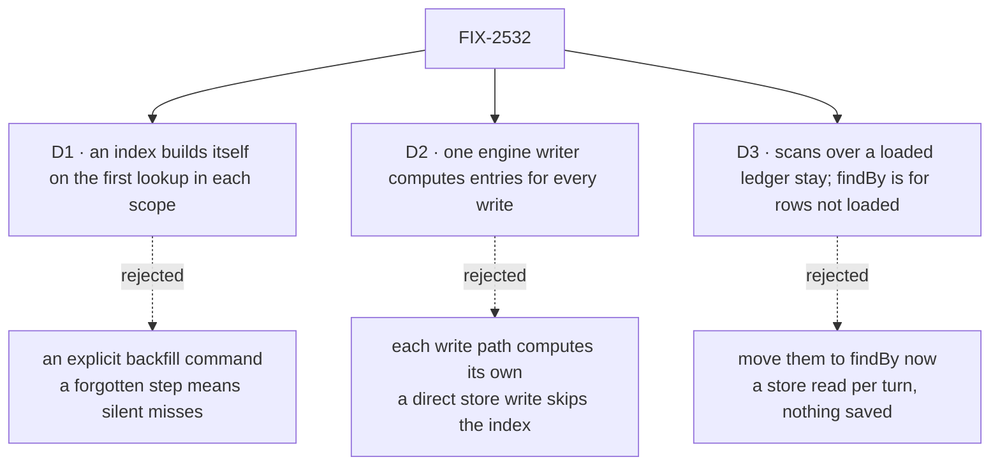

# FIX-2532 · Decisions

[Spec](SPEC.md) · **Decisions**

What was considered, what was chosen, why, and what each choice locks in. Three decisions are
the sign-off surface. Everything else here is context for them.

## The tree

Solid edges are what you're signing. Dashed edges lost, and the label says why.

## D1 · A new or changed index builds itself on the first lookup in each scope

| | |
|---|---|
| **Instead of** | An explicit backfill command an operator runs after deploying a new or changed index |
| **Because** | A command someone forgets leaves `findBy` returning too few rows with no error, which is the one failure a lookup must not have. The first call per scope already has to read the rows to answer, so it writes their entries and records `(scope, collection, index, version)` as built. A version bump counts as unbuilt, so a changed index function rebuilds the same way |
| **Locks in** | Index entries are a superset, re-checked against each row on every read. To keep it one, the build only adds entries and never replaces them, and a live write always writes its entries whether or not the index is built yet: a build that replaced entries with the state it read could undo a write that landed mid-build. The first lookup per scope per index version pays one scan of that scope. For the ledger's `byTaskId` that scope is the user cell, every conversation's partitions, once. Every caller of `findBy`, ours or an app's, inherits that one-time cost. A write that carries no entries for an index the scope has marked built or building clears that marker, so the next lookup rebuilds, and a build marks itself built only if its building marker survived the scan |

It comes down to the step nobody runs: a command that is forgotten makes `findBy` silently miss rows.

**Upgrade note.** The marker rule covers a process that runs this change's store code but doesn't
declare the index, such as a v1 process still writing during a rolling deploy to v2: its writes
clear the marker and the next lookup rebuilds. It can't cover a binary from before this change,
whose store knows no markers. A row such a binary writes after the first lookup has no entries
until it is rewritten. Finish that rollout before the first lookup, or bump the index's version
once it's done, which rebuilds.

**What would change my mind:** a scope large enough that one scan on a request path is not
acceptable. Then a command is added beside the lazy build, not instead of it.

## D2 · One engine writer computes index entries for every resource write

| | |
|---|---|
| **Instead of** | Each engine write path (block writes, the browser create route) computing entries from the collection it already holds |
| **Because** | A row written without its entries is never found again, and no read-side check can recover a missing entry (a stale one is filtered; an absent one is invisible). Writes reach the store from more than the block path: the resource routes, and host code that writes `stores.resourceState` directly. The owner-writes check is no model here: it lives in each run's resource registry (`engine/src/context/resource-registry.ts`), and direct store writers skip it. So the writer wraps the `StoreRegistry` that `createFlowState` resolves (`engine/src/flowstate/createFlowState.ts`), before the router, the worker or `runtime.stores` takes it, and every handle derives from the wrapped one ([tenet 5](../../../docs/philosophy.md)). That covers `harness-manager/src/upgrade-kept-turns.ts`, which the devteam host calls with `runtime.stores`, and goal seeds that write through `runtime.stores` |
| **Locks in** | The app's index declarations are known at startup. The writer computes a key's entries from every registered declaration whose pattern matches it, not from the writing flow's, so a flow that declares the same pattern without `indexes` still writes the entries another flow declared, and is no conflict. Startup refuses one index name at two versions on overlapping patterns in one scope; functions can't be compared, so name and version are the identity. A process that registers no flow declaring an index writes no entries for it; its writes clear the built marker ([D1](#d1)), so the cost is a rebuild, not a missed row |

It comes down to a write that skips the block path: per-path computation leaves that row unfindable.

**What would change my mind:** processes that routinely write collections they don't declare.
Then entries would have to be computed in the store from a persisted declaration.

## D3 · Scans over a loaded ledger stay; `findBy` is for rows not yet loaded

| | |
|---|---|
| **Instead of** | Moving the task ledger's in-partition scans to `findBy` now, with an in-memory filter for the part one field doesn't answer |
| **Because** | Every one of them filters a partition the request already holds in memory, so an index saves no read. Most ask more than one field equality answers (table below), so each would still filter in code after an awaited store read, and it would read the committed index where the rest of the turn reads the request's mirror. The one lookup that does avoid loading rows, a task id across partitions, is `__ids`, and it moves |
| **Locks in** | `findBy` is the way to find rows by a field **when the alternative is reading them from the store**; filtering rows already loaded is not a lookup, and the docs say so. The task ledger declares one index, `byTaskId` |

It comes down to what an index saves: on a partition already in memory, nothing.

| Site (chained `list(...).find/filter/some`) | Asks | If the ledger stopped loading whole partitions |
|---|---|---|
| `held-task.ts` `claimedTask` | in progress, and `run.requestId` **or** the stamped claim's id | `findBy` on `run.requestId` + `get` of the claim, status filtered in code |
| `held-task.ts` `linkedTaskOf` | `run.requestId` | `findBy` |
| `steer.ts` (thread lookup, settle-wake) · `task-admission.ts` `ownTaskRow` | open thread of `taskId`; in progress and `run.sessionId` | `findBy` on the one field + status filtered in code |
| `task-admission.ts` `piecesHold` | legacy rows without `filedByTask` | stays: ages out with the rows |
| `routed-session.ts` | open rows with a `targetSessionId` | stays: a sweep, not a lookup |
| `wait-on-task.ts` `releaseEndedWaits` | lapsed wait with a request id | `findBy` on a derived `lapsedWait` value |
| `steer-context.ts` `runningTaskOf` · `task-tools-capability.ts` (claim, duplicate check) | session, request and attempt together; assignee, target, goal | `findBy` on `run.requestId` + the rest in code; the duplicate check stays |

**What would change my mind:** the ledger stops hydrating whole partitions. Then each site
becomes a store read, and moves to `findBy` plus an in-memory filter as the last column says.

## Decided, not asked

- **The convergence point for "every row's entries match its index functions"** is the D2
  writer, on the registry `createFlowState` resolves. Writers that pass through it:
  `mutateResourceKey` and `deleteResourceKey` (`engine/context/createExecutionContext.ts`), the
  browser create and delete routes (`engine/routes/resource-routes.ts`), `deleteAll`
  (`session-routes.ts`), and host-level writers given `runtime.stores`
  (`harness-manager/src/upgrade-kept-turns.ts`, goal seeds). Test seeds
  (`testing/src/runtime/createTestContext.ts`, `testing/src/test-utilities/testFlow.ts`) write
  before any lookup, so D1's build picks them up. Tombstone, `deleteAll` and `purgeTombstones`
  clear entries inside the store, with no declaration needed.
- **Store verbs on `ResourceStateStore`, all optional:**
  - `set(scopeType, scopeId, key, state, expectedVersion, options?: { indexEntries?:
    IndexEntry[] })`, where `IndexEntry` is `{ collection, index, values }`: the full pattern,
    the index name with its version, and the canonical value strings (empty for `null`). In the
    row's transaction the store replaces the key's entries for each listed `(collection, index)`
    and deletes the built or building marker of any index in the scope whose pattern matches the
    key and that the call doesn't list (D1). A `set` without options lists nothing.
  - `indexes?: { state, beginBuild, completeBuild, findKeys }`. `state(scope, collection, index)`
    returns `unbuilt`, `building` or `built`. `beginBuild` writes the building marker.
    `completeBuild(scope, collection, index, entries: { key, values }[])` adds the entries and
    flips building to built in one transaction, only if the building marker is still there;
    otherwise the lookup's own scan has answered and the next one tries again.
    `findKeys(scope, collection, index, value)` returns keys. A store implements all four or
    none.
  - `delete`, `deleteAll` and `purgeTombstones` keep their signatures and clear entries inside
    the store.
- **SQL: one generic table**, `resource_index(scope_type, scope_id, collection, index_name, value,
  resource_key)` with all six as the primary key, plus a built-marker table. A write replaces
  that row's entries in the same transaction. No per-field DDL, no `ALTER TABLE`.
- **`collection` is the collection's full declared pattern**, not its storage prefix: two
  patterns can share a prefix (`data/[topic]/observations` and `data/[topic]/notes` are both
  `data`), and a shared identity would let one collection's built marker cover the other. The
  version is part of the stored index name, so entries of an old version are never read.
- **`findBy` reads the same cell and passes the same owner fence as `list`.** A partitioned
  ledger's partitions share one cell, so a lookup crosses partitions, which is what
  `findTaskPartitions` needs. `TaskCollectionRef` gets no `findBy`: nothing calls it (D3).
- **What `findBy` sees:** keys come from the committed index, and a write persists when it is
  made, so this request's own writes are found. Each hit's state is read as `get` reads it, and
  a key this request deleted is not returned. It can return a row another request committed
  after this one started, which an eagerly loaded `list` would not.
- **Cost on SQL:** one index query, then one row read per hit for the re-check. Cheap for a key
  like a task id; an index whose value many rows share costs a read per row it returns.
- **Values:** a string, number or boolean, or an array of them, normalised to a canonical string.
  `null` and `undefined` index nothing. Equality only.
- **Determinism:** an index function sees `key` and `state` only, documented and tested. One
  that reads the clock drifts; the read-side re-check filters what it returns but can't add what
  it missed.
- **Declaration shape:** a function (version 1) or `{ version, value }`.
- **`taskLedgerResources(ledger)` keeps its name** and returns the ledger alone, so app code
  that spreads it keeps working. `__ids` rows are left in stores, unread (BP-030).
- **Memory and filesystem stores implement no index verbs**: the engine's scan serves them, and
  the conformance suite runs the same cases against all stores.

## Considered and dropped

| Alternative | Why not |
|---|---|
| Keep scanning with `list().filter()` everywhere | The simplest option, and correct. It loads the scope on every lookup, and a ledger kept per partition still needs `__ids` to find an id without loading every partition |
| An index per field: JSONB expression indexes or generated columns | Per-field DDL and migrations for every declaration; SQLite and Postgres diverge |
| An ORM (Drizzle, Kysely) | Doesn't remove the hard part, keeping entries in step with rows |
| Maintain entries from `onInstance*` hooks, as the schedule index does | Hooks run after the write and don't see direct store writes, so an entry and its row commit apart |
| Ledger-local: a second key per task (`<ledger>/by-id/<taskId>/<partition>`) or an id-first key layout | `byTaskId` is today's only consumer, so this is the cheap alternative. A second key is a second `set`, which is `__ids` again: marker and row commit apart. An id-first layout breaks the partition prefix read the ledger loads by. And the issue's objective is that no package builds its own index, so a ledger-local fix is the thing being removed |

## Settled

- **The scans over a loaded ledger, and the one hand-built index** — **CONFIRMED** by
  [`poc/fact-check/check.sh`](poc/fact-check/check.sh), which counts every chained
  `list(...).find|filter|some` site in `workforce` and `orchestration` sources, across lines, per
  file, and asserts the count is the inventory on [D3](#d3): eleven sites in seven files. Its
  control, `FACT_CHECK_PLANT=1`, plants a multiline site in a listed file and fails, as it must.
  It proves the inventory, not that a site could move as a drop-in; D3's table says what each asks.

## Analysis

2026-11-04 · watermark 2026-11-03 (issue filed) · **Right approach.** Run in the authoring
session: no fresh sub-agent was available in this environment.

1. **Reuse** — `indexes`/`findBy` extend `collection`; the store verbs extend `store`; the writer
   reuses the owner-writes placement; `findTaskPartitions` keeps its lookup over `byTaskId`.
   None is a second mechanism except as recorded in the debt. See
   [Builds on / Adds](SPEC.md#whats-already-here-and-the-debt).
2. **Prior art** — a side index table written in the row's transaction is the standard secondary
   index over key/value-on-SQL. Lazy build on first query matches CouchDB views; Firestore and
   DynamoDB require an explicit build, which D1 rejects for the reason on its card.
3. **Other shapes** — hooks-maintained index, per-field DDL, scanning: recorded in *Considered
   and dropped*.
4. **New factors** — none since the watermark; open PRs touch neither the resource store nor
   `id-index.ts`.
5. **Necessity** — earns its place: it removes a hand-built index whose marker and row commit
   apart.
6. **Ergonomics** — one config field and one method; `findBy` returns the refs `list` returns.
7. **Concerns** — D3 as first drafted moved four scans for consistency, not speed; review
   showed the scans are eleven and mostly compound, and D3 now leaves them (*How it got here*).

## How it got here

- **Draft** — framed as a field lookup the framework keeps current; a generic SQL index table
  written in the row's transaction, a scan elsewhere, and a lazy build; replaces FIX-2160 D1's
  hand-built `__ids`.
- **Round 1** — D3 reversed: the in-partition scans stay on the loaded mirror, because review
  showed there are eleven, not four, most on predicates one field doesn't answer, over rows
  already in memory, so moving them saved no read and added one. `TaskCollectionRef.findBy`
  dropped with them. Collection identity changed from the storage prefix to the full pattern,
  because two patterns can share a prefix. D1 now states the build's add-only discipline.
- **Round 2** — precision only. A write without an index's entries clears its built marker, so
  a process that doesn't declare the index costs a rebuild rather than a missed row; the
  upgrade gap that rule can't close is named on D1. D2's writer sits on the resolved
  `StoreRegistry`, not beside the owner-writes check, and the store verbs are named.

## Notes from review

For the implementer, not baked into the design.

- **cursor[bot], D1:** "lazy build granularity should match `TaskCollectionRef` partition
  narrowing where possible, so D1's one-time cost does not regress FIX-2160-scale paths on first
  deploy." `byTaskId` crosses partitions by definition, so a partition-sized build can't answer
  it; the one-time cell scan is on D1's card. Keep the cell scan off a request path where you can.
- **Second look #4, D2:** "Prefer a loud failure: the wrapped store throws (or logs once per
  collection) when it sees a write to a key matching no registered declaration *and* the scope has
  built markers for that prefix."
- **Second look, architecture:** "Delete `resolveResourceCollection`'s `__ids` special-casing in
  the same PR rather than leaving a no-op wrapper (BP-034)." · "Put the canonical-string value
  normalisation in one shared util used by both the scan fallback and the SQL write path."

**Open: none.**
