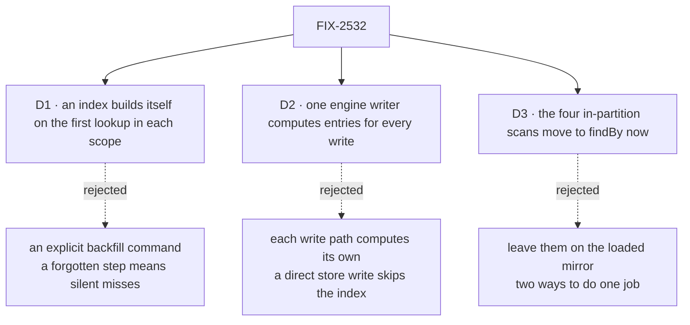

# FIX-2532 · Decisions

[Spec](SPEC.md) · **Decisions**

What was considered, what was chosen, why, and what each choice locks in. Three decisions are
the sign-off surface. Everything else here is context for them.

## The tree

Solid edges are what you're signing. Dashed edges lost, and the label says why.

## D1 · A new or changed index builds itself on the first lookup in each scope

| | |
|---|---|
| **Instead of** | An explicit backfill command an operator runs after deploying a new or changed index |
| **Because** | A command someone forgets leaves `findBy` returning too few rows with no error, which is the one failure a lookup must not have. The first call per scope already has to read the rows to answer, so it writes their entries and records `(scope, collection, index, version)` as built. A version bump counts as unbuilt, so a changed index function rebuilds the same way |
| **Locks in** | Index entries are a superset, re-checked against each row on every read. The first lookup per scope per index version pays one scan of that scope. Every caller of `findBy`, ours or an app's, inherits that one-time cost |

It comes down to the step nobody runs: a command that is forgotten makes `findBy` silently miss rows.

**What would change my mind:** a scope large enough that one scan on a request path is not
acceptable. Then a command is added beside the lazy build, not instead of it.

## D2 · One engine writer computes index entries for every resource write

| | |
|---|---|
| **Instead of** | Each engine write path (block writes, the browser create route) computing entries from the collection it already holds |
| **Because** | A row written without its entries is never found again, and no read-side check can recover a missing entry (a stale one is filtered; an absent one is invisible). Writes reach the store from more than the block path: the resource routes, and packages that write `stores.resourceState` directly (`harness-manager/src/upgrade-kept-turns.ts`). One writer over the store the runtime hands out covers them all, the way the owner-writes check already sits where every write meets the store ([tenet 5](../../../docs/philosophy.md)) |
| **Locks in** | The app's index declarations are known at startup, and two flows declaring different indexes on overlapping collections in one scope are refused there. A process that writes a collection must register a flow declaring it; its writes otherwise carry no entries |

It comes down to a write that skips the block path: per-path computation leaves that row unfindable.

**What would change my mind:** processes that routinely write collections they don't declare.
Then entries would have to be computed in the store from a persisted declaration.

## D3 · The four in-partition scans move to `findBy` now

| | |
|---|---|
| **Instead of** | Leaving `held-task.ts`, `steer.ts`, `task-admission.ts` and `wait-on-task.ts` on `list().find/filter` over the ledger already loaded for the request |
| **Because** | The issue's objective is one way to look a row up by a field. Two would teach the next reader to copy the scan onto ledgers where it costs. Honestly: today each site scans a partition already in memory, so the move buys no speed until the ledger stops loading whole partitions |
| **Locks in** | The task ledger declares indexes on `id`, `run.requestId`, `run.sessionId` and the lapsed wait. A change to those fields on the task schema needs an index version bump. The turn path takes one awaited store read per lookup where it now reads memory |

It comes down to one way to do the job: leaving the scans keeps a pattern that is copied where it costs.

**What would change my mind:** a turn-latency budget the extra read breaks. Then the three
conversation sites stay on the mirror and only `wait-on-task.ts`, which reads a whole board,
moves.

## Decided, not asked

- **The convergence point for "every row's entries match its index functions"** is the D2
  writer. Writers that must pass through it: `mutateResourceKey` and `deleteResourceKey`
  (`engine/context/createExecutionContext.ts`), the browser create and delete routes
  (`engine/routes/resource-routes.ts`), `deleteAll` (`session-routes.ts`), and every direct
  `stores.resourceState.set` in packages. Tombstone, `deleteAll` and `purgeTombstones` clear
  entries inside the store, with no declaration needed.
- **SQL: one generic table**, `resource_index(scope_type, scope_id, collection, index_name, value,
  resource_key)` with all six as the primary key, plus a built-marker table. A write replaces
  that row's entries in the same transaction. No per-field DDL, no `ALTER TABLE`.
- **`collection` is the pattern's storage prefix**; the version is part of the stored index name,
  so entries of an old version are never read.
- **`findBy` reads the same cell and passes the same owner fence as `list`.** A partitioned
  ledger's partitions share one cell, so a lookup crosses partitions; `TaskCollectionRef.findBy`
  narrows to its own partition with the existing wrapper.
- **Values:** a string, number or boolean, or an array of them, normalised to a canonical string.
  `null` and `undefined` index nothing. Equality only.
- **Determinism:** an index function sees `key` and `state` only, documented and tested. One
  that reads the clock drifts; the read-side re-check filters what it returns but can't add what
  it missed.
- **Declaration shape:** a function (version 1) or `{ version, value }`.
- **`taskLedgerResources(ledger)` keeps its name** and returns the ledger alone, so app code
  that spreads it keeps working. `__ids` rows are left in stores, unread (BP-030).
- **Memory and filesystem stores implement no index verbs**: the engine's scan serves them, and
  the conformance suite runs the same cases against all stores.

## Considered and dropped

| Alternative | Why not |
|---|---|
| Keep scanning with `list().filter()` everywhere | The simplest option, and correct. It loads the scope on every lookup, and a ledger kept per partition still needs `__ids` to find an id without loading every partition |
| An index per field: JSONB expression indexes or generated columns | Per-field DDL and migrations for every declaration; SQLite and Postgres diverge |
| An ORM (Drizzle, Kysely) | Doesn't remove the hard part, keeping entries in step with rows |
| Maintain entries from `onInstance*` hooks, as the schedule index does | Hooks run after the write and don't see direct store writes, so an entry and its row commit apart |

## Settled

- **The spec's counts: four scan sites and one hand-built index** — **CONFIRMED** by
  [`poc/fact-check/check.sh`](poc/fact-check/check.sh), which asserts the set of
  `list(...).find|filter` sites over a ledger in `workforce` and `orchestration` is exactly the
  four named. Its control, `FACT_CHECK_PLANT=1`, plants a fifth site and fails, as it must.

## Analysis

2026-11-04 · watermark 2026-11-03 (issue filed) · **Right approach.** Run in the authoring
session: no fresh sub-agent was available in this environment.

1. **Reuse** — `indexes`/`findBy` extend `collection`; the store verbs extend `store`; the writer
   reuses the owner-writes placement; `TaskCollectionRef.findBy` composes the partition wrapper.
   None is a second mechanism except as recorded in the debt. See
   [Builds on / Adds](SPEC.md#whats-already-here-and-the-debt).
2. **Prior art** — a side index table written in the row's transaction is the standard secondary
   index over key/value-on-SQL. Lazy build on first query matches CouchDB views; Firestore and
   DynamoDB require an explicit build, which D1 rejects for the reason on its card.
3. **Other shapes** — hooks-maintained index, per-field DDL, scanning: recorded in *Considered
   and dropped*.
4. **New factors** — none since the watermark; open PRs touch neither the resource store nor
   `id-index.ts`.
5. **Necessity** — earns its place: it removes a hand-built index whose marker and row commit
   apart.
6. **Ergonomics** — one config field and one method; `findBy` returns the refs `list` returns.
7. **Concerns** — D3's gain is consistency, not speed; stated on its card. Recorded, nothing
   folded.

## How it got here

- **Draft** — framed as a field lookup the framework keeps current; a generic SQL index table
  written in the row's transaction, a scan elsewhere, and a lazy build; replaces FIX-2160 D1's
  hand-built `__ids`.

**Open: none.**
