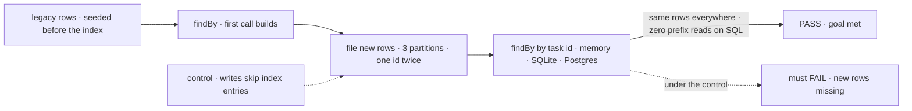
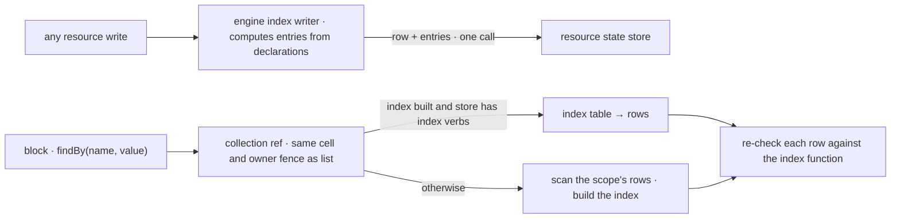

# FIX-2532 · Resource collections: declared field indexes with findBy

**Spec** · [Decisions](DECISIONS.md)

## Five people, before and after

| Someone who… | Today | After |
|---|---|---|
| **builds a flow that looks a row up by a field that isn't in its key** | Lists the collection and filters in code, or hand-builds a second collection of markers and keeps it in step | Declares the field once on the collection and calls `findBy`. The framework keeps the lookup current |
| **runs that flow on SQLite or Postgres with thousands of rows** | Every lookup loads every row in the scope | The lookup reads an index table. A row and its index entries commit together or not at all |
| **adds an index to a collection that already has rows** | n/a | The first lookup in each scope builds the index from the rows it finds, and returns the right rows on that first call |
| **sends a message to a task by id on a ledger kept per conversation** | Found through a hand-built `__ids` marker written apart from the row; a marker can outlive or precede its row | Found through the ledger's own `byTaskId` index, written with the row. Old `__ids` rows stay in the store, unread |
| **runs tests and dev on the memory or filesystem store** | n/a | `findBy` returns the same rows, by scanning. Slower, never different |

The task ledger alone has five lookups on fields outside the key, done two different ways. Each
new lookup on a ledger kept per partition would need another hand-built index like `__ids`.

## The goal, and how we'll know it's met

**A flow finds a collection's rows by a declared field and gets the same rows on every store;
on SQLite and Postgres it reads an index kept in step with the rows, including rows written
before the index existed.**

| Is it the right goal? | |
|---|---|
| **The real need** | "Collections declare which fields they can be looked up by, and the framework maintains and serves the lookup. No package builds its own index." ([FIX-2532](https://linear.app/fixpoint-labs/issue/FIX-2532), Objective) |
| **Smaller, and rejected** | "`findBy` exists and returns the right rows." Hittable by a scan on every store, which is the cost the issue exists to remove, and leaves `__ids` in place |
| **Bigger, and not this issue's** | Range queries, ordering, search inside a collection (FIX-833), lookups across users |
| **Not done if** | The conformance suite is green but the SQL store still scans · rows written before the declaration are missing on the first lookup · `__ids` or one of the four scans is still there · an entry and its row can commit apart |



The check reads which rows come back and which store reads ran, not what the index table holds.

| How we verify | |
|---|---|
| **Goal check** | `goals/collection-indexes/find-rows-by-a-declared-field/` · model `n/a` · real stores (memory, SQLite, PGlite) under a real flow with a ledger kept per partition · run by the implementer at completion · verdict in the implementation PR |
| **Signal** | (a) every `findBy` returns exactly the fixture's rows, the same set on all three stores, a duplicate id in two partitions included; (b) on SQLite and Postgres, the second `findBy` makes **zero** prefix or whole-scope reads of resource state; (c) rows seeded before the declaration are in the first result |
| **Input** | A held-out set of task ids and partitions. Different ids, partition counts or a different indexed field must pass too |
| **Anti-game** | Don't assert on index-table contents or on a mocked store. Both pass while the lookup still scans, or misses a row |
| **Control that must fail** | `GOAL_CONTROL=no-index-writes`: must FAIL signal (a) on the rows filed after the first build. `GOAL_CONTROL=scan-only` (SQL index verbs off): must FAIL signal (b). Today's `main` has no `findBy` and fails all three |

## What changes


The left side is two ways to find a row today. On the right, the index entries live inside the
row's own write, so a lookup can't see one without the other.

**The declaration and the lookup, as a person writes them:**

```diff
  export const work = defineResourceCollection({
    pattern: "work/**",
    scope: "user",
    stateSchema: taskSchema,
+   indexes: {
+     byTaskId: (key, state) => state.id,
+     byTag: { version: 2, value: (key, state) => state.tags },
+   },
  });

- const row = (await ctx.resources.work.list()).find((r) => r.state.id === id);
+ const [row] = await ctx.resources.work.findBy("byTaskId", id);
```

**Docs:** update `apps/docs/docs/resources/collections.md` with a *Looking rows up by a field*
section under *Runtime API* (declaring `indexes`, `findBy`, determinism, versions, first-lookup
build, store behaviour); update the `defineResourceCollection` entry in
`apps/docs/docs/api/core.md`; update `packages/core/README.md`, the `ResourceStateStore`
section of `packages/engine/README.md`, the table lists in the SQLite and Postgres READMEs, and
`packages/orchestration/README.md` (`taskLedgerResources` no longer installs an id index);
update `docs/architecture/resource-collections.md`. No new page.

## How a lookup is served



Every write passes one engine-side writer that knows the app's declared indexes
([D2](DECISIONS.md#d2)). Every hit is re-checked against its row, so a stale entry is never
returned.

## What stays as it is

- `list`, `get`, prefix reads and their costs. `findBy` is equality on one field, not a query
  language.
- The schedule index (`scheduled/src/scheduleIndex.ts`), a time-ordered claim across cells.
- Browser routes and the client: `findBy` is a server-side ref method only.
- Faceted collections' `search`, which filters several facets at once.

## What's already here, and the debt

| Already here | What this does with it |
|---|---|
| Whatever finds a row by a field outside its key: `collection` (`list(prefix)` then filter: `held-task.ts`, `steer.ts`, `task-admission.ts`, `wait-on-task.ts`, faceted `search`), and the hand-built marker collection `id-index.ts`. `schedule` is a different job (ordered claim). Searched `find(`, `filter(`, `__ids`, `index`, `lookup`, `by[A-Z]` across `packages/*/src` | **This is the third way** (key, prefix, field). **Replaces** `id-index.ts` and the four scans; ad-hoc predicates keep using `list` |
| `store` · `ResourceStateStore` | **Extends** with optional index verbs; a store without them is served by the engine's scan |
| The owner fence that sees every write meet the store (`engine/resources/owner-private.ts`) and its startup fence over flows | **Builds on** the same placement: one writer for entries, one startup check for conflicting declarations |
| Schema init by `CREATE TABLE IF NOT EXISTS` (`store-sqlite`, `store-postgres` `schema.ts`) | **Builds on** for the index table and the built-marker table |
| [FIX-2160 D1](../FIX-2160/DECISIONS.md#d1): the ledger finds a row by id across conversations, through an id index the ledger's add writes | **Amended:** the lookup and `findTaskPartitions` stay; the index becomes the ledger's declared `byTaskId`, written with the row, not before it. `taskLedgerResources(ledger)` keeps its name and returns the ledger alone |

| Adds | Existing piece considered | Why it doesn't fit, or how this is composed from it |
|---|---|---|
| `indexes` on `defineResourceCollection`, `findBy` on `ResourceCollectionRef` | `collection` · `list(prefix)` | `list` answers by key. A field lookup on it loads the scope; composed: the scan fallback *is* `list`'s read plus the index function |
| Optional index verbs on `ResourceStateStore` + one index table per SQL store | `store` · `set` / `delete` | Entries must commit in `set`'s own transaction, so they ride that call. Delete and tombstone clear entries with no declaration |
| One engine index writer over `stores.resourceState` | The owner-writes check where every write meets the store | Same placement, second job. Not inside each write path: direct store writers would skip it ([D2](DECISIONS.md#d2)) |
| `findBy` on `TaskCollectionRef` (its partition only) | `TaskCollectionRef.list(filter)` | `list` reads the loaded mirror; `findBy` is the resource ref's, narrowed by the existing partition wrapper |

| The debt | |
|---|---|
| **Removes** | `orchestration/src/tasks/collection/id-index.ts`, the `__ids` collection and its install rule, the index check in `resolveTaskIdIndex`, four `list().find/filter` scans |
| **Adds** | Dead `__ids` rows in deployed stores, never read (BP-030). Entries of a superseded index version, left until their row is rewritten and never read. Both permanent by design: removing them needs a migration nobody needs |
| **Leaves** | Faceted `search` still filters a listed collection; it could adopt indexes when a facet store grows. `piecesHold` (`task-admission.ts`) still scans for legacy rows that predate `filedByTask`; it ages out with them. No issue filed for either: no measured cost |

**Net: flat.** One hand-built index and four scans go; one framework index takes their job.

## Sign off

**[The goal](#the-goal-and-how-well-know-its-met), at that size:** same rows on every store, the
index read on SQL, legacy rows found on the first call. If wrong: we ship a `findBy` that still
scans, or hold the issue for range queries it was never meant to deliver.

**[The debt](#whats-already-here-and-the-debt), net flat:** `__ids` and four scans go; an index
table, optional store verbs and one engine writer arrive. If wrong: a second index mechanism
beside the first.

1. **[D1](DECISIONS.md#d1) · A new or changed index builds itself on the first lookup in each
   scope.** If wrong: a large scope pays one full scan on a request path.
2. **[D2](DECISIONS.md#d2) · One engine writer computes entries for every resource write.** If
   wrong: a process that writes a collection without declaring it leaves rows no lookup finds.
3. **[D3](DECISIONS.md#d3) · The four in-partition scans move to `findBy` now.** If wrong: one
   extra store read per turn for no speed gain today.

**Open: none.** D2 is the one to weigh. Reasoning and what lost: [DECISIONS.md](DECISIONS.md).

Feature · `core` · `engine` · `store-sqlite` · `store-postgres` · `orchestration` · `workforce` · large (6 packages, 2 public surfaces added, 1 module removed) · no epic
