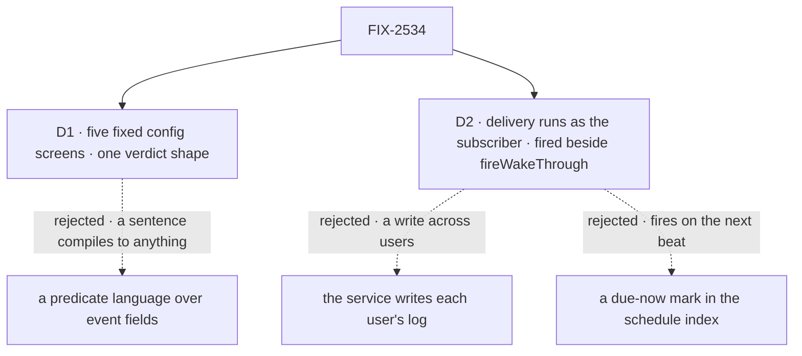

# FIX-2534 · Decisions

[Spec](SPEC.md) · **Decisions**

Two decisions are the sign-off surface; the epic's D1, D5, D9 and Q1, Q3–Q5 are inputs.

## The tree

Solid edges are signed; dashed edges lost, for the reason on the label.

## D1 · Config screens are five fixed kinds; every screen returns one verdict per subscription

| | |
|---|---|
| **Instead of** | A predicate language over event fields · a custom screen per event and subscription |
| **Because** | The kill line counts what config screens decide, so a model must fill them reliably from a sentence (epic D6). `sender` (Q1's role rule) and `own` (drops the subscriber's own actions) always run; `labels`, `words` and `allow` (named sender ids) are listed per subscription; all must pass. Out: `{ verdicts: [{ subscription, pass, reason }] }`; a missing verdict refuses; Jev returns the same shape (epic D7). The custom-screen slot is FIX-2537's (EM call, 2026-11-04) |
| **Locks in** | Five public kind names and one verdict shape, carried by saved subscriptions. Renaming or removing one breaks them |

It comes down to the share: with a language, it measures the model, not the screens.

## D2 · A delivery runs as the subscriber, fired host-side beside `fireWakeThrough` from their own subscription row

| | |
|---|---|
| **Instead of** | The service writing each subscriber's log · a due-now mark in the schedule index |
| **Because** | A request reaches only its own user's sessions: `sendMessage` refuses a sender with no worker (`send-message.ts` ~290) and checks its target as this user (`message-target.ts` ~64); a block starts no request as anyone else (`dispatch.ts` ~31). So a host-side sibling of `fireWakeThrough` (`request-wakes.ts` 58–79) runs the delivery as the row's owner, by the schedule resolver's rule (`createResourceCollectionScheduleResolver.ts` 138–169): the index entry picks a cell and grants nothing; the row must exist, be live and name this org. Never from the event (BP-031) |
| **Locks in** | A second host-side fire that starts a request as a row's owner; no ninth `RequestHost` verb. Security-sensitive: later "act for a user" features will ask for it |

**Why not the schedule index (EM call, 2026-11-04).** Both checks failed:

- **(a) It fires on the next cron beat.** `claimDue`'s only caller is the per-beat tick (`vercel/src/schedules.ts` 6, 120); BullMQ fires by cron pattern only (`bullmq/src/schedule-index.ts` 55, 72–76).
- **(b) The claim is keyed to cron time.** A second event in one period answers `duplicate` (`scheduled/src/routes.ts` 206–229; `scheduledTime.ts` 85–91, 196).

It comes down to a private repo: a service identity is one recipient-check bug from leaking it.

<b>Decided, not asked</b> — engineering calls

## Decided, not asked

- **Where.** Subscriptions and delivery in `workforce`; the event schema in `core`.
- **The event (ER-6).** `provider`, `threads` (widest first), `kind`, `object { id, version }`, `sender { id, name, role }`, `audience`, `title`, bounded `text`, `labels`, `url`, `received`, `at`, `deliveryId`; no headers or raw bytes. A Slack `message` maps to it.
- **Selection.** Provider, one thread key, optional kinds (epic D6); a sentence alone is refused. `unknown` is an outsider (Q1).
- **`sender` is not `allow`.** The role rule, against one subscription's named senders; renamed from `senders` (EM call, 2026-11-04).
- **ER-5's convergence point.** One `subscribe`, one `unsubscribe`: the tools, a task's ending and FIX-2535 call them. Seen versions live on a cursor row (pending epic amendment).
- **The index nominates; the row decides.** A hook mirror: thread key → subscription ids (user, org, cell), provider, kinds; screen settings come from the row (EM call, 2026-11-04).
- **ER-8, no third dedupe store (epic D4).** Three ids; not `runOnce` (EM call, 2026-11-04):

  | Id | Dedupes | Scope |
  |---|---|---|
  | `deliveryId` | Nothing: provenance | One provider delivery |
  | Cursor version | A redelivery or re-poll | One subscription |
  | `<object>@<version>:<session>` | A second send, on `getOrCreate` | One session |
- **ER-4.** `subscribe` checks read access as the user; a `private` delivery checks again.
- **Recipient check.** The live subscription's session, not `checkTargetSession`.
- **Sender and mark.** `service:<provider>` (epic D9), marked outside content (epic D7).
- **Cap.** Per subscription; the session hears how many were held.
- **Unmatched events** are dropped and counted, FIX-2538's seam; no `forward` (EM call, 2026-11-04).
- **FIX-2070's seam.** Of FIX-2242 and FIX-2279, the second rebases.

## Considered and dropped

| Alternative | Why not |
|---|---|
| Org-scoped subscriptions | Private repo names leak org-wide |
| One dedupe key, `<object>@<version>` | The second session on a PR hears nothing |
| Ending subscriptions lazily | A polled one keeps polling |
| Delivery through `checkTargetSession` | It refuses a task's session, the epic's first row |

## Open

Subscription end follows epic ER-7, pending on #4675 (DECISIONS.md#er7).

## Settled

None; D2's facts were read in the code.

## Analysis

2026-11-04 · watermark 2026-11-03 (the epic's set) · **Right approach, one fork raised.** Run by
the authoring worker (no sub-agent tool); say so at the gate.

1. **Reuse:** every Adds row composes; the owner run is the one new door.
2. **Prior art:** GitHub notifications: filter, then deliver per user.
3. **Other shapes:** a cross-user service write ([D2](#d2)); a predicate language ([D1](#d1)).
4. **New factors:** none; the index waits on FIX-2532.
5. **Necessity:** the seam the other four children start from.
6. **Ergonomics:** one tool pair.
7. **Concerns:** ER-7 against the epic's first row. Raised on the epic, #4675.

## How it got here

- **Draft:** the epic's seam.
- **Round 1 (EM call, 2026-11-04):** D2 left the schedule index. Cut `forward:` and the
  custom-screen slot. Folded Cursor's review: index payload, D4, ER-8, `allow`.
- **Trim:** the ER-7 ask moved to the epic amendment, #4675.
