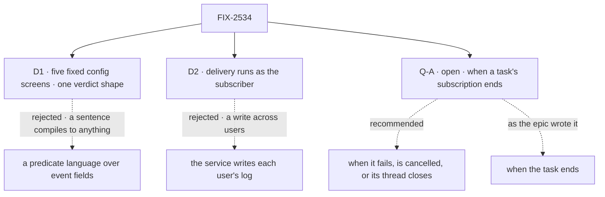

# FIX-2534 · Decisions

[Spec](SPEC.md) · **Decisions**

Two decisions and one open fork are the sign-off surface. The epic's D1, D5, D9 and its decided
Q1, Q3, Q4 and Q5 are inputs here, not questions.

## The tree

Solid edges are what you sign. Dashed edges lost, or are the open fork's two answers.

## D1 · Config screens are five fixed kinds; a custom screen gets one event and its surviving subscriptions, and returns one verdict for each

| | |
|---|---|
| **Instead of** | A small predicate language over event fields (paths, operators, regular expressions) · a custom screen called once per event and subscription |
| **Because** | The kill line counts what config screens decide, so they must be what a subscribing model fills reliably from a sentence (epic D6). Five kinds: `sender` (Q1's rule: members, collaborators and listed bots; outsiders by opt-in) and `own` (drops what the subscriber's own credentials caused) always run first; `labels`, `words` and `senders` are listed by the subscriber, and all must pass. A custom screen takes `{ event, subscriptions }` and returns `{ verdicts: [{ subscription, pass, reason }] }`; a missing verdict refuses. Jev returns the same shape (epic D7), so FIX-2537 builds to one contract |
| **Locks in** | The five kind names and the verdict shape are public: saved subscriptions carry them. A kind can be added later; removing or renaming one breaks every saved subscription that uses it |

It comes down to the share: with a language, it measures the model's cleverness, not the screens.

**What would change my mind:** the fixture's share is under half with the five kinds and over
half with a predicate language over the same subscriptions.

## D2 · A delivery runs as the subscriber, started by the engine from their own subscription row

| | |
|---|---|
| **Instead of** | The service, running as the webhook's one host principal, writing into each subscriber's message log and session |
| **Because** | A request today reaches only its own user's sessions and log: `sendMessage` refuses a sender with no worker (`send-message.ts` ~290), and checks its target as the engine reads it for this user (`message-target.ts` ~64). A block can't start a request as anyone else (`dispatch.ts` ~31). The owner run takes its principal from the row's storage cell, the rule a saved schedule already fires on, never from the event (BP-031), so ER-4 holds by construction. Push and poll then reach one delivery entry, as epic D4 says ingestion should |
| **Locks in** | One new engine door: start an internal entry as the owner of a server-written user row. It is security-sensitive, and each later "act for a user" feature will ask to use it. Each delivered session costs one request |

It comes down to a private repo: a service identity is one recipient-check bug from leaking it.

**What would change my mind:** a store-level write that is refused outside one named row of
the target user. Then the service could write as itself at lower cost.

## Decided, not asked

- **Where it lives.** Subscriptions, the chain and delivery in `@flow-state-dev/workforce`, beside
  the message log; the normalized event's schema in `@flow-state-dev/core`, beside
  `WebhookInboundEvent`, so it stays isomorphic.
- **The normalized event (ER-6).** `provider`, `threads` (every key it belongs to, widest first:
  `github:acme/api`, `github:acme/api#412`; `slack:T1/C9`, `slack:T1/C9/1700.01`), `kind`,
  `object { id, version }`, `sender { id, name, role }` with role `member · collaborator · bot ·
  outsider · unknown`, `audience` (`public · private`), `title`, `text` (bounded), `labels`
  (default `[]`), `url`, `received` (`push · poll`), `at`, `deliveryId`. Headers and raw bytes
  stop at normalization. Checked by hand against a Slack `message` event: channel and
  `thread_ts` make the keys, `edited.ts` the version, `bot_id` and the team the role.
- **Selection.** Provider, one thread key from `threads`, optional kinds, at zero tokens (epic
  D6). A subscribe with only a sentence is refused. An `unknown` role is an outsider (Q1).
- **ER-5's convergence point.** One `subscribe` and one `unsubscribe` function. The two tools, a
  task's ending, and FIX-2535's PR-open subscribe call them; nothing else writes a subscription.
  What has been seen lives on a separate cursor row the delivery writes, so the seam's "last-seen
  version" (epic → Coordination seams) is that row, not a field on the subscription.
- **The thread index nominates; the owner's row decides.** It mirrors each write through the
  collection's hooks, as the schedule index does, and holds the pointer and the screening part,
  never content. A stale entry costs one refused delivery. `subscribe` confirms the entry before
  it answers ok, so a missing one can't silently miss events.
- **ER-8.** Seen once per subscription: the cursor's version per object. Sent once per session:
  the message id `<object>@<version>:<session>` on the log's `getOrCreate`. Not `runOnce` (epic D4).
- **ER-4.** `subscribe` checks read access with the provider flow's check on the user's
  credentials. A `private` event's delivery checks it again; the caching is the implementer's.
- **ER-7 as written.** The task's ending (`onTaskSettled`'s handling, once) calls `unsubscribe`;
  the owner run refuses a subscription whose task has ended, in case the ending's call is late.
- **The subscriber check.** The owner run delivers only to the session the live subscription
  names. That replaces `checkTargetSession` for this path; a message to a session mid-turn
  waits for the turn, as every message does.
- **Sender and mark.** `service:<provider>` in the sender slot (epic D9). Every delivered message
  carries the outside-content mark (epic D7), and the text the model reads names the event's sender.
- **The per-subscription cap** guards against a runaway thread. Over the cap, the session is told
  how many events were held back. It is never silent.
- **Unmatched events (D8's seam).** An event that selects nothing goes to the app's `forward`
  entry when its kind is listed, or is dropped and counted. FIX-2538 decides what the coordinator
  does with it.
- **FIX-2070's seam.** Its open children, FIX-2242 and FIX-2279, may still edit `sendMessage`. The
  second to land rebases onto the other's `exempt` path (epic → Coordination seams).

## Considered and dropped

| Alternative | Why not |
|---|---|
| Subscriptions in org scope with rows keyed by owner | An owner-private row is unreadable to the service; an owner-shared one is served to every user in the org, private repo names included |
| One dedupe key, `<object>@<version>` | The second session on a PR hears nothing; it is this goal's control |
| End subscriptions only lazily, at the next delivery | A polled subscription would keep polling after its task ended |
| A custom screen per event and subscription | N calls per event where one does, and a second shape beside Jev's |
| Delivery through `checkTargetSession` | It refuses a task's session and a running coding task, the case the epic's first row is about |

## Open

### Q-A · When does a coding task's subscription end?

- **In plain terms:** ER-7 says a task's subscription ends with the task. A coding task ends
  when its run's verdict is in, which is just after it opens its PR. Reviews and CI arrive
  later, so under ER-7 they reach no task.
- **The trade-off:** as written, the epic's first row (*"a screened review lands in its
  session"*) mostly doesn't happen. Amended, a finished task's session wakes on each review until
  the PR closes, which costs a turn per review.
- **My recommendation: amend ER-7.** A task's subscription ends when the task fails or is
  cancelled, or when the thread it follows closes; a task that finished keeps hearing its open
  PR. Today a finished task's session already takes messages (`message-target.ts` ~90). Either
  answer is one rule at the one `unsubscribe`.
- **What would change my mind:** FIX-2535 means to keep a coding task open until its PR closes.
  Then ER-7 works as written, but the task runs for days, and a running coding task refuses
  messages today.
- **If wrong:** amended, a session wakes on late reviews nobody acts on, until the cap. As
  written, the review loop the epic sells needs a person to relay it.

It comes down to a review after the run: as written, it reaches no task.

## Settled

None. No POC was built: the load-bearing facts (who `sendMessage` refuses, how a request reads
another user's session, which dispatch a block may start) were read in the code cited above.

## Analysis

2026-11-04 · watermark 2026-11-03 (the epic's set) · **Right approach, one fork raised.** Run by
the authoring worker against the seven objectives, not by a fresh sub-agent: this dispatch has no
sub-agent tool. Say so at the gate.

1. **Reuse:** every Adds row composes an existing piece; the owner run is the one new door.
2. **Prior art:** GitHub's own notifications filter by subscription and reason, then deliver per
   user; the same split as config screens, then delivery.
3. **Other shapes:** a service identity writing across users ([D2](#d2)); a predicate language ([D1](#d1)).
4. **New factors:** FIX-2532 (declared field indexes) declines lookups across users, so the
   thread index stays a mirror.
5. **Necessity:** the seam the four other children start from.
6. **Ergonomics:** a worker learns one tool pair; a delivered message reads like any message.
7. **Concerns:** ER-7 against the epic's first row. Open as [Q-A](#q-a).

## How it got here

- **Draft** — framed as the epic's seam: one normalized event, user-scoped subscriptions found
  through a mirrored thread index, five config screens, and delivery as `sendMessage`'s exempt
  path inside a run as the subscriber.
