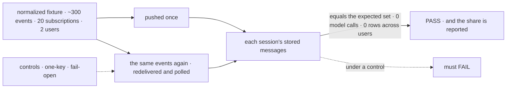
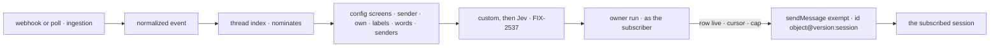

# FIX-2534 · Subscriptions, config screens, delivery

**Spec** · [Decisions](DECISIONS.md)

## Six people, before and after

| Someone who… | Today | After |
|---|---|---|
| **has a coding task that opened a PR** | Hears a review only if the app's binding happens to name its session | Its session gets each review and CI result on that PR once, from `service:github`, marked as outside content. Its own comments don't come back |
| **has two sessions following one PR** | One session per event at most; nothing dedupes | Each session gets each event once. A redelivery, or a poll of the same version, adds nothing |
| **is an outsider commenting on a public repo a task follows** | Whatever the binding does with it | Refused, unless that subscription opted in to outsiders ([Q1](../../epics/FIX-2471/DECISIONS.md#q1)) |
| **subscribes to a thread they can't read** (user B, a private repo of user A's) | n/a | Refused at subscribe. An event on it never reaches B, and B's runs never read A's rows |
| **owns a task that ends** | n/a | Its subscriptions end with it, as the epic wrote ER-7. That rule is this spec's open fork ([Q-A](DECISIONS.md#q-a)) |
| **decides whether the epic goes on** | No number to decide on | This issue's goal check reports the share of deliveries code-only screens decide, before FIX-2537 starts |

The epic ([FIX-2471](../../epics/FIX-2471/SPEC.md)) gives this issue the seam the other four
children build on, and six of its eight rules, ER-3 to ER-8. It also settles Q2, the screen
contract, at this gate.

## The goal, and how we'll know it's met

**A session that subscribed to a thread hears each event on it once, from the service, after
code-only screens, and nothing it didn't ask for, can't read, or caused itself; and we know what
share of deliveries those code-only screens decided.**

| Is it the right goal? | |
|---|---|
| **The real need** | The epic's outcome: *"a coding task, a coordinator or a lab hears about a PR review, a CI result or a message it follows, with nobody relaying it and no model reading every event"*, and its kill line: *"config screens deciding under half the deliveries … we stop. Child 1 reports that share before child 4 starts."* |
| **Smaller, and rejected** | "Subscriptions can be saved and listed, and a delivery helper exists." Hittable with no event reaching any session, and it reports no share, so the kill line could not fire |
| **Bigger, and not this issue's** | GitHub's own payloads and `sessionId` (FIX-2535), polling (FIX-2536), custom and Jev screens (FIX-2537), work modes (FIX-2538), the four legs end to end (FIX-2539) |
| **Not done if** | The check reads `deliver` calls instead of stored messages · the second session on a PR hears nothing · a redelivered event lands twice · user B's run reads a row of user A's · a model is called anywhere on the path · an outsider passes by default · a subscription keeps receiving after its task ended · the share is printed from a fixture whose subscriptions were edited after the first run |



The check reads what each session stored, not what the chain meant to send.

| How we verify | |
|---|---|
| **Goal check** | `goals/webhook-routing/delivers-each-event-once-to-its-subscribers/` · model `n/a` (no model on the path) · run by the implementer at completion · verdict on the implementation PR. A test service flow mounts the fixture: FIX-2535's GitHub flow does not exist yet |
| **Signal** | (a) Each session's message rows and items equal the fixture's expected set, exactly. (b) 0 rows or reads in another user's cell. (c) 0 generator and 0 evaluator calls. (d) 0 deliveries to a subscription after its task ended. (e) Outsiders refused except where opted in. **Reported, not gating:** decided-by-config pairs ÷ selected pairs, with `KILL LINE` printed under 0.5 |
| **Input** | The epic's closure fixture, started here in normalized form: GitHub deliveries recorded from a real repo plus Slack-shaped messages, each with its raw payload beside it so FIX-2535 checks its normalization against the same events. Two sessions on one PR; redeliveries; one private repo. A different valid input: a second week of recordings must pass too |
| **Anti-game** | Assert on stored message rows and session items, not on `deliver` or `sendMessage` calls. The expected set is a table written from the fixture, and the 20 subscriptions are frozen in a commit, named in `goal.md`, before the share is first computed |
| **Control that must fail** | `GOAL_CONTROL=one-key` (the sent-once id drops the session): (a) FAILS on the second session of the shared PR. `GOAL_CONTROL=fail-open` (outsiders pass): (e) FAILS. Today's `main`: (a) FAILS, since nothing subscribes |

## What changes

![What changes. Before: a webhook binding names one session per event, and nothing dedupes. After: the service flow, running as the service in the org, normalizes the event, nominates subscriptions from a thread index, and runs the config screens, then later children's custom and Jev screens. Each passing subscription is handed across a fence to a request that runs as that subscription's user, which checks the subscription, dedupes by its cursor, and sends one message per session through sendMessage's exempt path](figures/what-changes.svg)

Everything left of the fence runs as the service and holds no user content; everything right of
it runs as one subscriber ([D2](DECISIONS.md#d2)).

**A worker subscribes with the tool; an app mounts one flow per provider:**

```diff
 // a worker's turn (a coding task, or a conversation)
+subscribe({
+  provider: "github",
+  thread: "github:acme/api#412",             // one of the event's thread keys
+  kinds: ["review", "check"],                // optional; selects at zero tokens
+  screens: [{ screen: "words", any: ["crash", "panic"] }],
+  interest: "reviews and CI on my PR",        // kept; a sentence alone is refused
+})

 // the app (FIX-2535 builds GitHub's; this issue builds the seam it plugs into)
-webhooks: { github: { on: { pull_request_review: defineWebhookBinding({ block, input,
-  sessionId: (e) => `pr-${e.payload.pull_request.number}` }) } } }
+serviceFlow({ provider: "github", normalize, canRead, trustedBots: ["codex"],
+  screens: { crashReports },                 // custom screens, by name (FIX-2537)
+  forward: ["issues.opened"] })              // unmatched kinds the coordinator gets (FIX-2538)

 // a custom screen: one event and its surviving subscriptions in, one verdict each out
+const crashReports = handler({ name: "crash-reports",
+  inputSchema: screenInputSchema, outputSchema: screenVerdictsSchema,
+  execute: ({ event, subscriptions }) => ({ verdicts: subscriptions.map((s) =>
+    ({ subscription: s.id, pass: event.labels.includes("crash"), reason: "label crash" })) }) })
```

`serviceFlow`, `normalize` and `canRead` are illustrations; [D1](DECISIONS.md#d1) locks the
screen kinds and the verdict shape, and the epic locks `subscribe` and `unsubscribe`.

**Docs:** update the workforce README with a *Subscriptions* section (the two tools, the screen
contract, a delivered message's sender and mark); extend `apps/docs/docs/workforce/messaging-workers.md`
with *Messages from a service*, placed after its sending sections; add the normalized event to the
core README; update `docs/architecture/dispatched-work.md` with the owner run. The GitHub guide and
`webhook-transport.md` are FIX-2535's, per the epic's docs line.

## How an event reaches a session



Push and poll end at the same owner run, so delivery has one path ([D4](../../epics/FIX-2471/DECISIONS.md#d4)).

## What stays as it is

- `sendMessage` for worker-to-worker sends: its target checks, budget and refusals.
- The webhook transport's signature check, `deliveryId` and `when`; `sessionId` until FIX-2535.
- The coordinator's `routing`, the Inbox, and the realtime bus.

## What's already here, and the debt

| Already here | What this does with it |
|---|---|
| **The job, "bring an outside event to a session".** Searched `docs/mechanisms/mechanisms.yaml` for jobs that deliver, route or notify, and `sessionId`, `subscribe`, `matchTopic`, `deliver` across `packages/`. Found `webhook` (a binding's `sessionId`, the closest), `event-actors` (an entry becomes a task, not a message), `push-delivery` (notices to browsers, not sessions) | **Second way, for GitHub until FIX-2535 retires `sessionId`; the only way for a session to choose** |
| `WebhookInboundEvent` (`core/src/types/webhooks.ts`) | **Extends:** the normalized event is the service flow's input over it; headers and raw bytes stop at normalization |
| `worker-messages` · `sendMessage`'s `exempt` path (`send-message.ts` ~249) and the log's `getOrCreate` (~394) | **Extends** with the service label in the sender slot (~290), the subscriber check, a per-subscription cap; **builds on** the log for sent-once |
| `checkTargetSession` (`message-target.ts`), which refuses a task's session (~70) and a running coding task (~90) | **Leaves alone.** A service delivery's recipient check is its own subscription row, since a coding task's session is exactly where a review belongs |
| `schedule` · `defineScheduleCollection`'s index mirror; the dynamic-schedule resolver's rule that a row's cell names its owner | **Builds on** both: the thread index mirrors the same way, and the owner run takes its principal by the same rule |
| `onTaskSettled`, the one ending path (FIX-2078) | **Builds on:** a task's ending calls `unsubscribe` |
| Epic [D4](../../epics/FIX-2471/DECISIONS.md#d4), [D5](../../epics/FIX-2471/DECISIONS.md#d5), [D7](../../epics/FIX-2471/DECISIONS.md#d7), [D9](../../epics/FIX-2471/DECISIONS.md#d9), ER-3 to ER-8 | **Kept.** Q2 settled here ([D1](DECISIONS.md#d1)). D9 **amended**: its subscriber check runs as the subscriber ([D2](DECISIONS.md#d2)). ER-7 kept as written and put to the owner ([Q-A](DECISIONS.md#q-a)) |

| Adds | Existing piece considered | Why it doesn't fit, or how this is composed from it |
|---|---|---|
| The normalized event | `webhook` · `WebhookInboundEvent` | Extends it: provider-neutral fields; checked against a Slack message payload |
| Subscriptions and the two tools | `worker-messages` · the message log; standing rules' tools | Reuses a user-scoped collection and the rule tools' shape |
| The thread index | `schedule` · `defineScheduleCollection`'s mirror | Composed: the same hook mirror, into a server-only org-scoped collection. FIX-2532 declines lookups across users |
| The cursor rows | `worker-messages` · message chain rows | Composed: a server-only user-scoped collection, so a subscription stays written by its two tools |
| The screen chain and config screens | `block` · the router kind; `.stepIf` | Reuses a sequencer (epic D7) |
| The owner run | `dispatch` · `internal`; the dynamic-schedule resolver | New door, composed from the resolver's trust rule ([D2](DECISIONS.md#d2)) |

| The debt | |
|---|---|
| **Removes** | Nothing here. FIX-2535 removes GitHub's `sessionId` and its guide's routing code |
| **Adds** | The owner run: permanent by design ([D2](DECISIONS.md#d2)). A second hand-kept index beside the schedule index: accepted until the framework looks up rows across users, which no issue owns yet. A third exempt sender beside the midway question and the owed answer |
| **Leaves** | `sessionId` for Stripe, Slack and custom bindings ([Q5](../../epics/FIX-2471/DECISIONS.md#q5)). `checkTargetSession`'s two refusals, for worker sends |

**Net: up.** The routing layer the epic signed, plus one engine door.

## Sign off

**[The goal](#the-goal-and-how-well-know-its-met):** each event once per subscribed session,
after code-only screens, with the share reported. If wrong: a seam that works and a kill line
nobody can read.

**[The debt](#whats-already-here-and-the-debt): up,** the routing layer and one engine door, and
nothing removed until FIX-2535. If wrong: a door other features reach through to act as a user.

1. **[D2](DECISIONS.md#d2) · A delivery runs as the subscriber, started from their own
   subscription.** The one to weigh. If wrong: a new way to start a request as a user, which
   every later feature will want.
2. **[D1](DECISIONS.md#d1) · Config screens are five fixed kinds; a custom screen gets one event
   and its subscriptions, and answers once for each.** If wrong: the share measures a list too
   small, and the kill line fires early.

**Open: [Q-A](DECISIONS.md#q-a)** · when a coding task's subscription ends. Recommended: amend
ER-7, so a finished task keeps hearing its open PR.

Feature · workforce, core, engine · large: three packages, six adds, one engine door · epic FIX-2471
