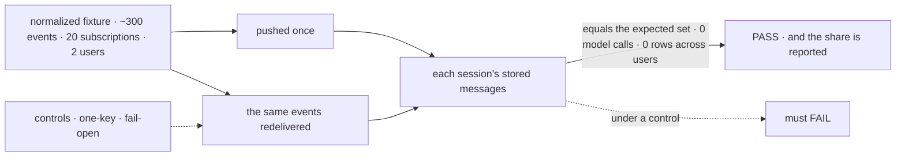

# FIX-2534 · Subscriptions, config screens, delivery

**Spec** · [Decisions](DECISIONS.md)

## Six people, before and after

| Someone who… | Today | After |
|---|---|---|
| **has a coding task that opened a PR** | Hears a review if a binding names its session | Each review and CI result once, from `service:github`, marked outside content |
| **has two sessions following one PR** | One session per event at most | Each session gets each event once. A redelivery adds nothing |
| **is an outsider commenting on a public repo** | Whatever the binding does | Refused, unless that subscription opted in ([Q1](../../epics/FIX-2471/DECISIONS.md#q1)) |
| **subscribes to a thread they can't read** | n/a | Refused at subscribe; nothing of A's private repo reaches B |
| **owns a task that ends** | n/a | Its subscriptions end per epic ER-7 once signed (#4675) |
| **decides whether the epic goes on** | No number | The share code-only screens decide, before FIX-2537 |

The epic ([FIX-2471](../../epics/FIX-2471/SPEC.md)) gives this issue its seam, ER-3 to ER-8, and Q2.

## The goal, and how we'll know it's met

**A session that subscribed to a thread hears each event on it once, from the service, after
code-only screens, and nothing it didn't ask for, can't read, or caused itself; and we know what
share of deliveries those screens decided.**

| Is it the right goal? | |
|---|---|
| **The real need** | The epic's *"nobody relaying it"*, and its kill line: *"config screens deciding under half … we stop"* |
| **Smaller, and rejected** | "Subscriptions save, and a delivery helper exists": no event need arrive, no share |
| **Bigger, and not this issue's** | GitHub (FIX-2535), polling (FIX-2536), custom and Jev screens (FIX-2537), work modes (FIX-2538), end to end (FIX-2539) |
| **Not done if** | The second session hears nothing · a redelivery lands twice · B's run reads A's row · a model is called · an outsider passes by default · the subscriptions changed after the first share |



| How we verify | |
|---|---|
| **Goal check** | `goals/webhook-routing/delivers-each-event-once-to-its-subscribers/` · no model · verdict on the implementation PR, from a test service flow |
| **Signal** | (a) Each session's rows equal the expected set. (b) 0 reads across users. (c) 0 model calls. (d) 0 deliveries after a subscription ended, per ER-7 once signed. (e) Outsiders refused unless opted in. **Reported:** config-decided ÷ selected, `KILL LINE` under 0.5 |
| **Input** | The closure fixture, normalized: recorded GitHub deliveries, two sessions on one PR, redeliveries, a private repo. Poll and Slack shapes are unit tests |
| **Anti-game** | Assert on stored rows, not `sendMessage` calls. The 20 subscriptions are frozen in a commit named in `goal.md` before the first share |
| **Control that must fail** | `GOAL_CONTROL=one-key` (id without the session): (a) FAILS. `fail-open`: (e) FAILS. Today's `main`: (a) FAILS |

## What changes


Left of the fence runs as the service, with no user content; right, as one subscriber ([D2](DECISIONS.md#d2)).

```diff
 // a worker's turn
+subscribe({
+  provider: "github",
+  thread: "github:acme/api#412",             // one of the event's thread keys
+  kinds: ["review", "check"],                // optional; selects at zero tokens
+  screens: [{ screen: "words", any: ["crash", "panic"] }],
+  interest: "reviews and CI on my PR",        // kept; a sentence alone is refused
+})

 // the app (FIX-2535 builds GitHub's)
-webhooks: { github: { on: { pull_request_review: defineWebhookBinding({ block, input,
-  sessionId: (e) => `pr-${e.payload.pull_request.number}` }) } } }
+serviceFlow({ provider: "github", normalize, canRead, trustedBots: ["codex"] })
```

`serviceFlow`, `normalize` and `canRead` are illustrations; [D1](DECISIONS.md#d1) locks the
screens and verdict schema. Named, not built (EM call, 2026-11-04): custom screens (FIX-2537)
and the unmatched-event count (FIX-2538).

**Docs:** the workforce and core READMEs, `messaging-workers.md`, `dispatched-work.md`.

## How an event reaches a session

```mermaid
flowchart LR
  W["webhook or poll · ingestion"] --> N["normalized event"]
  N --> I["thread index · nominates"]
  I --> C["config screens · sender · own · labels · words · allow"]
  C --> L["custom, then Jev · FIX-2537"]
  L --> R["owner run · as the subscriber"]
  R -->|"row live · cursor · cap"| M["sendMessage exempt · id object@version:session"]
  M --> S["the subscribed session"]
```



Push and poll end at one owner run ([D4](../../epics/FIX-2471/DECISIONS.md#d4)). **Stays:** `sendMessage` for worker sends, the webhook signature check, `sessionId` until
FIX-2535, the coordinator's `routing`, and the `RequestHost` verbs.

## What's already here, and the debt

| Already here | What this does with it |
|---|---|
| **The job, "bring an outside event to a session".** Searched `mechanisms.yaml`, `packages/`: `sessionId` closest | **Second way until FIX-2535 retires `sessionId`; the only one a session chooses** |
| `sendMessage`'s `exempt` path, the log's `getOrCreate` | **Extends** with the service sender and a cap |
| `checkTargetSession` | **Leaves alone:** a delivery's recipient check is its own subscription row |
| `fireWakeThrough`; the schedule resolver's rule, the id picks a cell and grants nothing | **Builds on** both ([D2](DECISIONS.md#d2)) |
| `onTaskSettled`, the one ending path | **Builds on:** a task's ending calls `unsubscribe` |

| Adds | Composed from |
|---|---|
| The normalized event | `WebhookInboundEvent`, provider-neutral |
| Subscriptions, the two tools, the cursor rows | User-scoped collections; the rule tools' shape |
| The thread index | `defineScheduleCollection`'s hook mirror, org-scoped, until FIX-2532 |
| The screen chain | A sequencer of `.stepIf` steps plus one evaluator (epic D7) |
| The owner run | A host-side sibling of `fireWakeThrough`; no `RequestHost` verb |

Epic D4's no-new-store holds (EM call, 2026-11-04): the log id and cursor dedupe; the index nominates.

| The debt | |
|---|---|
| **Removes** | Nothing here. FIX-2535 removes GitHub's `sessionId` |
| **Adds** | A second host-side fire starting a request as a row's owner, beside `fireWakeThrough`: permanent. A second hand-kept index, until FIX-2532. A third exempt sender |
| **Leaves** | `sessionId` for Stripe, Slack and custom bindings ([Q5](../../epics/FIX-2471/DECISIONS.md#q5)) |

**Net: up.** The routing layer the epic signed, and one host-side fire.

## Sign off

**[The goal](#the-goal-and-how-well-know-its-met):** each event once per subscribed session, with
the share reported. If wrong: a kill line nobody can read.

**[The debt](#whats-already-here-and-the-debt): up.** If wrong: a fire other features use to act as a user.

1. **[D2](DECISIONS.md#d2) · A delivery runs as the subscriber, fired host-side beside
   `fireWakeThrough`.** The one to weigh. If wrong: a second way to start a request as a user.
2. **[D1](DECISIONS.md#d1) · Five fixed config screens; one verdict per subscription.** If wrong: the share measures a list too small, and the kill line fires early.

**Open: none.** When a subscription ends is epic ER-7's, pending on #4675.

Feature · workforce, core, engine · large: three packages, six adds, one host-side fire · epic FIX-2471
